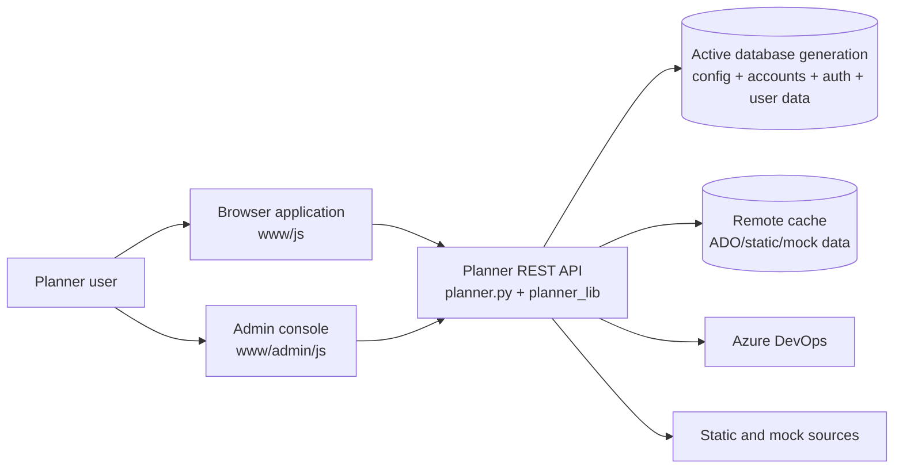
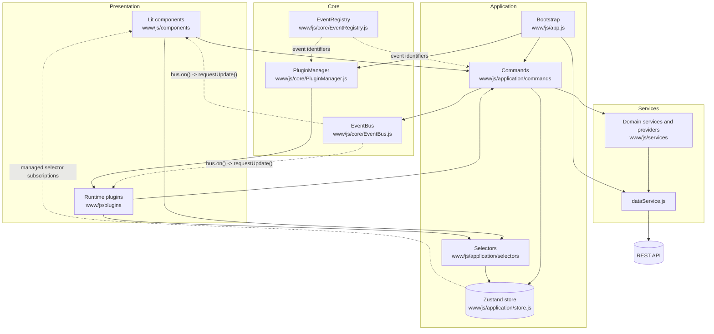
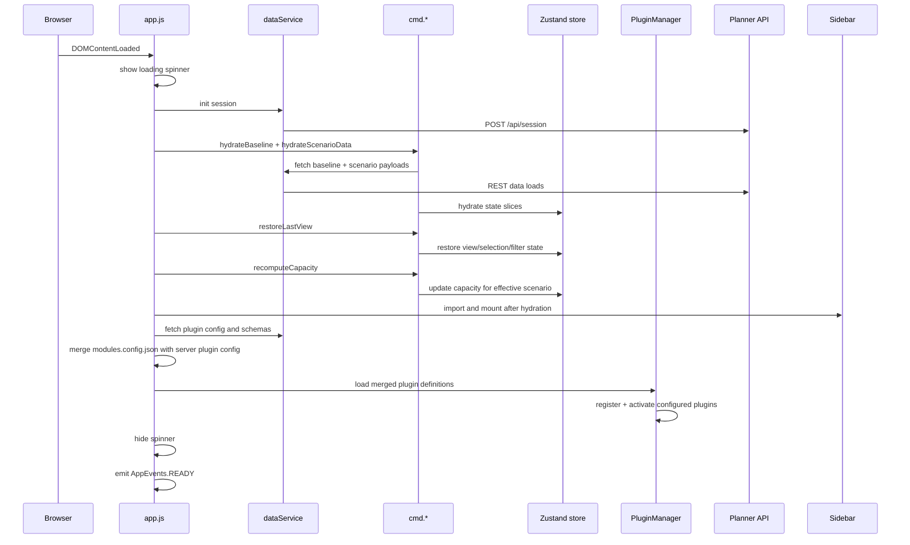
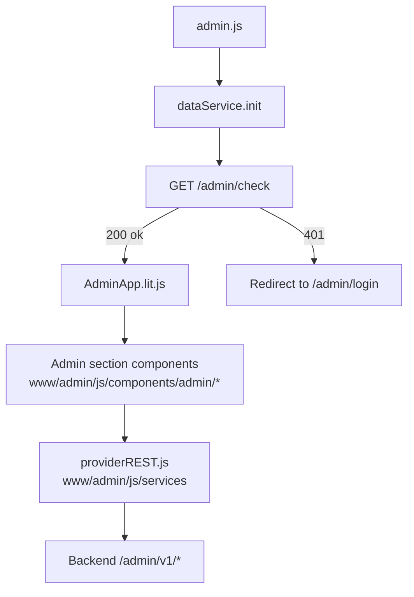
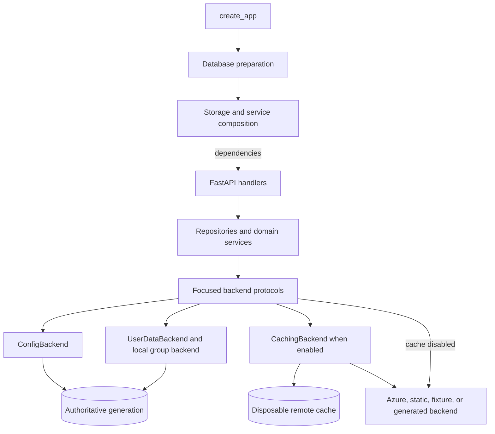

# PlannerTool Architecture

> Current architecture of the browser applications and backend runtime.

> Reviewed against the workspace implementation on 2026-10-14. Detailed contracts live in [Migrations](MIGRATIONS.md), [Authentication](AUTHENTICATION.md), and [Testing](TESTING.md).

## 1. Purpose

PlannerTool combines Lit browser applications with a FastAPI service. The main application uses a canonical runtime state store, explicit command and selector interfaces, and a configuration-driven plugin runtime. The backend owns configuration, authentication, and durable user data, and integrates external planning data through backend-neutral repository interfaces.

This document covers:

- the browser application under `www/js/`
- the admin application under `www/admin/js/`
- the backend service built from `planner_lib/` and `planner.py`
- the runtime boundaries between state, events, services, plugins, and persistence

Detailed backend contracts are described in [Backend Data](ARCHITECTURE_BACKEND_DATA.md).
Deployment procedures are covered in [Deployment](DEPLOYMENT.md). This document
describes runtime structure and contracts, not release history or user workflows.

## 2. Scope

In scope:

- Main frontend runtime and state model
- Admin configuration UI and backend schema flow
- REST API and service composition in the Python server
- Data storage, caching, and provider selection
- Plugin lifecycle and full-screen/toolbox mounts

Out of scope:

- exact low-level Azure SDK behavior
- infrastructure and cluster deployment
- browser-specific performance tuning

## 3. System Context

## 4. Technology Profile

| Concern | Current implementation |
|---|---|
| UI framework | Lit 3 custom elements |
| Module system | Native ES modules |
| Runtime state | Zustand vanilla store with `subscribeWithSelector` and Redux DevTools middleware |
| Write path | command modules in `www/js/application/commands` |
| Read path | selector modules in `www/js/application/selectors` |
| Events | symbol-based `EventBus` and `EventRegistry` |
| Plugin runtime | `PluginManager` + `modules.config.json` |
| Server | FastAPI + Uvicorn |
| Persistence | Server-owned authoritative DiskCache generations and separate disposable remote cache |
| Build | Vite + Rollup |
| Test stack | Vitest, Playwright, pytest |

### 4.1 Data ownership

| Data | Runtime owner | Persistence |
|---|---|---|
| Baseline work items and source metadata | Backend repositories; main-client snapshot | Source backend and disposable read cache |
| Scenario overrides and scenario-owned groups | Main-client store | Server records owned by stable account ID |
| Saved views and captured plugin state | Main-client store | Server records owned by stable account ID |
| Selection, filters, capacity results, notifications | Main-client store | Transient; views capture selected preferences |
| Shared baseline groups | Server; browser-session cache | Authoritative database |
| Preferences, colors, synthetic Baseline plugin data | Browser-local providers | Browser storage |
| Configuration, accounts, devices, sessions | Server services | Authoritative database |
| Temporary editor and plugin interaction state | Component or plugin | Transient unless explicitly captured |

Canonical application state does not include every component-local value or
replace server persistence. The admin application is a separate composition,
not another consumer of the main application's store.

### 4.2 Build and runtime assets

[vite.config.js](../vite.config.js) builds the planning page, admin page, and
admin login page from `www/` into `dist/`, with hashed entry/chunk assets and a
manifest. Selected native modules, configuration, and static assets are also
copied for runtime loading. [rollup.config.mjs](../rollup.config.mjs) produces
shared ES-module vendor bundles for Lit and Zustand under `www/js/vendor/`.
Both clients and direct component tests use these shared vendor entry points.

The backend serves `dist/` under `/static`; its root HTML base follows the
installation's reverse-proxy root path. The Vite development server serves `www/`
and proxies API/admin requests to the Python service. Source-module development
and built-asset serving are distinct runtime paths; browser tests against the
backend exercise the built assets, not unsaved source changes.

## 5. Frontend Runtime Architecture

State writes and repaint signals are separate. Commands update the store and
notify interested consumers. Bus listeners request Lit updates or assign reactive
properties from selectors. Managed store subscriptions supply another repaint
path. There is no universal subscription that repaints every component after
every write. Store-backed plugin state has command-owned subscriber callbacks;
plugin-local interaction stores have their own notifications. See section 14.

DetailsPanel and Sidebar use managed `StoreController` subscriptions in their dedicated
controllers, alongside explicit event subscriptions. `StoreController` subscribes
on connection and unsubscribes on disconnection. These subscriptions are local to
their consumers; other components still depend on bus signals.

### 5.1 DetailsPanel section contracts

`DetailsPanel.lit.js` composes five section render modules under `components/details-panel/`:
Header, Scheduling, Capacity, Tags, and Relations. Each renderer takes a presentation
`model` and named `actions` where interaction is required. Renderers do not receive the
panel host, call private panel methods, subscribe to events, or read application state.
DOM-local handling translates interaction into action values such as a team ID and
capacity, iteration path, date, tag draft, or selected state.

Capacity, Relations, and Scheduling export pure model builders. Capacity projects
allocation rows and summary segments without mutating source allocations. Relations
groups and sorts explicit baseline-feature lookups, preserving unloaded targets and
cross-plan parent labels. Scheduling receives an explicit current date for deterministic
iteration grouping. Scheduling also computes child date bounds, and Tags parses and
compares normalized tags without mutating inputs. `DetailsPanelController` supplies
selector data, manages subscriptions and temporary editor state, and guards section
actions and delayed work against feature, scenario, close, and disconnect changes.
The shell adapts named actions to application commands. Iteration-select synchronization
also rejects obsolete requests after awaiting the current render.

`DetailsPanel.styles.lit.js` supplies a shared stylesheet. Sections render within
one `details-panel` shadow root; render modules do not introduce independent
styling or event boundaries. Icon-bearing section tests use the bundled Lit
renderer to match the application's directive implementation.

### 5.2 Sidebar section contracts

`Sidebar.lit.js` composes Team Drill-down, Hierarchy Controls, Task Filters, and Footer
renderers under `components/sidebar/`. Renderers receive explicit `{ model, actions }`
values and do not read selectors, subscribe, or call host methods. The
`app-sidebar` shell owns the shadow root and adapts actions to commands.
`Sidebar.styles.lit.js` supplies the shared stylesheet and cascade.

`SidebarController` projects presentation from stable store dependencies, manages board
fold-state notifications, and owns health requests and queued animation frames.
Disconnect cancels queued frames, removes subscriptions, and invalidates asynchronous
responses; reconnect establishes one fresh set of subscriptions. Mounting or becoming
ready does not initialize, reset, or otherwise mutate restored application state.

Task-type commands atomically update selected names and hidden types. Selectors expose
effective selected names without requiring a mounted Sidebar; Cost and saved-view
capture consume these application contracts instead of Sidebar fields or DOM queries.
Packed-mode transitions atomically snapshot `packedModeUnplannedPreference`, disable
Unplanned, and restore the snapshot when leaving packed mode. Saving and restoring views
preserves that preference. Intrinsic packed-mode restrictions are unioned with plugin
restrictions by a selector, without changing the plugin-owned restrictions map.

### 5.3 Notifications and diagnostics

The `notifications` store slice is a session-local application log. UI commands
collect entries, deduplicate repeated messages, track occurrence counts and
first/last timestamps, and support read/clear actions. The log retains the latest
100 distinct entries; it is neither persisted across reloads nor broadcast to
other users.

REST response observation collects public backend diagnostics from the
`X-Backend-Diagnostics` header and reports HTTP failures without consuming the
response body. Network failures are reported after retries are exhausted;
failed operation Results also contribute errors. Observers run outside network
retry handling so an observer failure cannot replay a completed write. Session,
hydration, initialization, uncaught browser/promise, and export failures use the
same log. Loading indicators and interactive authentication/confirmation dialogs
are separate UI mechanisms.

### 5.4 Board composition and interaction

`TimelineBoard` composes the capacity graph, timeline header, scroll surface,
FeatureBoard, and overlays. Timeline scale owns horizontal date geometry;
board row scaling and scroll position belong to the presentation layer.
`BoardCoordinateService` supplies viewport/coordinate notifications used by
cards and overlays, separate from canonical planning state.

FeatureBoard derives eligible tasks and groups through selectors, then computes
hierarchy folding, group bands, swimlanes, ordering, and visible geometry.
Large task sets use chunked/viewport-aware rendering; render generations prevent
obsolete scheduled work from publishing stale output. Fold and viewport updates
are board-local presentation signals, not edits to source tasks or allocations.

Feature cards, detail editors, and drag/resize interactions translate user actions
into feature/group commands. Scenario-aware commands own the actual changes,
dirty tracking, capacity recomputation, and signals. Overlay plugins consume
rendered board geometry and task IDs rather than owning task state. Export
renderers project application data into an export surface; an export does not
publish task edits.

## 6. State and Planning Domain

### 6.1 Canonical store

The runtime state is defined in [store.js](../www/js/application/store.js) and
[createInitialAppState.js](../www/js/application/createInitialAppState.js). It is
the single source of truth for main-app selection, filters, scenarios, store-backed
plugin state, capacity results, detail selection, and notifications.

Primary slices include:

- `lifecycle`
- `baseline`
- `scenarios`
- `selection`
- `view`
- `groups`
- `pluginState`
- `capacity`
- `featureDisplay`
- `notifications`

Planning scope is derived by `sel.scope` from selection, view context, and effective tasks; it is not a separate persisted store slice. `featureDisplay` holds the currently selected task ID.

### 6.2 Write path

The write path is command-driven:

- components and plugins call functions from `www/js/application/imports.js`
- commands mutate the store using `store.setState(...)`
- commands emit typed events for cross-module coordination
- initial hydration is done from `app.js` using `cmd.data.hydrateBaseline()`, `cmd.data.hydrateScenarioData()`, and `cmd.viewRestore.restoreLastView()`

`application/imports.js` composes the command/selector surface. It also
synchronizes incoming scenario data on `DataEvents.SCENARIOS_CHANGED` and
`SCENARIOS_DATA`. This is an explicit application-level write path outside the
command modules, not a general presentation-layer mutation interface.

### 6.3 Read path

The read path is selector-driven:

- selectors compute derived values from the current store snapshot
- components read from `sel.*`, either during rendering or in event listeners that refresh reactive properties
- most UI reactivity is driven by `EventBus` subscriptions: commands mutate the store and signal interested consumers, which schedule Lit updates
- `sel.scope` caches resolved, context, and visible task projections using input references and selection/view keys; other selectors may recompute on each call

Scope caching also includes indexed parent/child and dependency relationships,
plan membership, and eligible-card counts. Selector results are read-only by
convention and may contain store-owned references. Mutating them bypasses command
side effects and can invalidate reference-based cache assumptions.

### 6.4 Invariants

- UI and plugin callers write through commands, not by mutating selector results. Application composition also contains the scenario-data synchronization path described above.
- Selectors are pure and deterministic for a given snapshot.
- Services do not own canonical UI state.
- UI components represent presentation, not state ownership.

### 6.5 Task ownership, scope, and presentation

Task records distinguish ownership, provenance, and presentation:

- `project` is the backend-provided domain owner and anchors base board membership.
- `sourcePlanIds` identifies importing plans and governs import-scoped reads and
    per-plan calculation attribution.
- `presentationPlanIds` identifies plans whose configuration permits presentation.
    An empty list denotes hidden graph context, not an ordinary filtered card.
- `parentId`, relations, `excludedChildIds`, and `traversalBoundary` describe
    hierarchy and which edges are eligible for traversal and calculations.
- `ancestorOnly`, `childrenComplete`, and `unresolvedParentIds` distinguish
    partial ancestor context from imported work with complete descendant coverage.
- `stateCategory`, presentation metadata, and `sourcePlanName` are backend-neutral
    values; consumers do not derive them from private provider fields.

`sel.scope` separates the effective scenario graph, relationship-expanded planning
context, and displayed tasks. Scope is derived, not a persisted store slice.
Selected domain owners form base membership. Context flags add eligible ancestors,
descendants, dependencies, and other work allocated to participating teams.
Participating teams come from base-plan allocations, not sidebar team selection.

Plan overview returns all eligible scoped cards. Team focus starts from explicit
selected-team allocations, retains connecting ancestors, and follows unallocated
or matching-team descendants. Other-team-only branches stop that descent;
matching-team work deeper in those branches can seed its own ancestor path.
Presentation eligibility, state/type/task filters, and folding still apply.

Scope-option counts measure eligible-card set differences for the proposed
context, before team drill-down. Board breakdowns reconcile selected-plan counts,
shared-task duplicates, scope additions/removals, display-filter exclusions, and
team focus without double counting. Neither hidden context records nor loaded
dataset totals are interchangeable with displayed-card counts.

Ancestor-only records are an explicit Parent Context presentation exception.
Their source owners remain opaque and may have labeled context lanes without
becoming selectable configured plans. Their empty import provenance keeps them
out of plan capacity totals, and they do not create cost charges.

### 6.6 Capacity and allocation precedence

Capacity recomputation derives effective tasks directly across all configured
plans and teams, independently of display filters. Organization totals count
canonical tasks once; per-plan totals attribute work by source-plan membership.
Hiding cards or changing team focus must not change organization totals.

Capacity and cost resolve allocations over the complete effective graph before applying
report or display scope. Pure mirrored allocation-rule modules under
`www/js/application/shared/` and `planner_lib/cost/` compute descendant-team sets
bottom-up over eligible parent edges. A dated descendant allocation suppresses an ancestor's
reservation for that team across its entire span, including skipped levels. Undated, invalid,
and reversed spans have no effective allocations and do not suppress ancestor reservations;
dated descendants still propagate through undated intermediaries.
Excluded, traversal-boundary and `Task` edges do not participate;
Removed work contributes nothing. Cyclic eligible graphs fail explicitly. Shared JSON
fixtures enforce cross-language parity, including per-team monthly working-day loads.

Capacity uses a feature-first calculation path with per-feature ownership lookups.
Commands write the derived capacity slices and emit their repaint signals.

### 6.7 Cost resolution and report projection

Cost's browser payload contains the complete scenario
graph; report filters are applied to the resolved response. Undated, invalid and reversed
spans contribute zero cost/load. Cost responses expose `unknown_teams` allocation records
(`feature_id`, `team`, `capacity`); project site totals remain internal-only while team
site totals retain internal and external work. Ancestor-only context is not charged.
Cost views sum server-resolved per-team metrics bottom-up without reapplying allocation
precedence. Presentation rollups are iterative, reject cycles, and accumulate every sibling.
Cost feature responses also expose `estimateTeams` (original dated per-team estimates) and
`effectiveCapacity` (winning allocations). Estimates are comparison data, never additional
charges. The browser retains complete cost records; board-visible IDs select normal rows,
while other dated allocating tasks become marked context rows within the report period.
Selected empty tasks remain visible; empty hidden intermediary levels are compressed.
Backend normalization supplies known `stateCategory` values. Closed allocation-free
subtrees remain subject to backend lifecycle retention; missing dates or allocations
are not additional pruning criteria. Cost views do not prune lifecycle branches.
State and task filters exclude rows even when they have allocations; task-type-hidden allocating
levels remain context rows when those other filters pass. Financial records and totals stay complete.
Both hierarchical cost views compare each own team estimate against resolved descendant
contributions in the displayed months, excluding retained own charges from the breakdown.
Cost differences are compared as percentages; zero-cost estimates with hours use hours instead.
Flags are displayed to one decimal place, with differences below 0.05% treated as matching
to avoid flagging pricing roundoff. Unpriced allocations remain visible without an invented
zero budget. Cost activation preserves state/task-type selections and initially
disables Unplanned. Plugin-owned restrictions leave state, task-type, schedule,
and allocation filters editable while locking hierarchy and relation filters;
deactivation clears those restrictions. These controls select report presentation,
not the financial input graph.

### 6.8 Scenario, view, and group persistence

Baseline is a synthetic readonly scenario. Editable scenarios hold task overrides, group overrides, scenario-owned groups, and `pluginData`; selectors project these over baseline data. Task edits, scenario persistence, and explicit publishing to the backend are distinct operations.

The Zustand store is the canonical in-memory model, not the sole persistence layer. REST providers persist server scenarios, views, and configuration. Browser-local providers retain preferences and colors. Shared baseline groups are fetched from the server in batches and cached in `groups.byPlanId`; in-flight requests are deduplicated and account changes invalidate older responses. This browser-session cache is not local-storage persistence. The synthetic Baseline's `pluginData` is stored locally because it has no server-side scenario record; plugin view state can be captured and restored with saved views.

Scenario save clears unsaved-change tracking only after a successful persistence
Result. Feature/group edits and scenario activation trigger their relevant
calculation and notification paths. Publishing reports source-write failures
separately from saving the scenario; local dirty state is not evidence of a
successful external write.

Saved views capture plan/team selection, state/type/task filters, context,
display options, and participating plugin view state. Restoration applies these
through application commands and recomputes capacity. A synthetic Default View
is provided by the client; the last selected view ID is a browser-local preference.
Packed-mode preference snapshots belong to the saved-view contract rather than
Sidebar lifetime state.

## 7. Event and Signal Model

`www/js/core/EventBus.js` is the cross-cutting signal bus. Events are symbol-based identifiers defined in `EventRegistry.js`.

Event payloads are defined by individual producers and consumers, not a universal envelope:

- many events are payload-free invalidation signals; others carry IDs, field metadata, plugin IDs, or data such as scenario and saved-view lists
- feature mutations currently use shapes including `{ id, field }`, `{ id, fields }`, and batch `{ ids }`; there is no automatic `actionName` injection into payloads
- consumers refresh selectors or reactive properties; incoming scenario-data events also drive the explicit synchronization in `application/imports.js`

`EventBus.emit` invokes listeners synchronously and logs caught listener errors; it does not await asynchronous listeners or propagate their failures as a command transaction. Symbol identifiers are the standard, while the bus still accepts strings and supports namespace listeners and optional bounded history logging.

Examples include:

- `FeatureEvents.*`
- `ScenarioEvents.*`
- `CapacityEvents.*`
- `PluginEvents.*`
- `GroupEvents.*`
- `AppEvents.READY`

## 8. Startup Sequence

The Top Menu, Timeline Board, and Details components are registered before data
hydration. Sidebar mounting follows the awaited hydration, view-restoration, and
capacity operations. Failure listeners are registered at the beginning of
startup; onboarding and keyboard shortcuts follow the ready signal.

Hydration commands validate provider Results and payload shapes before writing
their respective slices. Failure emits `HYDRATION_FAILED` and returns
`{ ok: false, error }`. Bootstrap awaits hydration but does not inspect those
returned Results, so a reported hydration failure is not itself a throwing
startup gate; later operations may still fail. `AppEvents.READY` is completion
of the bootstrap path, not proof of successful hydration or complete plugin loading.

Thrown initialization failures are logged, added to the notification store, and
rethrown after the loading overlay is removed. This is distinct from command
failures represented as Results.

## 9. Plugin Architecture

Plugins are first-class runtime modules instantiated from constructors in `core/pluginRegistry.js`. `PluginManager` loads the packaged `www/js/modules.config.json` definitions merged with server runtime settings from `/api/plugins/config`; `/api/plugins/schemas` supplies their settings schemas.

A plugin has a lifecycle of:

- `init()`
- `activate()`
- `deactivate()`
- `destroy()`

The configured plugin types are `hidden`, `tool`, and `menu`. Presentation includes:

- tool plugins exposed in the Tools menu and mounted in the app surface
- full-screen plugins mounted at the app level
- persistent overlays that remain active across other plugin switches
- exclusive plugins that deactivate competing activations when needed
- menu plugins positioned before or after Tools; TopMenu creates their dropdown content without activating them or replacing the active tool

Registration calls `init()`, activation honors dependencies, and unregistering deactivates and destroys the plugin. Disabled definitions are skipped. Dependency sorting controls initialization order while `displayOrder` retains the configured menu order. Only the first non-menu plugin marked `activateOnStartup` is auto-activated. Individual load failures are logged and loading continues; the app ready signal does not certify that every configured plugin loaded successfully.

Plugin view state is captured/restored through store-backed plugin-state commands;
scenario-owned plugin data is a separate opaque `pluginData` bag. High-frequency
viewport and interaction state can remain plugin-local. Plugins own their mounts,
subscriptions, and delayed work, and must release them during lifecycle teardown.

Menu-plugin initialization can start a background domain runtime independently of
tool activation. Reconciliation uses this pattern: pure schedule/quality assessments
are projected by a controller subscribed to application changes; review, markers,
and menu attention counts share its assessment snapshot. Marker visibility changes
presentation, not issue detection.

## 10. Admin Application Architecture

The admin application is a separate Lit SPA under `www/admin/js`, bootstrapped by `www/admin/js/admin.js`. It follows the same module/build conventions as the main app but is a distinct UI composition (no shared Zustand store, commands, or selectors with `www/js`).

The admin surface is responsible for:

- project and team configuration
- Azure settings and feature flags
- server configuration and backup/reload behavior
- user and permissions management
- schema-driven admin forms (see `docs/SCHEMA_UI_SYSTEM.md` for the schema/data contract in detail)

Teams, Projects, System, and Azure settings use `BaseConfigComponent`, which loads schema and content in parallel and renders schema-driven forms. Other sections, including People, Cost, Users, Plugins, Iterations, and backup utilities, are dedicated Lit components with specialized workflows; not every admin domain is a thin generic-form subclass. See [Schema UI System](SCHEMA_UI_SYSTEM.md) for the schema/data contract.

Admin bootstrap attempts shared `dataService` initialization before `/admin/check`. A 401 redirects to `/admin/login`; network errors or other unexpected responses can still reach the client mount path. Authorization is enforced by backend handlers, not solely by this browser check. Admin shares data-access infrastructure with the main app but has no shared canonical UI store.

## 11. Backend Architecture Summary

The Python backend is assembled in `planner_lib/main.py` by `create_app(config)`;
`planner.py` exposes the server entry points and Uvicorn factory. FastAPI uses an
application-owned `ServiceContainer`. Factories resolve dependencies on first use
and retain their results as application singletons; request dependencies resolve
through `request.app.state.container`. Service instances and request-local identity
or credentials have different lifetimes.

The important backend boundaries are:

- authoritative storage for server config, accounts, device authentication, sessions, and user data
- a separate `remote_cache_storage` directory for TTL-governed backend reads
- backend registry functions that select an Azure, static, fixture, or generated implementation from feature flags
- `CachingBackend` as a transparent soft-freshness proxy around remote data backends
- repositories that depend on focused protocols rather than concrete backend classes

This creates a clear split between durable server state and volatile remote-data cache state.

| Service boundary | Responsibility |
|---|---|
| Accounts, AuthManager, SessionManager | Account records, enrollment, device/session validity and revocation |
| Task and History repositories | Canonical task reads/writes and revision history |
| Project, Team, People repositories | Domain-facing configuration and roster reads |
| Plan and Iteration repositories | Plan markers, iteration sets, and schedule presets |
| Scenario and View repositories | Account-owned durable planning data |
| Event and Group repositories | Plan-scoped events and shared baseline groups |
| CapacityService and CostService | Team capacity metadata and financial calculations |
| AdminService and ReloadOrchestrator | Privileged configuration, accounts, snapshots, reload side effects |
| CacheCoordinator and metadata service | Registered invalidation and project metadata caching |

Focused protocols in `backend/port.py` isolate repositories from concrete providers.
`BackendPort` composes planning-data capabilities; local configuration, user-data,
and optional diagnostic capabilities have separate contracts. The registry selects
Static, generated mock, fixture mock, or Azure backends in feature-flag priority
order, with Azure as the default.

Groups use the local group backend. Events use local user-data storage or a
configured Azure wiki backend. These persistence choices are separate from the
active work-item backend.

### 11.1 Database preparation and ownership

Before logging, schema-dependent configuration reads, or service construction,
`create_app` calls `Database(config.data_dir).prepare()` for disk-backed installations.
Fresh databases initialize the current schema (revision 34); admitted historical
databases are upgraded and validated in an independent candidate generation.
Unsupported or unverifiable layouts fail before HTTP startup. Isolated memory
storage is initialized when schema metadata is absent, then validated against the
current schema and record contracts. Application construction admits diskcache or
isolated memory storage with the raw serializer, not arbitrary storage/serializer
combinations exposed by lower-level utilities.

`DATA_DIR` is the installation root. `active-generation.json` selects `generations/<id>/cache/`, which contains the complete authoritative DiskCache; `upgrade-state.json` records preparation and recovery phases. Current workers retain a shared lifetime lease; preparation and offline maintenance require exclusive ownership. Validated candidates are durably published and activated before predecessor cleanup, and successful upgrades retain no automatic backup. Shutdown closes database/cache handles and releases ownership. See [Migrations](MIGRATIONS.md) for admission, locks, recovery, and operator backups.

Schema revisions and application versions are separate contracts. Admission uses
validated schema metadata and migration evidence, not directory timestamps or a
version label. Current generations are opened without an upgrade copy. Storage
provides namespaced operations over the complete DiskCache, including external
value files; recovery cannot treat the SQLite file alone as the database.

`remote_cache/` remains separate and disposable. Its handle is constructed lazily
when caching is enabled. Configuration and user-data backends are not wrapped in
`CachingBackend`; `fetch_projects` and `fetch_project_map` bypass its cached-read
path to preserve configuration consistency.

### 11.2 Authentication and data-access boundaries

Stable account IDs own user data and credentials. Email is an enrollment lookup
and display attribute, not the persistent owner identity. Browser authentication
uses HTTP-only `sessionId` and `plannerDevice` cookies. `/api/session` renews from
an enrolled device; enrollment uses the generated account-key workflow. Credentials
are persisted as hashes; account PATs remain encrypted at rest. Email-only sessions
and `X-Session-Id` are unsupported.

Identity and credential resolution are request-local and separate. Identity-only
routes do not decrypt PATs. Credential-bearing operations resolve the current
account PAT once per request; identities and decrypted PATs are not shared across
requests or users. Azure client connections are worker-thread scoped. Middleware
rechecks persisted device/session validity before renewing cookies, and cookie
paths follow the installation root. Backend handlers enforce ordinary and admin
permissions independently of client mounting. See [Authentication](AUTHENTICATION.md).

Main and admin REST providers share `RestProviderBase` and normalized JSON Results (`{ ok: true, data }` or `{ ok: false, error }`). Consumers must check failures before hydration or persistence; session acquisition and authentication flows also have explicit throwing/control-flow paths rather than treating every operation as a JSON Result.

### 11.3 HTTP and domain operation flow

Routers parse requests, enforce identity/permissions, resolve repositories or
services, and shape responses. Main operations live under `/api/*`, privileged
configuration under `/admin/v1/*`, and Azure browsing/cache operations under their
dedicated prefixes. Cache-management routes are conditionally registered when
caching is enabled. Health, events, groups, cost, scenarios, and views have distinct
domain routers rather than a generic persistence endpoint.

A task read resolves the request credential, asks TaskRepository for normalized
domain records, and returns pending public diagnostics separately from the task
payload. A task write accepts canonical IDs and supported changes, delegates
source conversion and mutation to the backend, and returns updated/error results.
Publishing is not an atomic transaction spanning remote task writes and local
scenario/group persistence; callers must retain and report partial failures.

Local scenario/view operations resolve stable account ownership and use durable
storage without the remote cache. Cost resolves allocations from the supplied
effective graph and configured pricing/rosters. HTTP status and operation Results
are separate: an HTTP-successful batch may still contain failed writes.

Session middleware and route-level guards enforce access. GZip is always installed
and Brotli is configurable. Exception handlers shape access-denied, not-found,
and JSON error responses. The server serves the built SPA under `/static`; the
root page receives an installation-aware HTML base path.

### 11.4 Task normalization and external scheduling

TaskRepository calls `fetch_plan_tasks(plan, credential)` for configured seeds,
merges canonical IDs using domain revisions and import provenance, then calls
`fetch_task_context(seeds)` once for the combined forest. Project-specific reads
filter the normalized result by `sourcePlanIds`, not provider paths.

Backends return `BackendTask` records with opaque `backendData`. Cached/backend
records retain it, but TaskRepository strips it from public `DomainTask` records
and rejects consumer attempts to write it. Only a concrete backend interprets
source settings, native IDs/types/revisions, ownership, or SDK identity.

ADO loads bounded Child traversal across source areas/projects and applies native
TaskCategory boundaries. A second bounded Parent pass adds ancestor context
without expanding sibling branches. Ancestor-only records have partial child
coverage and empty import/presentation membership; independently imported work
remains ordinary work. Unresolved references and excluded edges remain explicit.
Source ownership and labels, presentation eligibility, and known lifecycle
categories are supplied by the backend, not inferred by repositories or UI.

Removed-category work is omitted before provenance propagation. Completed trees
are retained whole while any imported member is active, recently completed, or
lacks verifiable completion age. Trees whose imported members all completed more
than six calendar months ago are omitted. Missing allocations or schedules are
not pruning criteria. Historical anchor presentation can place completed work
without inventing task dates; display placement is not a financial allocation span.

Explicit task dates take precedence. Missing boundaries can be inferred from the
exact assigned iteration in the native project; context enrichment shares project
iteration maps and preserves explicit dates. Unmatched or undated iterations
leave boundaries unset. This inference does not publish dates back to ADO.
Schedule presets expose validated date ranges with opaque IDs; UI code does not
parse provider-native paths. Backend-owned clearing of both dates resets the ADO
iteration assignment and removes supported explicit date fields in one SDK patch.

Per-plan configuration/unavailability failures are logged and skipped, allowing
partial seed loads; authentication failures propagate. Remote refresh failures
and missing schedule metadata can produce public diagnostics. Backend-specific
diagnostic details and credentials do not enter the public task contract.

### 11.5 Remote-cache consistency

CachingBackend transparently implements the inner backend's read protocols.
Keys derive from method and arguments, excluding credentials; cached snapshots
are shared rather than per-account. Per-method freshness lives in `taskmeta__*`
sidecars, not hard DiskCache expiry. Plan-task and context reads share task TTL
policy. An uncached read fetches from the source; a fresh snapshot returns directly.

For remote ADO reads with a cached snapshot, soft expiry schedules a deduplicated
background refresh and returns existing data. Failed or empty refreshes can retain
old content and queue warnings. There is no hard stale-age ceiling. Local/static/
mock sources do not use remote stale-on-failure handling. Successful task writes
patch affected cached snapshots without extending their freshness window;
explicit invalidation removes disposable read entries.

### 11.6 Configuration reload

Admin writes persist authoritative configuration. ReloadOrchestrator rereads
settings, updates logging and Azure configuration, rebuilds concrete clients,
and calls registered `Reloadable` or `Invalidatable` services. Backend switches
invalidate affected domain caches. CacheCoordinator supplies shared invalidation
operations across registered services.

Reload is not a distributed or transactional commit: individual registered-service
reload failures can be logged without failing the overall reload Result. Server
process construction choices, such as installed middleware, remain startup-owned.

## 12. Quality Constraints

The architecture is designed around a few non-negotiable rules:

- canonical main-app runtime state lives in one store; durable server data and explicit browser-local data have separate ownership
- writes are explicit and command-driven
- selectors stay side-effect free
- plugin lifecycle is explicit and inspectable
- backend config and user data are durable, cache is not
- the browser UI is a client to the server, not the system of record for configuration

These are architectural constraints, not a claim of universal runtime enforcement.
Relevant limitations are explicit in the startup, event, reload, and cache contracts.

Runtime behavior notes:

- `PluginManager` emits `PluginEvents.REGISTERED`, `ACTIVATED`, `DEACTIVATED`, `UNREGISTERED`.
- `loadFromConfig` resolves dependencies and can reorder activation for dependency safety.
- Plugin UI components typically subscribe to EventBus signals and read state via `sel.*`.

## 13. Testing Architecture

Test layers:

- Unit: command, selector, service, and pure utility coverage
- Component: Lit rendering and interaction coverage
- Integration: command + selector + store behavior
- E2E: Playwright user-path validation
- Backend/API: pytest coverage

Contract-testing rules:

- Tests assert public behavior and observable effects.
- New contract tests prefer public interfaces over private-field coupling; existing characterization tests still include private handlers and simulated DOM paths.
- Tests isolate state per test case.

Python suites mirror `planner_lib` owners under `tests/python/`; database-upgrade
suites live in `tests/migrations/`. JavaScript suites mirror commands, selectors,
shared helpers, components, services, and plugins. Vitest has separate jsdom and
Node projects. Shared JSON fixtures verify browser/server allocation parity.

Playwright desktop workflows use isolated fixtures. Backend-authenticated
workflows use per-run temporary databases, mock source data, and enrolled test
accounts. Frontend-only workflows use in-memory providers without a backend.
Neither uses the active installation as a fixture. HTTP tests exercise real cookie
authentication, not a test-auth bypass. Timing benchmarks are opt-in under
`tests/performance/`. See [Testing](TESTING.md) for commands, fixture contracts,
and remaining characterization/private-handler coverage gaps.

## 14. Known Sharp Edges

- **Writes and repaint signals are separate.** A store update does not universally repaint the main UI. Each consumer needs a bus notification or dedicated subscription. DevTools action labels are the third argument to `store.setState`, not event metadata.
- **Event shapes differ.** Consumers must handle the payload documented by their producer, including payload-free invalidations and singular versus batch feature IDs. The bus does not validate payloads or provide rollback; a caught listener error may leave one consumer stale while others update.
- **Selector results are read-only by convention.** Some expose store-owned objects. Mutating those objects bypasses command side effects and can also invalidate reference-based caching assumptions; use commands for changes.
- **Memoization is selective.** Scope projections are cached, but many selectors recompute and managed subscriptions are local to their consumers. Reference-based caches require immutable inputs.
- **Multiple notification models coexist.** `cmd.pluginState.subscribe` observes store-backed plugin state through command-owned callbacks, not a second canonical store. Plugin-local viewport/interaction stores provide another path for high-frequency updates; avoid routing every scroll frame through the global bus.
- **Success signals have different meanings.** `AppEvents.READY` does not certify hydration or plugin success; HTTP success does not certify every batch write; reload success does not certify every registered service refreshed.
- **Remote cache freshness is soft.** Stale content may outlive the configured freshness window indefinitely during remote failures. Freshness sidecars and diagnostics, not snapshot existence, describe cache health.
- **The active pointer determines authoritative storage.** Generation and control/lock files are database state, not disposable caches. Database preparation owns admission and activation; only remote-cache storage is disposable.

## 15. Quality Attributes

### 15.1 Modifiability

- Layered separation of presentation, application, core, and service responsibilities.
- Command/selector seams localize state-model changes.

### 15.2 Testability

- Deterministic selectors and explicit command APIs.
- Event-driven UI updates (`bus.on(...)` → `requestUpdate()`) make update behavior observable and easy to trigger from tests without mounting the full store.

### 15.3 Performance

- Bus listeners and managed selector subscriptions limit repaints to interested consumers; local viewport paths handle high-frequency geometry updates.
- Scope projections reuse cached results when their inputs are unchanged. High-frequency plugin-local interactions can use local pub-sub rather than global events; `cmd.pluginState.subscribe` is a separate notification API for canonical store-backed plugin state, not proof that an interaction bypasses the store.

### 15.4 Reliability

- Startup orders hydration, view restoration, capacity, and plugin loading; Result failures and individual plugin-load failures are not universal readiness gates.
- Session lifecycle handling is centralized in data-access services.
- Database compatibility and generation ownership are checked before HTTP startup; authentication is enforced on the server independently of browser mounts.

## 16. Governance Rules

- New UI/plugin state writes are added through command modules; the existing application-level scenario synchronization is not a license for direct presentation-layer writes.
- New derived reads are added only through selectors.
- New event types must document payload shape and consumer responsibility; do not assume a universal envelope or automatic repaint.
- Plugin additions must define lifecycle behavior and cleanup.
- Architecture-impacting changes must update this document and corresponding tests.
