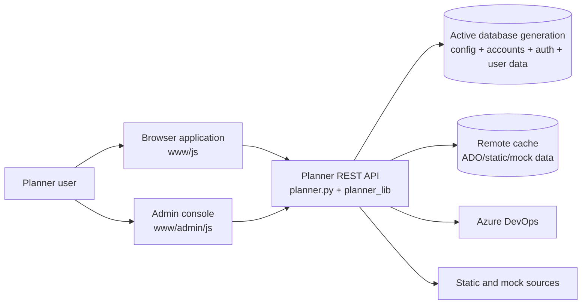
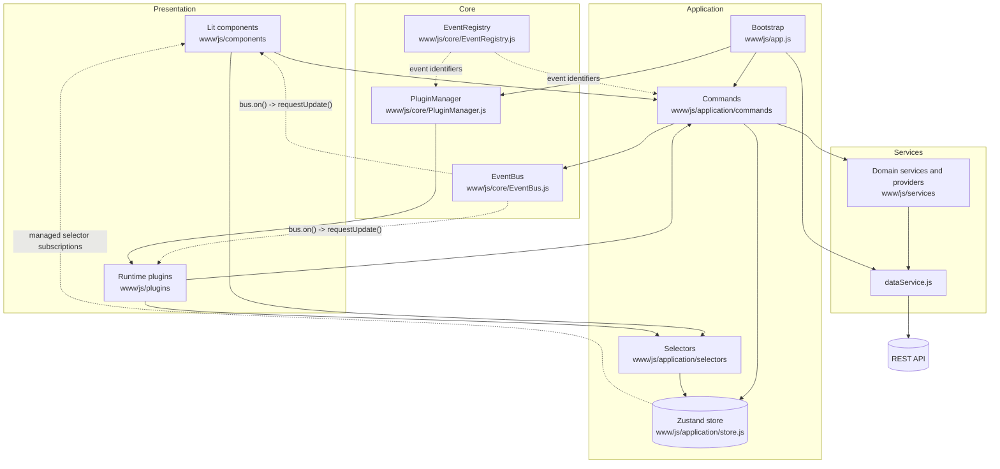
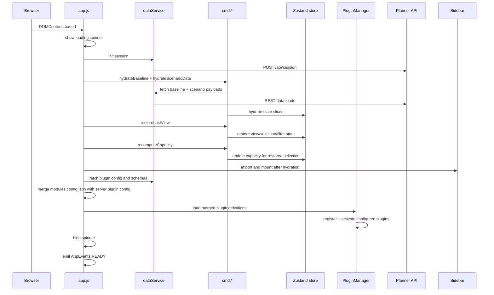
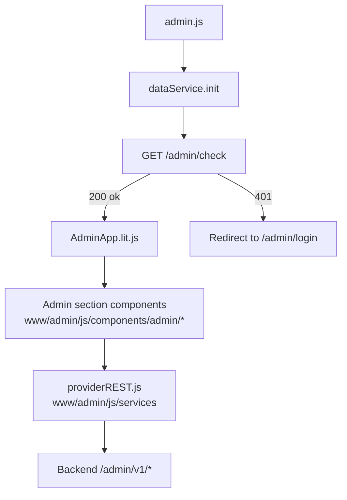

# PlannerTool Architecture

> Current architecture of the browser applications and backend runtime.

> Reviewed against the workspace implementation on 2026-10-14. Detailed contracts live in [Migrations](MIGRATIONS.md), [Authentication](AUTHENTICATION.md), and [Testing](TESTING.md).

## 1. Purpose

PlannerTool combines Lit browser applications with a FastAPI service. The main application uses a canonical runtime state store, explicit command and selector interfaces, and a configuration-driven plugin runtime. The backend owns configuration, authentication, and durable user data, and integrates external planning data through backend-neutral repository interfaces.

This document covers:

- the browser application under `www/js/`
- the admin application under `www/admin/js/`
- the backend service built from `planner_lib/` and `planner.py`
- the runtime boundaries between state, events, services, plugins, and persistence

Detailed backend contracts are described in [Backend Data](ARCHITECTURE_BACKEND_DATA.md).
Deployment procedures are covered in [Deployment](DEPLOYMENT.md). This document
describes runtime structure and contracts, not release history or user workflows.

## 2. Scope

In scope:

- Main frontend runtime and state model
- Admin configuration UI and backend schema flow
- REST API and service composition in the Python server
- Data storage, caching, and provider selection
- Plugin lifecycle and full-screen/toolbox mounts

Out of scope:

- exact low-level Azure SDK behavior
- infrastructure and cluster deployment
- browser-specific performance tuning

## 3. System Context

## 4. Technology Profile

| Concern | Current implementation |
|---|---|
| UI framework | Lit 3 custom elements |
| Module system | Native ES modules |
| Runtime state | Zustand vanilla store with `subscribeWithSelector` and Redux DevTools middleware |
| Write path | command modules in `www/js/application/commands` |
| Read path | selector modules in `www/js/application/selectors` |
| Events | symbol-based `EventBus` and `EventRegistry` |
| Plugin runtime | `PluginManager` + `modules.config.json` |
| Server | FastAPI + Uvicorn |
| Persistence | Server-owned authoritative DiskCache generations and separate disposable remote cache |
| Build | Vite + Rollup |
| Test stack | Vitest, Playwright, pytest |

### 4.1 Data ownership

| Data | Runtime owner | Persistence |
|---|---|---|
| Baseline work items and source metadata | Backend repositories; main-client snapshot | Source backend and disposable read cache |
| Scenario overrides and scenario-owned groups | Main-client store | Server records owned by stable account ID |
| Saved views and captured plugin state | Main-client store | Server records owned by stable account ID |
| Selection, filters, capacity results, notifications | Main-client store | Transient; views capture selected preferences |
| Shared baseline groups | Server; browser-session cache | Authoritative database |
| Preferences, colors, synthetic Baseline plugin data | Browser-local providers | Browser storage |
| Configuration, accounts, devices, sessions | Server services | Authoritative database |
| Temporary editor and plugin interaction state | Component or plugin | Transient unless explicitly captured |

Canonical application state does not include every component-local value or
replace server persistence. The admin application is a separate composition,
not another consumer of the main application's store.

## 5. Frontend Runtime Architecture

State writes and repaint signals are separate. Commands update the store and
notify interested consumers. Bus listeners request Lit updates or assign reactive
properties from selectors. Managed store subscriptions supply another repaint
path. There is no universal subscription that repaints every component after
every write. Store-backed plugin state has command-owned subscriber callbacks;
plugin-local interaction stores have their own notifications. See section 14.

DetailsPanel and Sidebar use managed `StoreController` subscriptions in their dedicated
controllers, alongside explicit event subscriptions. `StoreController` subscribes
on connection and unsubscribes on disconnection. These subscriptions are local to
their consumers; other components still depend on bus signals.

### 5.1 DetailsPanel section contracts

`DetailsPanel.lit.js` composes five section render modules under `components/details-panel/`:
Header, Scheduling, Capacity, Tags, and Relations. Each renderer takes a presentation
`model` and named `actions` where interaction is required. Renderers do not receive the
panel host, call private panel methods, subscribe to events, or read application state.
DOM-local handling translates interaction into action values such as a team ID and
capacity, iteration path, date, tag draft, or selected state.

Capacity, Relations, and Scheduling export pure model builders. Capacity projects
allocation rows and summary segments without mutating source allocations. Relations
groups and sorts explicit baseline-feature lookups, preserving unloaded targets and
cross-plan parent labels. Scheduling receives an explicit current date for deterministic
iteration grouping. Scheduling also computes child date bounds, and Tags parses and
compares normalized tags without mutating inputs. `DetailsPanelController` supplies
selector data, manages subscriptions and temporary editor state, and guards section
actions and delayed work against feature, scenario, close, and disconnect changes.
The shell adapts named actions to application commands. Iteration-select synchronization
also rejects obsolete requests after awaiting the current render.

`DetailsPanel.styles.lit.js` supplies a shared stylesheet. Sections render within
one `details-panel` shadow root; render modules do not introduce independent
styling or event boundaries. Icon-bearing section tests use the bundled Lit
renderer to match the application's directive implementation.

### 5.2 Sidebar section contracts

`Sidebar.lit.js` composes Team Drill-down, Hierarchy Controls, Task Filters, and Footer
renderers under `components/sidebar/`. Renderers receive explicit `{ model, actions }`
values and do not read selectors, subscribe, or call host methods. The
`app-sidebar` shell owns the shadow root and adapts actions to commands.
`Sidebar.styles.lit.js` supplies the shared stylesheet and cascade.

`SidebarController` projects presentation from stable store dependencies, manages board
fold-state notifications, and owns health requests and queued animation frames.
Disconnect cancels queued frames, removes subscriptions, and invalidates asynchronous
responses; reconnect establishes one fresh set of subscriptions. Mounting or becoming
ready does not initialize, reset, or otherwise mutate restored application state.

Task-type commands atomically update selected names and hidden types. Selectors expose
effective selected names without requiring a mounted Sidebar; Cost and saved-view
capture consume these application contracts instead of Sidebar fields or DOM queries.
Packed-mode transitions atomically snapshot `packedModeUnplannedPreference`, disable
Unplanned, and restore the snapshot when leaving packed mode. Saving and restoring views
preserves that preference. Intrinsic packed-mode restrictions are unioned with plugin
restrictions by a selector, without changing the plugin-owned restrictions map.

### 5.3 Notifications and diagnostics

The `notifications` store slice is a session-local application log. UI commands
collect entries, deduplicate repeated messages, track occurrence counts and
first/last timestamps, and support read/clear actions. The log retains the latest
100 distinct entries; it is neither persisted across reloads nor broadcast to
other users.

REST response observation collects public backend diagnostics from the
`X-Backend-Diagnostics` header and reports HTTP failures without consuming the
response body. Network failures are reported after retries are exhausted;
failed operation Results also contribute errors. Observers run outside network
retry handling so an observer failure cannot replay a completed write. Session,
hydration, initialization, uncaught browser/promise, and export failures use the
same log. Loading indicators and interactive authentication/confirmation dialogs
are separate UI mechanisms.

## 6. State Architecture

### 6.1 Canonical store

The runtime state is defined in `www/js/application/store.js`. It is the single source of truth for UI state, selection, filter state, scenarios, plugin state, and capacity data.

Primary slices include:

- `lifecycle`
- `baseline`
- `scenarios`
- `selection`
- `view`
- `groups`
- `pluginState`
- `capacity`
- `featureDisplay`
- `notifications`

Planning scope is derived by `sel.scope` from selection, view context, and effective tasks; it is not a separate persisted store slice. `featureDisplay` holds the currently selected task ID.

### 6.2 Write path

The write path is command-driven:

- components and plugins call functions from `www/js/application/imports.js`
- commands mutate the store using `store.setState(...)`
- commands emit typed events for cross-module coordination
- initial hydration is done from `app.js` using `cmd.data.hydrateBaseline()`, `cmd.data.hydrateScenarioData()`, and `cmd.viewRestore.restoreLastView()`

`application/imports.js` composes the command/selector surface. It also
synchronizes incoming scenario data on `DataEvents.SCENARIOS_CHANGED` and
`SCENARIOS_DATA`. This is an explicit application-level write path outside the
command modules, not a general presentation-layer mutation interface.

### 6.3 Read path

The read path is selector-driven:

- selectors compute derived values from the current store snapshot
- components read from `sel.*`, either during rendering or in event listeners that refresh reactive properties
- most UI reactivity is driven by `EventBus` subscriptions: commands mutate the store and signal interested consumers, which schedule Lit updates
- `sel.scope` caches resolved, context, and visible task projections using input references and selection/view keys; other selectors may recompute on each call

Scope caching also includes indexed parent/child and dependency relationships,
plan membership, and eligible-card counts. Selector results are read-only by
convention and may contain store-owned references. Mutating them bypasses command
side effects and can invalidate reference-based cache assumptions.

### 6.4 Invariants

- UI and plugin callers write through commands, not by mutating selector results. Application composition also contains the scenario-data synchronization path described above.
- Selectors are pure and deterministic for a given snapshot.
- Services do not own canonical UI state.
- UI components represent presentation, not state ownership.

### 6.5 Scope, scenarios, and persistence

`sel.scope` separates effective tasks, planning context, and displayed tasks. Plan selection and Scope relationship flags determine planning context; team focus and display filters determine visibility. Capacity recomputation derives effective tasks directly and calculates across all configured plans and teams, independently of display filters, so hiding cards must not change organization totals.

Capacity and cost resolve allocations over the complete effective graph before applying
report or display scope. Pure mirrored allocation-rule modules under
`www/js/application/shared/` and `planner_lib/cost/` compute descendant-team sets
bottom-up over eligible parent edges. A dated descendant allocation suppresses an ancestor's
reservation for that team across its entire span, including skipped levels. Undated, invalid,
and reversed spans have no effective allocations and do not suppress ancestor reservations;
dated descendants still propagate through undated intermediaries.
Excluded, traversal-boundary and Task-category edges do not participate;
Removed work contributes nothing. Cyclic eligible graphs fail explicitly. Shared JSON
fixtures enforce cross-language parity, including per-team monthly working-day loads.

Capacity uses one feature-first calculation path with per-feature ownership lookups,
without a separate delta cache or per-day precedence mode. Commands still own store
writes and repaint signals. Cost's browser payload contains the complete scenario
graph; report filters are applied to the resolved response. Undated, invalid and reversed
spans contribute zero cost/load. Cost responses expose `unknown_teams` allocation records
(`feature_id`, `team`, `capacity`); project site totals remain internal-only while team
site totals retain internal and external work. Ancestor-only context is not charged.
Cost views sum server-resolved per-team metrics bottom-up without reapplying allocation
precedence. Presentation rollups are iterative, reject cycles, and accumulate every sibling.
Cost feature responses also expose `estimateTeams` (original dated per-team estimates) and
`effectiveCapacity` (winning allocations). Estimates are comparison data, never additional
charges. The browser retains complete cost records; board-visible IDs select normal rows,
while other dated allocating tasks become marked context rows within the report period.
Selected empty tasks remain visible; empty hidden intermediary levels are compressed.
ADO context normalization publishes known backend-neutral `stateCategory` values. Closed
allocation-free subtrees remain in the graph within the existing closed-tree retention policy;
missing dates or allocations are not additional pruning criteria. Cost views do not prune
lifecycle branches. Previously pruned cached plan data needs a refresh to restore omitted nodes.
State and task filters exclude rows even when they have allocations; task-type-hidden allocating
levels remain context rows when those other filters pass. Financial records and totals stay complete.
Both hierarchical cost views compare each own team estimate against resolved descendant
contributions in the displayed months, excluding retained own charges from the breakdown.
Cost differences are compared as percentages; zero-cost estimates with hours use hours instead.
Flags are displayed to one decimal place, with differences below 0.05% treated as matching
to avoid flagging pricing roundoff. Unpriced allocations remain visible without an invented
zero budget. Opening Cost preserves state/task-type selections and initially turns Unplanned off.
State, task-type, schedule and allocation controls remain editable; hierarchy and relation controls
remain locked while Cost is open. Closing clears these restrictions.

Baseline is a synthetic readonly scenario. Editable scenarios hold task overrides, group overrides, scenario-owned groups, and `pluginData`; selectors project these over baseline data. Task edits, scenario persistence, and explicit publishing to the backend are distinct operations.

The Zustand store is the canonical in-memory model, not the sole persistence layer. REST providers persist server scenarios, views, and configuration. Browser-local providers retain preferences and colors. Shared baseline groups are fetched from the server in batches and cached in `groups.byPlanId`; in-flight requests are deduplicated and account changes invalidate older responses. This browser-session cache is not local-storage persistence. The synthetic Baseline's `pluginData` is stored locally because it has no server-side scenario record; plugin view state can be captured and restored with saved views.

## 7. Event and Signal Model

`www/js/core/EventBus.js` is the cross-cutting signal bus. Events are symbol-based identifiers defined in `EventRegistry.js`.

Event payloads are defined by individual producers and consumers, not a universal envelope:

- many events are payload-free invalidation signals; others carry IDs, field metadata, plugin IDs, or data such as scenario and saved-view lists
- feature mutations currently use shapes including `{ id, field }`, `{ id, fields }`, and batch `{ ids }`; there is no automatic `actionName` injection into payloads
- consumers refresh selectors or reactive properties; incoming scenario-data events also drive the explicit synchronization in `application/imports.js`

`EventBus.emit` invokes listeners synchronously and logs caught listener errors; it does not await asynchronous listeners or propagate their failures as a command transaction. Symbol identifiers are the standard, while the bus still accepts strings and supports namespace listeners and optional bounded history logging.

Examples include:

- `FeatureEvents.*`
- `ScenarioEvents.*`
- `CapacityEvents.*`
- `PluginEvents.*`
- `GroupEvents.*`
- `AppEvents.READY`

## 8. Startup Sequence

The Top Menu, Timeline Board, and Details components are registered before data hydration. Sidebar mounting is deliberately deferred until baseline, scenarios, saved-view restoration, and capacity recomputation complete. After the ready signal, startup handles first-run onboarding, session-expiry notifications, and keyboard shortcuts.

## 9. Plugin Architecture

Plugins are first-class runtime modules instantiated from constructors in `core/pluginRegistry.js`. `PluginManager` loads the packaged `www/js/modules.config.json` definitions merged with server runtime settings from `/api/plugins/config`; `/api/plugins/schemas` supplies their settings schemas.

A plugin has a lifecycle of:

- `init()`
- `activate()`
- `deactivate()`
- `destroy()`

The configured plugin types are `hidden`, `tool`, and `menu`. Presentation includes:

- tool plugins exposed in the Tools menu and mounted in the app surface
- full-screen plugins mounted at the app level
- persistent overlays that remain active across other plugin switches
- exclusive plugins that deactivate competing activations when needed
- menu plugins positioned before or after Tools; TopMenu creates their dropdown content without activating them or replacing the active tool

Registration calls `init()`, activation honors dependencies, and unregistering deactivates and destroys the plugin. Disabled definitions are skipped. Dependency sorting controls initialization order while `displayOrder` retains the configured menu order. Only the first non-menu plugin marked `activateOnStartup` is auto-activated. Individual load failures are logged and loading continues; the app ready signal does not certify that every configured plugin loaded successfully.

This is the current source of truth for plugin behavior and runtime configuration.

## 10. Admin Application Architecture

The admin application is a separate Lit SPA under `www/admin/js`, bootstrapped by `www/admin/js/admin.js`. It follows the same module/build conventions as the main app but is a distinct UI composition (no shared Zustand store, commands, or selectors with `www/js`).

The admin surface is responsible for:

- project and team configuration
- Azure settings and feature flags
- server configuration and backup/reload behavior
- user and permissions management
- schema-driven admin forms (see `docs/SCHEMA_UI_SYSTEM.md` for the schema/data contract in detail)

Teams, Projects, System, and Azure settings use `BaseConfigComponent`, which loads schema and content in parallel and renders schema-driven forms. Other sections, including People, Cost, Users, Plugins, Iterations, and backup utilities, are dedicated Lit components with specialized workflows; not every admin domain is a thin generic-form subclass. See [Schema UI System](SCHEMA_UI_SYSTEM.md) for the schema/data contract.

Admin bootstrap attempts shared `dataService` initialization before `/admin/check`. A 401 redirects to `/admin/login`; network errors or other unexpected responses can still reach the client mount path. Authorization is enforced by backend handlers, not solely by this browser check. Admin shares data-access infrastructure with the main app but has no shared canonical UI store.

## 11. Backend Architecture Summary

The Python backend is built from `planner_lib` and assembled in `planner_lib/main.py` via `create_app(config)`. It uses FastAPI with an application-owned `ServiceContainer`: lazy service factories and singleton storage are composed once, and request dependencies resolve services from that container.

The important backend boundaries are:

- authoritative storage for server config, accounts, device authentication, sessions, and user data
- a separate `remote_cache_storage` directory for TTL-governed backend reads
- backend registry functions that select an Azure, static, fixture, or generated implementation from feature flags
- `CachingBackend` as a transparent soft-freshness proxy around remote data backends
- repositories that depend on focused protocols rather than concrete backend classes

This creates a clear split between durable server state and volatile remote-data cache state.

### 11.1 Database preparation and ownership

Before logging, schema-dependent configuration reads, or service construction, `create_app` calls `Database(config.data_dir).prepare()` for disk-backed installations. Fresh databases initialize the current schema (revision 34); admitted historical databases are upgraded and validated in an independent candidate generation. Unsupported or unverifiable layouts fail before HTTP startup. In-memory test storage must already satisfy the current schema contract.

`DATA_DIR` is the installation root. `active-generation.json` selects `generations/<id>/cache/`, which contains the complete authoritative DiskCache; `upgrade-state.json` records preparation and recovery phases. Current workers retain a shared lifetime lease; preparation and offline maintenance require exclusive ownership. Validated candidates are durably published and activated before predecessor cleanup, and successful upgrades retain no automatic backup. Shutdown closes database/cache handles and releases ownership. See [Migrations](MIGRATIONS.md) for admission, locks, recovery, and operator backups.

`remote_cache/` remains separate and disposable. Configuration and user-data backends are not wrapped in `CachingBackend`; `fetch_projects` and `fetch_project_map` also bypass its cached-read path to preserve configuration consistency.

### 11.2 Authentication and data-access boundaries

Browser authentication uses `sessionId` and remembered-device cookies. `/api/session` renews from an enrolled device; enrollment and recovery use the account-key workflow. Email-only sessions and `X-Session-Id` are unsupported. Request identity and credential access are separate: account PATs are decrypted only for credential-bearing requests, and Azure client connections are worker-thread scoped. See [Authentication](AUTHENTICATION.md).

Main and admin REST providers share `RestProviderBase` and normalized JSON Results (`{ ok: true, data }` or `{ ok: false, error }`). Consumers must check failures before hydration or persistence; session acquisition and authentication flows also have explicit throwing/control-flow paths rather than treating every operation as a JSON Result.

## 12. Quality Constraints

The architecture is designed around a few non-negotiable rules:

- canonical main-app runtime state lives in one store; durable server data and explicit browser-local data have separate ownership
- writes are explicit and command-driven
- selectors stay side-effect free
- plugin lifecycle is explicit and inspectable
- backend config and user data are durable, cache is not
- the browser UI is a client to the server, not the system of record for configuration

These rules are enforced in code and are the basis for valid V5 changes.

Runtime behavior notes:

- `PluginManager` emits `PluginEvents.REGISTERED`, `ACTIVATED`, `DEACTIVATED`, `UNREGISTERED`.
- `loadFromConfig` resolves dependencies and can reorder activation for dependency safety.
- Plugin UI components typically subscribe to EventBus signals and read state via `sel.*`.

## 13. Testing Architecture

Test layers:

- Unit: command, selector, service, and pure utility coverage
- Component: Lit rendering and interaction coverage
- Integration: command + selector + store behavior
- E2E: Playwright user-path validation
- Backend/API: pytest coverage

Contract-testing rules:

- Tests assert public behavior and observable effects.
- New contract tests prefer public interfaces over private-field coupling; existing characterization tests still include private handlers and simulated DOM paths.
- Tests isolate state per test case.

Python suites mirror `planner_lib` owners under `tests/python/`; database-upgrade suites live in `tests/migrations/`. JavaScript tests mirror application commands, selectors, shared helpers, components, services, and plugins. Vitest has separate jsdom and Node projects. Playwright desktop workflows run against a per-run temporary database and mock dataset, never the active installation. HTTP tests enroll isolated accounts and use real cookie authentication; there is no test-auth bypass. Timing benchmarks are opt-in under `tests/performance/`. See [Testing](TESTING.md) for commands, fixture rules, and remaining coverage gaps.

## 14. Known Sharp Edges

- **Writes and repaint signals are separate.** A store update alone does not repaint the main UI. Commands must notify relevant consumers unless notification is intentionally suppressed or supplied by a dedicated subscriber path. DevTools action labels are the third argument to `store.setState`, not event metadata.
- **Event shapes differ.** Consumers must handle the payload documented by their producer, including payload-free invalidations and singular versus batch feature IDs. The bus does not validate payloads or provide rollback; a caught listener error may leave one consumer stale while others update.
- **Selector results are read-only by convention.** Some expose store-owned objects. Mutating those objects bypasses command side effects and can also invalidate reference-based caching assumptions; use commands for changes.
- **Memoization is selective.** Scope projections are cached, but many selectors still recompute and there is no general fine-grained UI subscription layer. Preserve immutable inputs and measure hot paths before adding caches.
- **Multiple notification models coexist.** `cmd.pluginState.subscribe` observes store-backed plugin state through command-owned callbacks, not a second canonical store. Plugin-local viewport/interaction stores provide another path for high-frequency updates; avoid routing every scroll frame through the global bus.
- **Remote cache freshness is soft.** For remote ADO reads with cached content, stale results can be served immediately while a background refresh runs. Failures or empty refreshes can preserve old content and produce warnings; there is no hard stale-age ceiling. Inspect `taskmeta__*` freshness sidecars and `/api/cache/refresh`, not just configured TTLs. Local/static/mock failures are not covered by the remote stale-on-failure policy.
- **The active pointer determines authoritative storage.** Configuration, accounts, sessions, and user data live in the selected `data/generations/<id>/cache/`, not normally `data/cache`. Never select a generation by timestamp or delete generation/control/lock files as cache cleanup. Only `data/remote_cache/` is disposable; legacy root `cache/` is handled by database admission and activation.

## 15. Quality Attributes

### 15.1 Modifiability

- Layered separation of presentation, application, core, and service responsibilities.
- Command/selector seams localize state-model changes.

### 15.2 Testability

- Deterministic selectors and explicit command APIs.
- Event-driven UI updates (`bus.on(...)` → `requestUpdate()`) make update behavior observable and easy to trigger from tests without mounting the full store.

### 15.3 Performance

- Components re-render on explicit event signals rather than on every store write, limiting rerenders to interested listeners.
- Scope projections reuse cached results when their inputs are unchanged. High-frequency plugin-local interactions can use local pub-sub rather than global events; `cmd.pluginState.subscribe` is a separate notification API for canonical store-backed plugin state, not proof that an interaction bypasses the store.

### 15.4 Reliability

- Startup sequence enforces explicit hydration before ready signal.
- Session lifecycle handling is centralized in data-access services.
- Database compatibility and generation ownership are checked before HTTP startup; authentication is enforced on the server independently of browser mounts.

## 16. Governance Rules

- New UI/plugin state writes are added through command modules; the existing application-level scenario synchronization is not a license for direct presentation-layer writes.
- New derived reads are added only through selectors.
- New event types must document payload shape and consumer responsibility; do not assume a universal envelope or automatic repaint.
- Plugin additions must define lifecycle behavior and cleanup.
- Architecture-impacting changes must update this document and corresponding tests.
