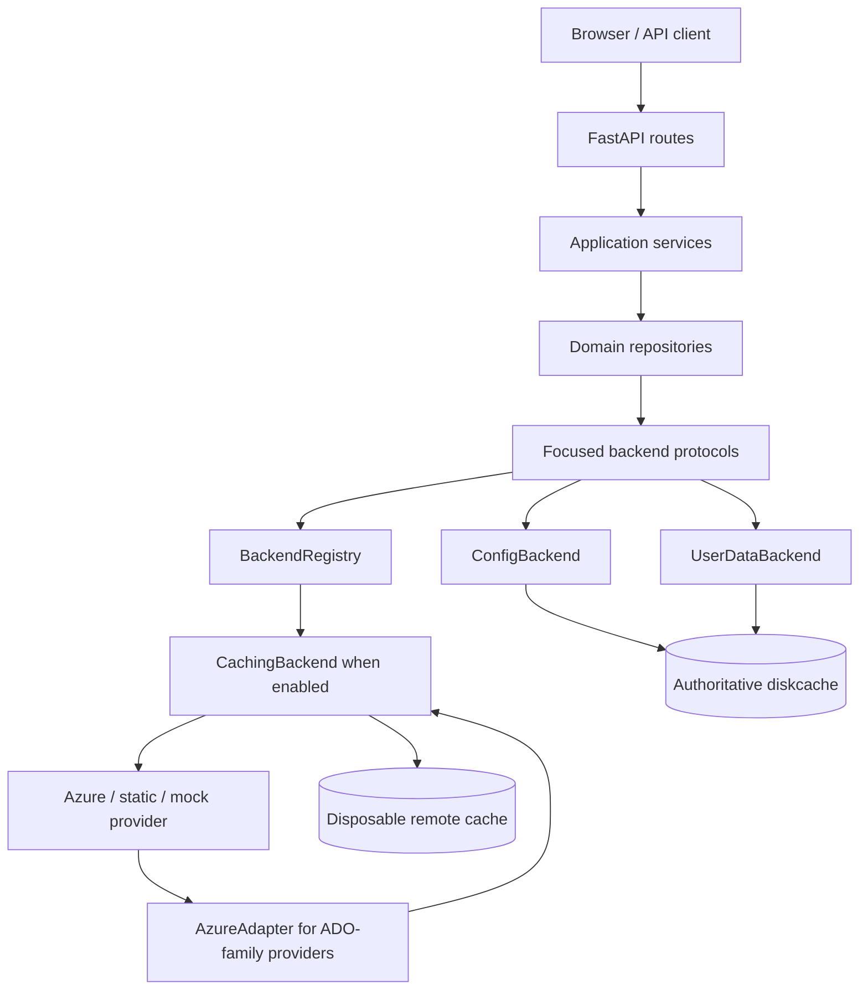

# System Architecture & Design: Backend Data

This document describes how PlannerTool moves data from the browser and REST
routes through repositories, backend protocols, providers, and storage. It is
the contributor mental model for changing backend data behavior safely.

## 1. Executive Summary & Mental Model

### High-Level Purpose

The backend data layer gives planning features one stable domain-facing API while
supporting live Azure DevOps data, deterministic fixtures, generated mock data,
local configuration, and user-owned scenarios and views. It also separates data
that can be re-fetched from data that must survive a cache purge.

### The Core Metaphor

Treat the subsystem as a **port-and-adapter pipeline with two ledgers**:

- repositories and protocols are the ports; concrete Azure, static, and mock
  implementations are replaceable adapters
- the authoritative ledger stores configuration, accounts, sessions, scenarios,
  views, events, and groups
- the remote ledger is a disposable read-through cache for provider data

The pipeline normalizes provider-specific records into domain objects before the
rest of the application sees them. The cache can return stale remote data during
an outage, but it must never be used as the system of record for user changes.

## 2. System Components & Boundary Map

### Directory & File Layout

```text
planner_lib/
  main.py                         dependency injection and app composition
  */api.py                        FastAPI routes and request/session boundary
  */service.py                    application orchestration and calculations
  repository/                     one repository per data domain
  backend/
    port.py                       focused runtime-checkable protocols
    registry.py                   active provider selection
    caching.py                    soft-freshness cache proxy
    adapter.py                    Azure-shaped data to domain translation
    azure.py                      live Azure DevOps adapter
    static.py                     read-only YAML/JSON domain-data adapter
    mock.py                       fixture and generated-data adapters
    config.py                     durable local configuration backend
    user_data.py                  durable scenarios, views, events, and groups
  domain/                         TypedDict domain contracts
  storage/                        StorageBackend and diskcache implementation
  services/container.py           DI keys and service container
  admin/reload_orchestrator.py    config reload and cache invalidation side effects
```

### Key Abstractions

| Component | Responsibility |
|---|---|
| `TaskRepository`, `HistoryRepository`, `PlanRepository`, `IterationRepository` | Translate application requests into remote protocol calls and return domain data. |
| `ProjectRepository`, `TeamRepository` | Read durable projects and canonical team/group identities. |
| `ScenarioRepository`, `ViewRepository` | Persist user-owned scenario and view data without a cache layer. |
| `TaskBackend`, `HistoryBackend`, `TeamsBackend`, `PlansBackend`, `IterationsBackend` | Focused remote-data ports. `BackendPort` composes these remote contracts. |
| `ConfigBackend` | Reads and writes configuration keys in authoritative diskcache storage. |
| `UserDataBackend` | Reads and writes scenarios, views, events, and groups in authoritative storage. |
| `BackendRegistry` | Selects one remote provider from ordered feature flags. |
| `CachingBackend` | Transparently caches `fetch_*` calls, tracks soft freshness, and patches cached task lists after writes. |
| `AzureAdapter` | Converts raw Azure-shaped work items into canonical `DomainTask` values. |
| `DiskCacheStorage` | Implements the `StorageBackend` abstraction over diskcache/SQLite. |
| `ReloadOrchestrator` | Applies admin configuration changes, rebuilds affected services, and invalidates remote data when required. |

The focused protocol inventory is:

| Protocol | Owner | Main operations |
|---|---|---|
| `TaskBackend` | Remote provider | `fetch_plan_tasks`, `fetch_task_context`, `write_task`, `invalidate_cache` |
| `HistoryBackend` | Remote provider | `fetch_history` |
| `TeamsBackend` | Remote provider | `fetch_teams` |
| `PlansBackend` | Remote provider | `fetch_plans`, `fetch_markers` |
| `IterationsBackend` | Remote provider | `fetch_iterations` |
| `ProjectConfigBackend`, `TeamConfigBackend` | `ConfigBackend` | Local project and canonical team/group configuration reads |
| `IterationConfigBackend`, `PlanConfigBackend`, `AdoConfigBackend` | `ConfigBackend` | Iteration, area-plan, and ADO configuration reads/writes |
| `EventConfigBackend` | `ConfigBackend` | Event configuration reads/writes |
| `ScenarioBackend`, `ViewBackend`, `EventBackend` | `UserDataBackend` | Scenario, view, and event persistence |

`BackendPort` is the composite remote contract. `DiagnosticBackend` is an
optional capability implemented by backends that publish user-facing
diagnostics; it is not part of the remote data contract itself.

### Task Metadata Boundary

`TaskRepository` calls `TaskBackend.fetch_plan_tasks(plan, credential)`. It uses
the configured plan ID for import provenance but forwards the plan record's
source settings without interpreting them. Only the concrete backend knows
whether a source is an ADO area path, an external query, or something else.
Existing ADO and ADO-like backends retain their native `fetch_tasks` helper;
it is not the repository's task-read protocol.

Backends return `BackendTask` records with canonical domain properties and an
optional opaque `backendData` dictionary. That dictionary remains associated
with its task in backend persistence/cache records. The repository neither
interprets nor mutates its contents and omits it from consumer-facing
`DomainTask` results. Consumers cannot read backend metadata through repository
results or replace it through repository updates.

Ownership is a backend-provided PlannerTool plan ID, not a repository inference
from provider paths or parent items. Canonical IDs, optional monotonic domain
`revision` values, and `sourcePlanIds` support deduplication and selection;
provider-specific revision tokens belong in `backendData`. Numeric SDK ID
conversion also belongs to the concrete backend, not the repository.

New repository consumers must use these domain properties, never backend-specific
source fields or metadata for ownership, selection, or calculations.

`TaskRepository` calls the required `fetch_task_context(seeds)` operation after
merging one combined forest of configured seeds, while private metadata is still
present. Only then does it scope project-specific reads by `sourcePlanIds` and
strip metadata for consumers. ADO interprets its own private identity, resolves
source owners and iteration enrichment, and emits domain-level `sourcePlanIds`,
`presentationPlanIds`, `excludedChildIds` and `traversalBoundary` properties.
File and mock providers return their supplied seed snapshots with presentation
metadata; repositories do not probe provider capabilities or interpret source fields.

ADO prepares task `start` and `end` from explicit scheduling fields first, then
fills missing boundaries from the exact assigned iteration in the work item's
native ADO project. Date resolution reads that project's full iteration tree,
independently of configured picker presets or their roots. Context enrichment
shares one iteration map per native project and recalculates missing or previously
inferred seed boundaries without replacing explicit dates. Unmatched or undated
iterations leave unavailable boundaries unset; no parent or name-based inference
is performed. Existing task/context snapshots acquire these dates on task refresh
or cache expiry. This preparation does not write inferred dates back to ADO.

Published date boundaries become explicit in every affected task cache, while
untouched boundaries retain their inference status. Failed iteration reads
propagate as backend failures instead of masquerading as empty schedule trees,
allowing the existing cache lifecycle to preserve its last successful snapshot.
Missing assigned schedules are reported in aggregate as warnings; assigned
schedules with unavailable boundary dates are informational. Project-root backlog
assignments do not generate these notices.

`GET /api/tasks` returns all pending diagnostics in the `X-Backend-Diagnostics`
JSON header, limited to public code/severity/message fields. The provider records
them in a session-level application notification log instead of opening a modal.
The log retains the latest 100 distinct entries, deduplicates repeated messages
with occurrence counts and first/last timestamps, and supports marking read and
clearing. Its bell appears immediately left of Settings only while entries exist.
Entries are not persisted across page reloads or broadcast to other users.

REST response observation collects diagnostics from every endpoint and reports
HTTP failures without consuming the response body. Network failures are reported
after retries are exhausted; successful HTTP responses with failed operation
results (including publishing) also contribute error entries. Response observers
run outside network retry handling to avoid replaying completed writes.
Session, hydration, initialization, uncaught browser/promise failures, and timeline
export messages use the same log rather than screen-dimming message overlays.
The initial loading indicator and interactive authentication/confirmation dialogs
remain; notification collection does not change publishing semantics.

After descendant expansion, ADO loads Parent paths across areas and projects in
bounded batches. Ancestors reached only by this second pass have `ancestorOnly: true`,
`childrenComplete: false`, and empty `sourcePlanIds` and `presentationPlanIds` lists.
Their Child links never trigger sibling expansion. An independently seeded or
descendant-reached item remains ordinary imported work, even when it is also an
ancestor. Parent traversal deduplicates IDs to terminate cycles and reports omitted
ADO parent targets in `unresolvedParentIds`; TaskCategory boundaries still apply.
Existing context caches acquire the new records on task refresh or cache expiry.
These are backend-neutral `DomainTask` properties, not ADO metadata. Backends
also provide `sourcePlanName` as the display label for a source owner; the ADO
backend maps the final area-path segment to this field (for example,
`Program\D Program\System Features\LE Audio` becomes `LE Audio`). Other backends
choose their own source labels. Distinct source-owner IDs retain distinct context
lanes and origin attribution even when their display names happen to match.
The application treats owner IDs as
opaque and never derives context ownership or labels from ADO project/area fields
or private `backendData`. Alternative providers can supply the same domain contract.

Import membership and calculation rollups follow importing-plan provenance.
Board scope starts with tasks owned by the selected PlannerTool plans; explicit
context options add eligible ancestors, descendants, dependencies and other work
by participating teams from the resolved graph. Scope menu counts are eligible-card
additions from enabling each option, or removals from disabling it. They apply
configured presentation, type, state and task filters, plus the board's allocation
and ancestor eligibility using the organization team roster in plan mode, before
sidebar Team Drill-down. Hidden context-only records are not counted as cards.
Participating teams are derived from base-plan allocations, not sidebar selection.
Ordinary presentation is restricted to tasks with configured presentation plans;
internal source owners do not become selectable plans. Hidden context records have
an empty `presentationPlanIds` list: they are loaded to preserve linked hierarchy
and calculation inputs, but no configured plan presents them as cards. They remain
in the resolved graph for inspection, capacity and cost, independently of sidebar
type/state/team filtering of otherwise presentable cards. Category-excluded references
remain inspectable but are not calculation edges, including independently seeded
Task-category endpoints. Shared tasks contribute once to organization totals and
once to each associated plan rollup. Cost reports retain all context types and
apply the same team-aware child precedence, without inventing source-owner plans.
Ancestor-only records are an explicit presentation exception: Parent Context can
show them subject to the ordinary type/state/task filters. Their card has an
Ancestor label identifying partial child coverage; unconfigured owners receive an
owner-label context swimlane, not a selectable plan. Parent Context places tasks
with their ancestors even across unseeded owners; an ancestor-only chain shares
its highest available ancestor lane without altering ownership or import provenance.
Ancestor types are available in
the task-type menu. Ancestor-only allocations and owners do not create cost rollups,
and their empty import provenance keeps them out of plan capacity totals.

### Dependency-Injection Keys

`planner_lib/main.py` wires these names through the service container:

| Key | Implementation | Boundary |
|---|---|---|
| `backend` | Selected provider, optionally wrapped by `CachingBackend` | Remote work-item, history, team, plan, and iteration data |
| `config_backend` | `ConfigBackend` | Durable local configuration |
| `user_data_backend` | `UserDataBackend` | Durable scenarios, views, events, and groups |
| `storage` | `DiskCacheStorage` | Authoritative diskcache instance |
| `remote_cache_storage` | Lazily-created `DiskCacheStorage` | Disposable cache, created only when caching is enabled |

### Layer Map



The diagram shows logical ownership rather than every Python call. In
particular, `ConfigBackend` and `UserDataBackend` do not pass through
`CachingBackend`, while the selected remote provider does.

## 3. Data Flow & Integration Patterns

### Primary Execution Path: Read

1. The browser calls a domain REST route. The route validates session context,
   parses request parameters, and creates a credential when remote access needs
   one.
2. The route or application service asks a repository for a domain operation.
3. The repository depends on a protocol, never on a concrete provider class.
4. For remote data, the injected `backend` is either the selected provider or a
   `CachingBackend` wrapper. A fresh cache hit returns immediately.
5. On a cache miss, the provider fetches data. Azure-family providers normalize
   provider records and call `AzureAdapter.to_domain()` before returning;
   `StaticBackend` already contains domain records and skips the adapter.
6. The repository applies domain-level filtering or composition and returns
   `DomainTask`, history, team, plan, or iteration values to the service.
7. FastAPI serializes the result for the browser.

### Primary Execution Path: Writes and Reloads

| Data | Write path | Consistency behavior |
|---|---|---|
| Azure work items | `TaskRepository` -> `TaskBackend.write_task()` -> provider | `CachingBackend` delegates the write, then patches matching task entries in every cached task list. |
| Configuration | Admin route/service -> `ConfigBackend` | Diskcache is authoritative; reads observe the saved value immediately. |
| ADO configuration | Admin ADO save -> `ConfigBackend` -> `ReloadOrchestrator` | The orchestrator rebuilds the Azure service/provider and invalidates affected remote cache entries. |
| Generic server configuration | Admin system save -> authoritative `config::server_config` key -> reload | The saved diskcache value is the source for subsequent service construction. |
| Scenarios and views | Repository -> `UserDataBackend` | Direct durable reads and writes; no stale cache layer is inserted. |

### Provider Selection

`BackendRegistry` evaluates feature flags in this order; the first enabled
flag wins. `AzureDevOpsBackend` is the default when no mock/static flag is set.

| Priority | Provider | Flag | Data representation |
|---|---|---|---|
| 1 | `StaticBackend` | `use_static_backend` | Domain data loaded from YAML or JSON. |
| 2 | `MockGeneratorBackend` | `use_azure_mock_generator` | ADO-shaped/generated data translated by `AzureAdapter`. |
| 3 | `MockFixtureBackend` | `use_azure_mock` | ADO-shaped fixture data translated by `AzureAdapter`. |
| 4 | `AzureDevOpsBackend` | none | Live Azure DevOps data translated by `AzureAdapter`. |

### Cache Read Path

For task repository reads with live remote caching enabled, `TaskSnapshotBackend`
provides one stable complete forest rather than independently cached seeds and
context. `TaskSnapshot` persists the list at
`backend_domain::fetch_task_context__complete` with companion metadata containing
a configuration fingerprint, generation, completion/freshness timestamps, and
the last refresh outcome. All registered users share the configured project
scope; no credential or initiating identity is stored in snapshot metadata.

Compatible snapshots are returned immediately, including when stale. A stale
authenticated read starts at most one background job in the application worker.
That job fetches live seeds for all plans, merges them using repository rules,
expands their context once, then atomically commits the complete list and
metadata. It bypasses independent seed/context cache reads. Freshness uses the
existing task TTL, measured from successful completion. Failed or empty refreshes
retain a populated snapshot; automatic retries have a 60-second cooldown.
Missing or incompatible snapshots require a synchronous first complete fetch
and preserve existing authentication/configuration/availability errors.

Configuration fingerprints include project, team, ADO, global normalization,
iteration and area-plan settings. A configuration guard and task-cache mutation
epoch prevent refreshes from publishing over changed configuration, hard
invalidation, or successful writes. Configuration storage is locked before task
storage, matching workforce publication. Old fragmented task entries are retired
when the complete snapshot commits; retained workforce evidence and write-through
patching continue to use list-shaped task caches. The current deployment uses
one application worker; refresh single-flight is not cross-host coordination.

`POST /api/tasks/refresh` requests background work without invalidating the
serving snapshot. The existing menu refresh uses it and leaves board data,
scenario drafts and selection untouched. A later browser reload reads the new
snapshot. `X-Backend-Diagnostics` reports snapshot age, updating state, failures,
and refresh acceptance through the existing notification log. There is no polling,
push notification or automatic baseline replacement. Publication's reviewed-source
checks retain their explicit hard-invalidation and hydration path.

Other remote operations retain the generic per-method cache path:

```text
CachingBackend.fetch_*
        |
        +-- fresh entry ----------------------> return cached domain data
        |
        +-- soft-expired entry --> remote refresh
        |                            |
        |                            +-- success/non-empty -> replace entry
        |                            +-- remote failure/empty -> keep stale entry
        |                                                       + queue diagnostic
        |
        +-- missing entry ----------> provider fetch -> store data + freshness sidecar
```

`CachingBackend` intercepts `fetch_*` methods through `__getattribute__`. Cache
keys combine the method name with a hash of arguments; credentials are excluded
from the key so the same remote result can be reused while authorization is
still required for a cold fetch. Data entries are saved without a hard
diskcache expiry. A `taskmeta__*` sidecar records `fresh_until` instead.

For the live remote backend, a failed or empty refresh preserves stale data and
queues a diagnostic. Local/static/mock providers do not receive the same outage
classification because they are not remote. An in-flight key guard prevents
duplicate refresh work for the same cache entry.

### State Management & Storage

`planner_lib.main._build_storages()` creates the authoritative `storage`
instance, normally backed by `data/cache`. When caching is enabled,
`_build_services()` lazily creates a separate `remote_cache_storage` instance
under `data/remote_cache`.

| Store | Contents | Operational meaning |
|---|---|---|
| `storage` | Accounts, sessions, server config, projects, teams, workforce and iteration config, ADO config, scenarios, views, events, groups | Durable system of record. Never delete as a cache cleanup operation. |
| `remote_cache_storage` | Cached remote `fetch_*` results and freshness sidecars | Disposable. Clearing it forces provider reads but does not delete user work or configuration. |

Default cache freshness windows are configured by `cache.ttls` in
`config::server_config` and are measured in minutes. The current defaults are:

| Method | Default | Reason |
|---|---:|---|
| `fetch_tasks` | 30 minutes | Work-item state changes frequently. |
| `fetch_history` | 24 hours | History is comparatively stable/append-oriented. |
| `fetch_teams` | 4 hours | Membership changes less frequently than tasks. |
| `fetch_plans` | 4 hours | Plan metadata and markers are slower-moving. |
| `fetch_markers` | 2 hours | Sprint marker data needs a shorter window. |
| `fetch_iterations` | 8 hours | Iteration definitions are stable. |

`0` means no soft expiry until explicit invalidation. These are freshness
windows, not deletion deadlines: preserving stale rows is what allows an
outage-safe refresh.

### Side Effects

- A remote refresh failure queues backend diagnostics consumed by the API layer.
- A successful task write mutates the remote provider and patches matching
  cached task lists.
- Admin changes can trigger `ReloadOrchestrator` to rebuild the Azure service,
  update the active provider, and invalidate remote cache data.
- Explicit hard cache invalidation removes remote-cache entries; it must not
  touch authoritative storage. Task-menu background refresh does not delete
  the serving complete snapshot.

## 4. Architectural Decisions & Trade-offs

### Observed Design Patterns

- **Hexagonal architecture / ports and adapters:** repositories depend on small
  protocols, allowing Azure, static, and mock providers to be swapped without
  changing application code.
- **Interface segregation:** each domain has a focused protocol rather than one
  broad backend interface. `PlanRepository` and `IterationRepository` may
  combine remote and local configuration ports when that is the domain contract.
- **Strategy plus registry:** `BackendRegistry` selects the provider strategy at
  startup/reload from feature flags.
- **Decorator/proxy:** `CachingBackend` preserves the inner backend protocol and
  adds caching without changing repository call sites. Runtime-checkable
  protocol checks continue to work for the protocols implemented by the inner
  backend.
- **Repository pattern:** repositories contain domain-facing orchestration and
  keep storage/provider details out of routes and services.
- **Soft-expiry cache:** freshness metadata is separate from physical storage
  expiry so remote outages do not turn useful stale data into a hard failure.

### Technical Debt & Trade-offs

- `CachingBackend` uses dynamic attribute interception, which reduces repeated
  wrapper code but makes new `fetch_*` methods implicitly cacheable. A new fetch
  method must therefore have sensible cache-key inputs and TTL behavior.
- Cache keys intentionally omit credentials. This improves reuse, but provider
  authorization must still be enforced on cold misses and writes; cached data
  must not be treated as proof that a credential is valid.
- Remote refresh can return stale data rather than an error. Callers must expose
  diagnostics where appropriate so users understand that the displayed data may
  be older than the configured freshness window.
- Diskcache/SQLite gives simple durable local storage and WAL/mmap performance,
  but it is a local-server storage choice, not a multi-node coordination system.
- Static data is already canonical while Azure-family providers need an adapter;
  contributors adding a provider must decide explicitly which representation it
  owns rather than applying the adapter twice.

## 5. Contributor Guide & Operational Hazards

### Extension Points

To add a new data domain:

1. Define a focused protocol in `planner_lib/backend/port.py`.
2. Implement that protocol in each provider/backend that owns the data.
3. Add a repository in `planner_lib/repository/` that depends only on the new
   protocol and any genuinely required companion protocol.
4. Register the dependency key/factory in `planner_lib/main.py` and expose it to
   the owning route or service.
5. Add focused tests for the repository, provider behavior, and DI wiring.

For a new remote provider, register it in `BackendRegistry`, define its feature
flag precedence, and return canonical domain objects. For an ADO-shaped source,
reuse `AzureAdapter`; for a source that already emits domain data, follow
`StaticBackend` and do not translate a second time.

### Known Sharp Edges

- Never put scenarios, views, configuration, accounts, or sessions in
  `remote_cache_storage`. It is intentionally disposable.
- Do not add a hard diskcache TTL to remote data. Physical expiry would remove
  the stale value needed for outage resilience.
- `write_task` always requires a credential even when a read can use warm cache
  data. Do not weaken this boundary.
- A cached task write patches cached lists but does not make every provider-side
  read globally transactional. Treat the provider write result as authoritative.
- Configuration changes are not complete until reload/invalidation side effects
  have run. Use `ReloadOrchestrator` rather than mutating an in-memory service
  alone.
- Iteration root paths are configuration-level values. The Azure backend owns
  construction of the project-prefixed ADO path; repositories must not duplicate
  that provider knowledge.
- `DomainTask` is the canonical contract above the backend adapter. Preserve its
  frontend-facing field names (`start`, `end`, `iterationPath`, `parentId`) when
  changing provider mappings.
- Warm cache reads are not a substitute for authorization. Cold remote reads and
  all remote writes still follow credential rules in `planner_lib/backend/port.py`.

### Testing Strategy

Run the backend-focused Python tests with the repository virtual environment
active:

```bash
source .venv/bin/activate
pytest
```

Useful focused coverage includes:

- repository tests using protocol fakes to verify calls and domain shaping
- adapter tests for raw ADO fields, inferred dates, relations, and capacity
- cache tests for miss, fresh hit, soft expiry, stale-on-failure, diagnostics,
  invalidation, and task-write patching
- provider tests for registry precedence and static/mock fixture formats
- integration tests for admin config save followed by reload and cache
  invalidation

The canonical domain contracts live in `planner_lib/domain/`; update or add
tests there when a public data shape changes. Avoid live Azure calls in unit
tests; use protocol fakes, static data, or mock providers.

## Data Schemas

### Raw ADO Dict

`AzureNativeClient` normalizes Azure field names before
`AzureAdapter.to_domain()` consumes them:

```text
{
  "id": int,
  "title": str,
  "type": str,
  "state": str,
  "startDate": str | None,
  "finishDate": str | None,
  "iterationPath": str | None,
  "parentId": str | None,
  "relations": List[{type, id, url}],
  "description": str | None,
  "assignee": str | None,
  "tags": str | None,
  "areaPath": str | None,
  "url": str | None
}
```

### DomainTask

`planner_lib/domain/tasks.py` defines the canonical `TypedDict` returned above
the adapter. Its required core fields are `id`, `title`, `type`, `state`, and
`project`; optional fields include `start`, `end`, `iterationPath`, `parentId`,
`relations`, `capacity`, `description`, `assignee`, `tags`, `areaPath`, and
`url`. `_inferred_start` and `_inferred_end` record dates inferred from an
iteration when explicit dates are absent.

`DomainRelation` contains `type`, `id`, and optional `url`.
`DomainCapacity` contains a team identifier and fractional `capacity` from 0 to
1. `WriteResult` contains `ok`, `updated`, and `errors`.

### History Contracts

`DomainHistoryEntry` contains `field`, `value`, `changed_at`, `changed_by`, and
optional `pair_id`. `DomainTaskHistory` contains `task_id`, `title`, `plan_id`,
and a list of history entries. See `planner_lib/domain/history.py` for the
single source of truth when fields change.

### Static Backend File Format

For `use_static_backend: true`, the YAML/JSON file maps `area_path` to a list of
canonical `DomainTask` values. Optional top-level keys provide `_teams`,
`_plans`, `_markers`, `_iterations`, and `_history`. Static files are
served as-is, so malformed or provider-shaped records are a data/configuration
error rather than an adapter input.

### Credential Rules

- Remote `fetch_*` calls may omit credentials when a warm cache entry exists;
  a cold miss without credentials raises `PermissionError`.
- `write_task` always requires a credential.
- Configuration and user-data backends do not require credentials.
