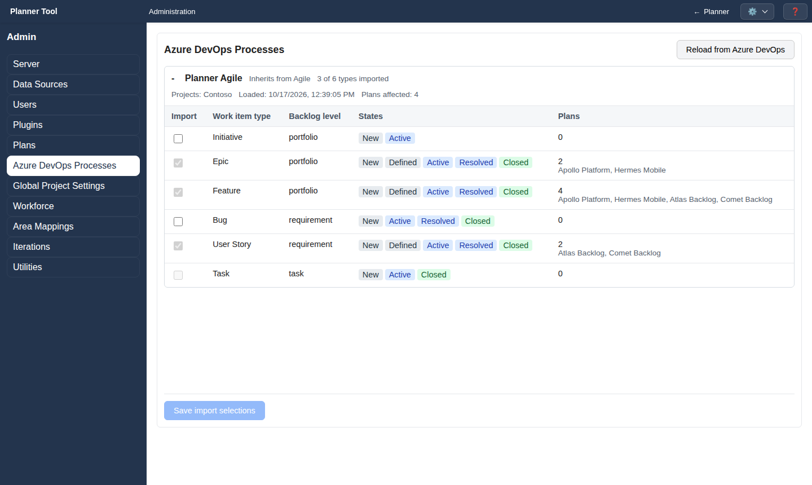

# Admin - Azure DevOps Processes

The **Azure DevOps Processes** section (`#ado-processes`) controls which work item types PlannerTool imports from each Azure DevOps process. It requires the `manage_projects` permission.

Processes are added automatically when a plan is created for a project that uses them (see [Admin - Plans](admin_plans.md)). Until then the page shows "No process definitions loaded".

## Process sections

Each process has an expandable section showing its name, the process it inherits from and "N of M types imported", followed by the Azure DevOps projects using it, when it was loaded and how many plans it affects.

The table lists every work item type:

- **Import**: whether plans may load this type.
- **Work item type**: marked "Missing in Azure DevOps" when the type no longer exists there.
- **Backlog level**: portfolio, requirement, task or none.
- **States**: the type's states, coloured by state category.
- **Plans**: the plans using the type.

An Import checkbox is disabled when plans still use the type ("Used by: …"), for task-level types, and for missing types that are not imported.

## Actions

- **Save import selections** stores changed checkboxes.
- **Reload from Azure DevOps** re-reads the processes; you are asked to confirm if there are unsaved changes.

Type order and state display are configured in [Admin - Global Project Settings](admin_global_settings.md).
