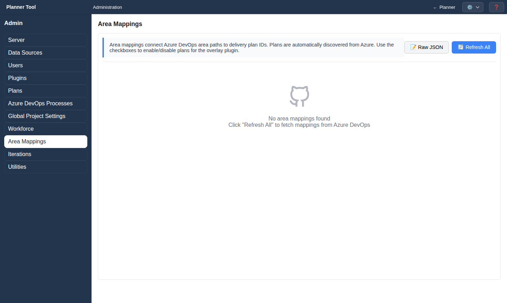

# Admin - Area Mappings

Area Mappings (`#area-mappings`, full administrators only) shows which Azure DevOps Delivery Plans are associated with each plan's area path, and which of them are enabled for the [Plan Markers](plugin_markers.md) overlay.

## Layout

- One card per plan. The card shows the PlannerTool plan name, the area path, "N plans • M enabled", a 🔄 refresh button and one checkbox per Delivery Plan (name and ID).
- A "Last updated" line shows when the mappings were last refreshed. "No area mappings found" is shown until a refresh has found Delivery Plans.

## Actions

- 🔄 on a card re-fetches the Delivery Plans for that area path; **🔄 Refresh All** refreshes every card.
- Ticking or clearing a plan checkbox saves immediately.
- **📝 Raw JSON** switches to a JSON editor with **💾 Save** and **🔄 Reload**; **📋 Card View** switches back.

## Notes

- Refreshing reads Azure DevOps with your Personal Access Token, which needs access to the Delivery Plans of the relevant projects.
- Data sources without Delivery Plans (such as the synthetic demo source) show plans without markers.
