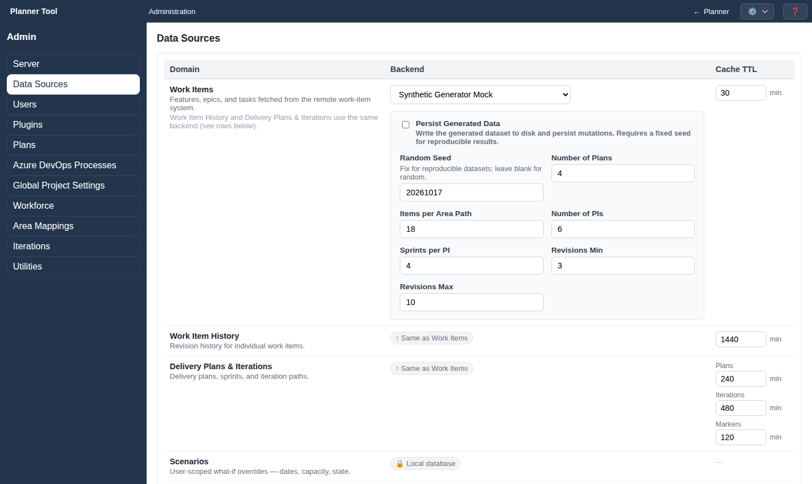

# Admin - Data Sources

The **Data Sources** section (`#data-sources`, full administrators only) selects where PlannerTool reads its data from and how long cached data is kept.

## Layout

A table with the columns **Domain**, **Backend** and **Cache TTL**:

| Domain | Backend | Default TTL (minutes) |
| --- | --- | --- |
| Work Items | Selectable (see below) | 30 |
| Work Item History | Same as Work Items | 1440 |
| Delivery Plans & Iterations | Same as Work Items | Plans 240, Iterations 480, Markers 120 |
| Scenarios, Views | Local database | — |
| Workforce | Local database | — |
| Projects & Teams | Local database | 240 |
| Plan Events | Local database (PlannerTool) or Azure DevOps Wiki page | — |
| Groups | Local database (PlannerTool) | — |

Cache lifetimes are whole minutes from 1 to 10080 (one week).

## Work item backends

- **Live Azure DevOps REST API**: reads and writes your Azure DevOps organization. Field: **Organization Name** (for example `MyCompany`). Each user supplies their own Personal Access Token in Configuration.
- **Fixture Mock (pre-recorded)**: serves recorded data from **Fixture Data Directory** (default `data/azure_mock`); **Persist Fixture Mutations** keeps published changes.
- **Synthetic Generator Mock**: generates a consistent demo dataset for the configured plans, with iterations and revision history. No Azure connection or PAT is needed. Fields: **Random Seed**, **Number of Plans**, **Items per Area Path**, **Number of PIs**, **Sprints per PI**, **Revisions Min/Max**, and **Persist Generated Data** with a **Persist Directory**. New installations start with this backend; the screenshots in this manual use it.
- **Static File (read-only)**: reads tasks from a YAML or JSON file mapping area paths to tasks (**Static Data File Path**).

## Plan Events backend

Plan events are stored in PlannerTool by default. Alternatively they can be kept on an **Azure DevOps Wiki page**: set **Organization Name**, **ADO Project**, **Wiki** and **Page Path** (default `/PlannerTool/Events`).

## Saving

Click **Save** to store all changes. When a backend changes, a banner explains that a server restart is required, because backend selections are read at startup. After switching backends, consider **Invalidate All Caches** in [Admin - Utilities](admin_utilities.md).
