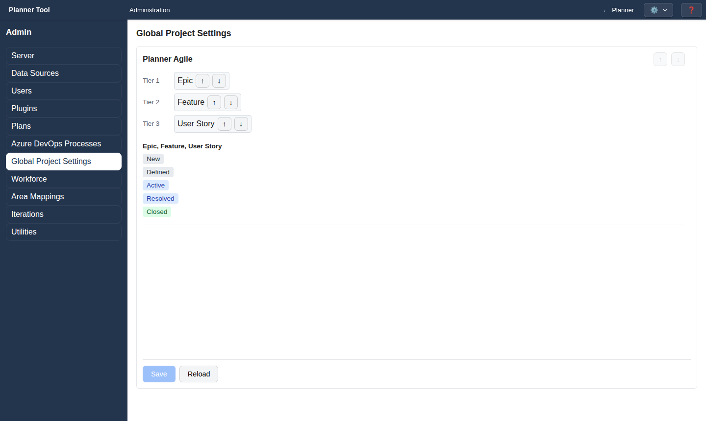

# Admin - Global Project Settings

The **Global Project Settings** section (`#global-project-settings`) orders processes and work item types for the whole installation. It requires the `manage_projects` permission.

## Process order

Each process with imported types has its own section. Use ↑ / ↓ to change the order in which processes are listed.

## Type tiers

Within a process, imported work item types are arranged in tiers: Tier 1 is the highest level (for example Epic), followed by lower tiers (for example Feature, then User Story). The tiers define the type order used in the planner, for example in the Plan menu counts, the Sidebar's Task Types and team counts.

Use the ↑ / ↓ buttons on a type ("Move X up a tier" / "down a tier") to move it. Moving past the first or last tier creates a new tier; empty tiers are removed. Several types can share a tier.

## State order

The state sequence of each type is shown read-only. Types sharing the same states are grouped. States follow Azure DevOps' order, are coloured by state category, and Removed states are hidden. States are changed in Azure DevOps, not here.

## Saving

**Save** (enabled when there are changes) stores the order; **Reload** discards edits. Every imported process and type must appear exactly once. "No work item types imported" is shown until types are imported in [Azure DevOps Processes](admin_ado_processes.md).
