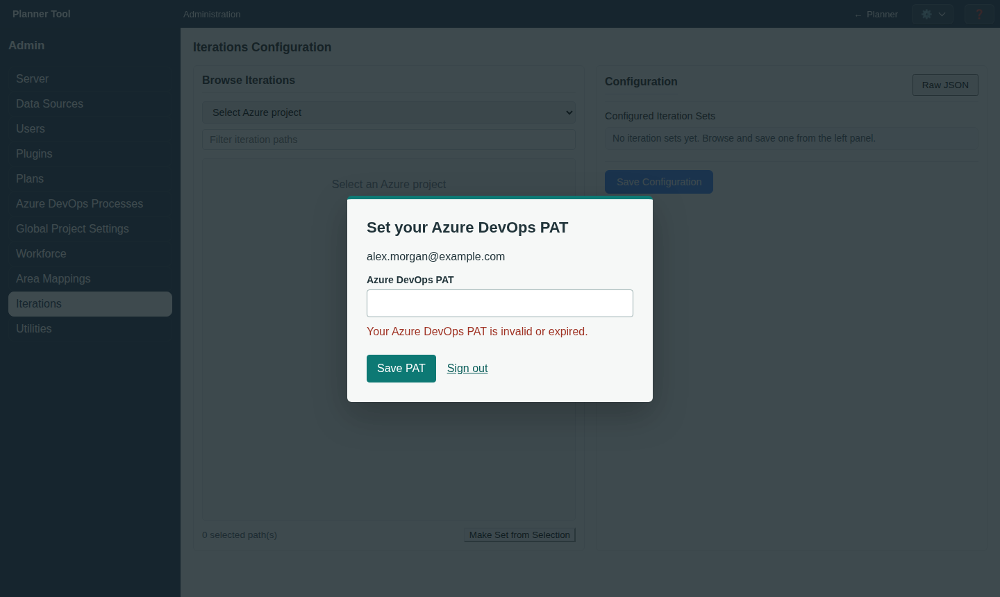

# Admin - Iterations

The **Iterations** section (`#iterations`, heading "Iteration sets") manages named collections of dated iterations that plans offer as schedule presets (see [Iterations (timeboxes)](iterations.md)). It requires the `manage_iterations` permission.

## Create Or Edit A Set

Choose a saved set on the left, or click **New set**, enter a name, and choose a source. The source editor is in the middle; **Resulting set** shows the exact dated members on the right.

- **Azure DevOps**: choose a project, then expand branches to drill through its iteration hierarchy. Expansion and selection are separate: selecting a parent includes its currently loaded descendants even when collapsed. Parent checkboxes show partial selection; branch summaries show included members. **Expand all** and **Collapse all** change only the view. Search reveals matching paths with their ancestors; clearing it restores the earlier expansion state without changing selection. Entries without valid start and end dates are excluded. **Reload source iterations** refreshes the current selection for review, but does not automatically include new descendants.
- **Date generator**: specify a start date, length in calendar days or weeks, and either a count or an inclusive end date. The generator creates contiguous iterations; a range ending partway through an iteration produces a shorter final iteration, highlighted in the preview. Naming prefix and starting number are configurable. Click **Generate preview** after changing settings. Generation is limited to 520 iterations and lengths of 1 to 366 calendar days.
- **Manual**: add individual named iterations with inclusive start and end dates. Edit or remove individual entries before saving.

**Save set** saves the draft. **Discard changes** restores the saved version. Navigation warns about unsaved changes. Generation and source reload only update the draft; neither changes an existing task's dates. Names can be changed with **Rename set**; source identity and technical IDs are read-only. To use another source, create a new set.

## Usage And Deletion

**Used by** lists assigned plans. Reassign those plans in Admin - Plans before deleting a set. **Details** contains the last saved time, technical identifiers, and **Delete set**, which requires confirmation and is blocked while the set is assigned. Deletion never automatically unassociates plans.

Assign a set to a plan with the **Iteration set** field when creating or editing the plan in [Admin - Plans](admin_plans.md).

## Notes

Only ADO browsing requires a valid Personal Access Token with project access. Generated and manual sets do not require ADO credentials. All sets are saved snapshots, not live subscriptions. Existing ADO sets and their plan associations are preserved by the server-owned schema upgrade.
