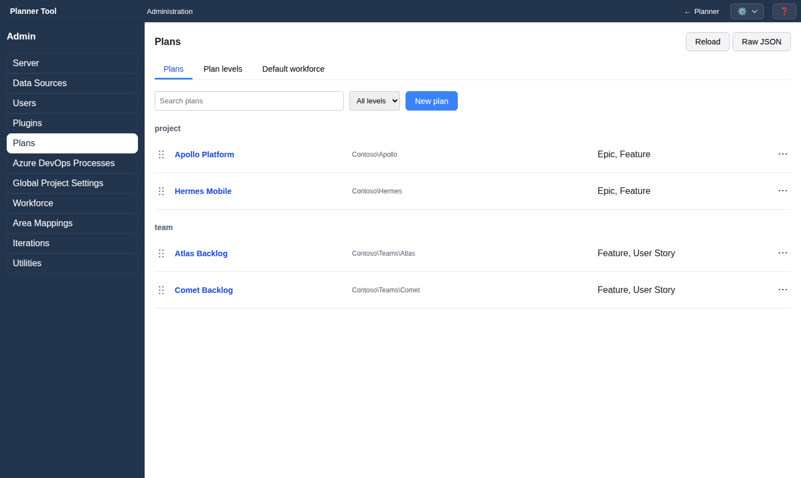
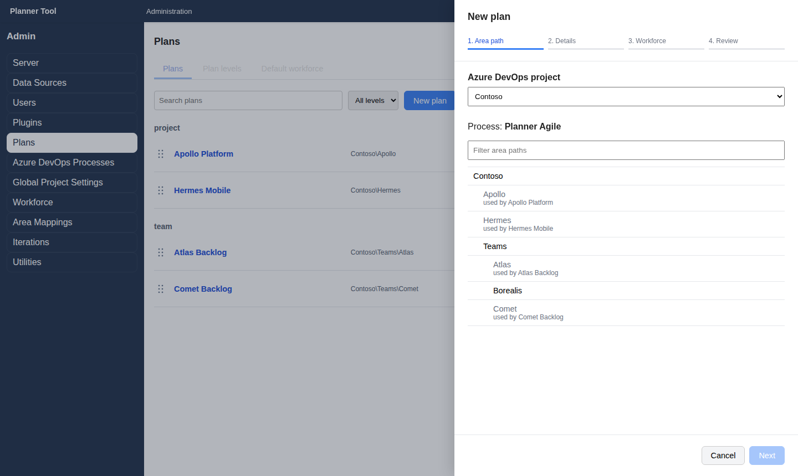
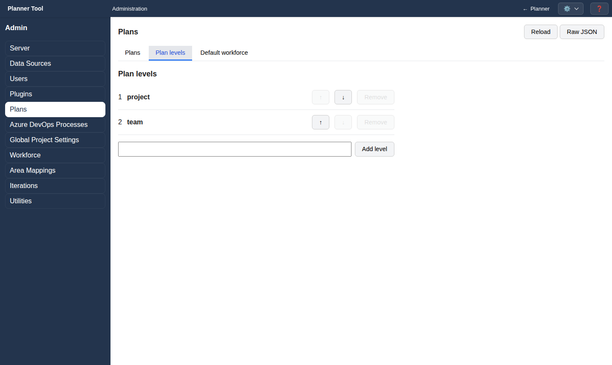
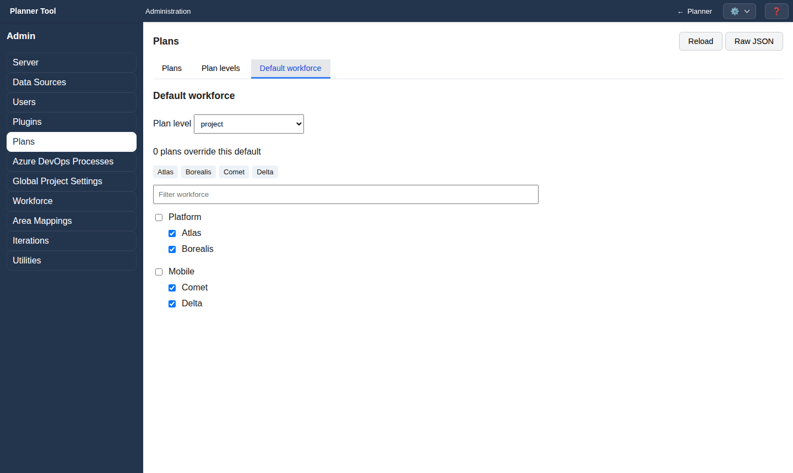

# Admin - Plans

A plan is a set of work items from one Azure DevOps area path. Users select plans in the planner's Plan menu. The **Plans** section (`#projects`) requires the `manage_projects` permission. It has three tabs: **Plans**, **Plan levels** and **Default workforce**. Changes on all tabs are saved automatically ("Saving...", then "Saved successfully").

Full administrators also have **Raw JSON** / **Form mode** and **Reload** in the header.

## Plans tab

- **Search plans** filters by name, area path and work item types.
- **Filter by level** shows all levels, one level, or archived plans.
- Plans are listed per level. Each row shows the plan name, area path, work item types, closed work history and the work item load status (with **Retry** after a failed load). "Process not imported" marks a plan whose process needs attention in [Azure DevOps Processes](admin_ado_processes.md).
- Drag the handle (⋮⋮) to reorder plans within a level; the order is used in the planner.
- The ⋯ menu has **Move up**, **Move down**, **Archive** / **Restore** and **Delete** (with confirmation; cannot be undone).
- Click a plan name to edit it.

## Creating a plan

Click **New plan**. A drawer guides you through four steps.

1. **Area path**: choose the **Azure DevOps project**. PlannerTool loads its area paths and its process. Filter and pick an area path; paths already used by another plan are disabled ("used by …").
2. **Details**:
   - **Name** (prefilled from the area path) and **Plan level**.
   - **Work item types** to load. Defaults follow other plans of the same level. Task-level types cannot be imported. Types not yet imported are imported when the plan is created.
   - **Closed work history**: None, 1 month, 3 months, 6 months or 1 year. Completed work linked to active items always shows.
   - **Iteration set**: the [iteration set](admin_iterations.md) offered as schedule presets.
3. **Workforce**: **Inherit level default**, or **Choose for this plan** to select groups and teams that may be allocated to this plan's tasks.
4. **Review**: check the summary and click **Create plan**. The drawer reports "Plan saved" and the result of loading the work items.

## Editing a plan

The **Edit plan** drawer shows all settings on one page. **Change area path...** replaces the source of the plan's work items. The **Danger zone** has **Archive** / **Restore** and **Delete**. Click **Save**; work items are reloaded when the area path, types or closed history changed.

## Plan levels tab

Plan levels (for example `project` and `team`) order plans from the top down. They define the Plan menu groups and the graph levels in the planner (see [Graph Area](graph.md)).

- Reorder levels with ↑ / ↓.
- **Remove** a level that no plan uses.
- Add a level with **New level name** and **Add level**. Names must be unique; at least one level is required.

## Default workforce tab

Choose a **Plan level** and select the groups and teams that may be allocated to tasks in plans of that level. Plans can override this default in their Workforce step; the tab shows how many plans do.
