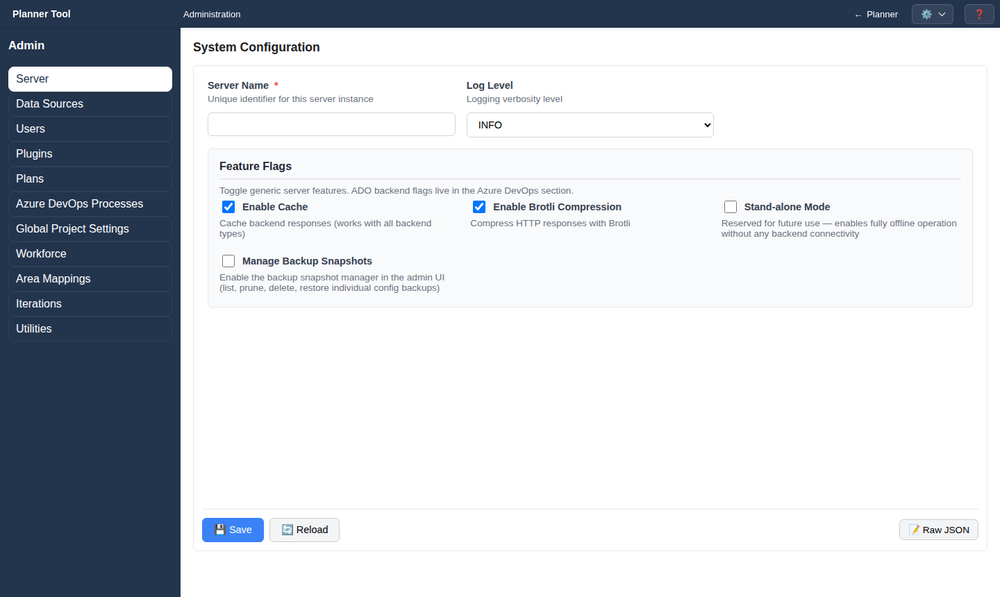

# Admin - Server

The **Server** section (`#server`, heading "System Configuration", full administrators only) holds general server settings.

## Fields

- **Server Name** (required): identifies this PlannerTool instance.
- **Log Level**: DEBUG, INFO (default), WARNING, ERROR or CRITICAL.
- **Feature Flags**:
  - **Enable Cache** (on by default): caches backend responses. Cache lifetimes are set in [Admin - Data Sources](admin_data_sources.md).
  - **Enable Brotli Compression** (on by default): compresses responses.
  - **Stand-alone Mode**: reserved for future use.
  - **Manage Backup Snapshots** (off by default): keeps a snapshot of the previous value on every configuration save and shows [Backup Snapshots](admin_backup_snapshots.md) in the administration menu.

## Actions

- **💾 Save** stores the settings.
- **🔄 Reload** discards unsaved edits.
- **📝 Raw JSON** / **📋 Form Mode** switches between a JSON editor and the form.

Some settings take effect only after a server restart; ask your operator if a change does not appear to apply.
