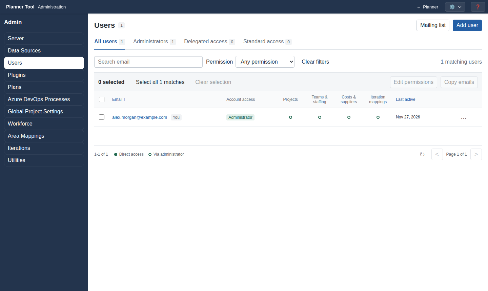

# Admin - Users

The **Users** section (`#users`, full administrators only) manages accounts, administrators and delegated administration permissions.

## Layout

The searchable, paginated table shows account access, effective permissions and last activity.
Use the view buttons to show all users, administrators, delegated access or standard access.
Filter by email or permission; sort by email or last activity. A missing activity date means
history is unavailable, not necessarily that the account was never used.

## Managing accounts

- Use **Add user** to create an account, and the account actions menu to manage or remove it.
- Click an email to review and edit permissions, including administrator access.
- Select multiple users and choose **Edit permissions** to review a bulk change.
- **Mailing list** or **Copy emails** copies or exports addresses for selected, filtered or all users.
- **Reload users** re-reads the table.

## Delegated administration

The permission editor lets you review changes before saving. Administrators have all delegated permissions.

| Checkbox | Permission | Sections |
| --- | --- | --- |
| Projects | `manage_projects` | Plans, Azure DevOps Processes, Global Project Settings |
| Workforce teams & staffing | `manage_workforce_teams` | Workforce: groups, teams, staffing |
| Workforce costs & suppliers | `manage_workforce_costs` | Workforce: suppliers, profiles |
| Iteration mappings | `manage_iterations` | Iterations |

A delegated user sees only the matching sections in the gear menu and the administration area.

On enrollment-based installations, creating an account assigns its account ID and permissions immediately. The
user then enrolls their browser with that email and their real name in the
planner and saves the generated account key. Assigned admin permission is
preserved; the user does not need to enroll before you create the admin account.
Creating an account does not issue its browser credentials to the administrator.

## Reset account access

On enrollment-based installations, use **Reset access** for an enrolled account whose browsers or account key are
lost. Confirm the reset, then save the replacement key displayed in the shared
account-key modal before checking the save confirmation and continuing. Give
the key to the account owner through a trusted channel.

Reset revokes every remembered browser and active session for the account and
invalidates its old account key. It preserves the account ID, name, permissions,
and Azure PAT. The account owner should use **Enrollment** with the replacement
key and save the next key shown after enrollment.

Resetting your own access signs you out. Save the key before confirming; the
planner opens afterward so you can enroll again. Do not close or reload the key
dialog before saving. If the key is lost, another authenticated administrator
or the installation operator must issue a fresh reset.

See [Account Access](account_access.md) for the account owner's instructions.

Logical account restore excludes credentials and devices; restored enrollment
accounts need fresh operator-issued keys. Arrange operator access before restore,
including for administrators. Entra account replacement is rejected.
Administrator Remove and self-service Delete account both remove the account,
PAT, owned saved views/scenarios, and authentication. Retained backups and
offline drafts on other browsers are outside that deletion.

## Notes

- Email addresses are validated on entry.
- Status messages confirm success or report an error after each change, and clear automatically after a few seconds.
