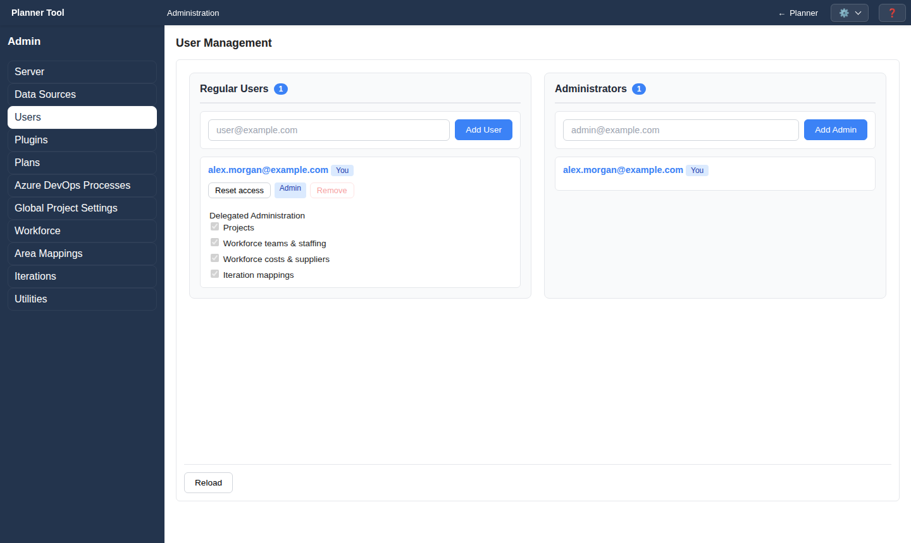

# Admin - Users

The **Users** section (`#users`, heading "User Management", full administrators only) manages every account that can sign in, who is an administrator, and which administration tasks are delegated to other users.

## Layout

Two lists side by side, each with a count badge:

- **Regular Users**: all accounts (the heading is historical). Administrators carry an "Admin" badge and your own account a "You" badge.
- **Administrators**: accounts with the `admin` permission, which can use every administration section.

## Managing accounts

- Add an account by entering an email address and clicking **Add User** or **Add Admin** (Enter also works). If the server requires it, a PAT field for the new account appears.
- Promote a user with **Make Admin**; demote an administrator with **Demote**.
- **Remove** deletes an account immediately, without a confirmation step. You cannot remove or demote your own account.
- **Reload** re-reads the account lists.

## Delegated administration

Each user row has a **Delegated Administration** group with checkboxes. Each change is saved immediately. For administrators the boxes are checked and disabled.

| Checkbox | Permission | Sections |
| --- | --- | --- |
| Projects | `manage_projects` | Plans, Azure DevOps Processes, Global Project Settings |
| Workforce teams & staffing | `manage_workforce_teams` | Workforce: groups, teams, staffing |
| Workforce costs & suppliers | `manage_workforce_costs` | Workforce: suppliers, profiles |
| Iteration mappings | `manage_iterations` | Iterations |

A delegated user sees only the matching sections in the gear menu and the administration area.

Creating an account assigns its account ID and permissions immediately. The
user then enrolls their browser with that email and their real name in the
planner and saves the generated account key. Assigned admin permission is
preserved; the user does not need to enroll before you create the admin account.
Creating an account does not issue its browser credentials to the administrator.

## Reset account access

Use **Reset access** for an enrolled account whose browsers or account key are
lost. Confirm the reset, then save the replacement key displayed in the shared
account-key modal before checking the save confirmation and continuing. Give
the key to the account owner through a trusted channel.

Reset revokes every remembered browser and active session for the account and
invalidates its old account key. It preserves the account ID, name, permissions,
and Azure PAT. The account owner should use **Enrollment** with the replacement
key and save the next key shown after enrollment.

Resetting your own access signs you out. Save the key before confirming; the
planner opens afterward so you can enroll again. Do not close or reload the key
dialog before saving. If the key is lost, another authenticated administrator
or the installation operator must issue a fresh reset.

See [Account Access](account_access.md) for the account owner's instructions.

Logical account restore excludes credentials and devices; restored enrollment
accounts need fresh operator-issued keys. Arrange operator access before restore,
including for administrators. Entra account replacement is rejected.
Administrator Remove and self-service Delete account both remove the account,
PAT, owned saved views/scenarios, and authentication. Retained backups and
offline drafts on other browsers are outside that deletion.

## Notes

- Email addresses are validated on entry.
- Status messages confirm success or report an error after each change, and clear automatically after a few seconds.
