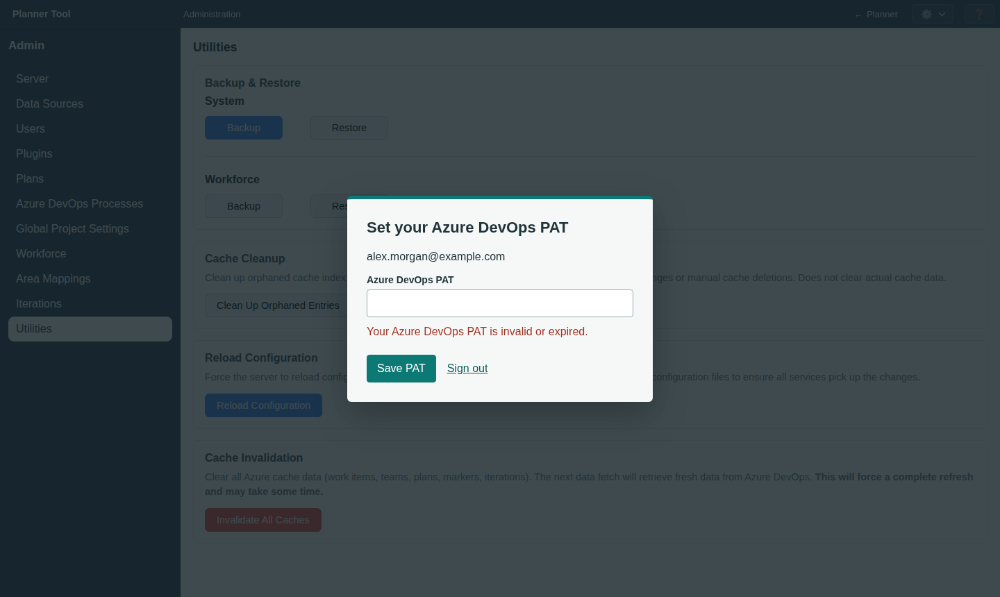

# Admin - Utilities

Utilities (`#utilities`, full administrators only) collects maintenance actions for keeping a PlannerTool installation healthy: backups, workforce transfer, cache cleanup, configuration reload and cache invalidation.

**Backup & Restore** has matching **System** and **Workforce** rows. Each has
**Backup** and **Restore** buttons. **Restore** opens the appropriate file picker;
the restore details appear below that row after a file is selected and checked.

## Workforce Transfer

Under **Backup & Restore > Workforce**, **Backup** downloads `planner-workforce.yaml` containing the complete
workforce: teams, workforce groups, suppliers, profiles, staffing and archived
definitions. IDs, ADO allocation tokens and recorded update dates are preserved.
The file includes supplier rates; keep it private. Accounts, credentials, projects,
views, scenarios and other server configuration are not exported.

To transfer workforce definitions to another instance:

1. Open **Utilities > Backup & Restore > Workforce**, select **Restore** to choose
	the exported YAML, and inspect the import preview. Files must be no larger than 2 MiB.
2. Review current and incoming values. New records are added by default; identical
	 records remain unchanged. Choose **Skip** or **Overwrite** for every conflict.
	 New records can also be skipped, for example staffing dependent on a skipped team.
3. Select **Review Choices** after changing any decision. The server checks the
	 complete result, including staffing dependencies, project availability and
	 group/member conflicts in retained tasks and scenarios.
4. Select **Import Workforce** and confirm. **Cancel** discards the preview without
	 changing the server or the separate full-backup restore selection.

Import is additive: destination-only records are kept. Records match by ID, never
by name. Overwrite changes the definition of the same identity; it cannot change
its allocation token, object kind or a profile's owning supplier. A token already
owned by another destination identity requires skipping the incoming record.
Dependencies of skipped records must still resolve in the resulting workforce.
Staffing with a new ID is a separate assignment, not a replacement for an existing
assignment with similar fields.

The preview checks only locally retained data; it cannot prove that historical ADO
references are absent. Existing ADO tasks are not rewritten. A configuration or
reference change after preview invalidates confirmation and requires another
preview. The paired team/workforce configuration is committed atomically, and
unrelated data is left unchanged. Source update dates remain source dates, not the
time of import. A refresh warning after a successful import does not mean the
configuration was rolled back.

This is a standalone file-transfer operation. It does not configure a shared
workforce authority or automatic synchronization.

### Transfer Format and API

The YAML envelope has exactly four fields: `format: plannertool-workforce`,
`version: 1`, `teams` (canonical schema version 3) and `workforce` (canonical schema
version 2). YAML aliases, duplicate mapping keys, unsupported tags and excessively
nested structures are rejected. Full-system backup files cannot be imported here.

All endpoints require an administrator's authenticated session and retain the
normal same-origin write protections:

- `GET /admin/v1/workforce/export` returns `content: {filename, source}`, where
	`source` is the YAML text. It never creates or filters a full-system backup.
- `POST /admin/v1/workforce/import/preview` accepts `{source, decisions}`. Decisions
	map incoming IDs to `skip` or `overwrite`; omitting a new ID means add. The
	response's `content` includes record comparisons, blocking errors, readiness,
	evidence coverage, the destination `revision` and a `review_revision` receipt.
- `POST /admin/v1/workforce/import` accepts the same `source` and `decisions` plus
	both returned revisions. A stale review returns HTTP 409; an invalid result
	returns HTTP 422 without writing. Success returns the committed workforce
	snapshot in `content` and any post-commit refresh `warnings` separately.

## System Backup & Restore

- Under **System**, **Backup** downloads a single JSON file containing configuration, users, views and scenarios. Cached Azure DevOps data is not included.
- Select **Restore** to choose a system JSON backup. After the compatibility check succeeds, tick which parts to restore (Config, User accounts, Views, Scenarios), and click **Restore Selected**. This is a destructive action and requires confirmation, since it overwrites the corresponding current data.

System backups must contain a `schema_revision` matching the running server's
supported storage schema. Unversioned backups, older schemas and newer schemas
are rejected without writing. Application release numbers may differ when their
storage schema is identical. Compatibility is checked through the read-only
`POST /admin/v1/restore/validate` endpoint after file selection and checked again
on the server immediately before restore. Selective restore retains the backup's
schema revision; removing categories does not bypass this requirement.

All categories, including **User accounts**, are checked by default. Uncheck **User accounts** to preserve current accounts,
PATs, keys, permissions, and remembered-browser credentials. Accounts and their
authentication are restored together. All successful restores clear active
sessions; a valid remembered browser can renew access automatically.

When restoring User accounts, read the warning before confirming: account keys
may revert to older keys, newer keys may stop working, revoked browsers may
regain access, and deleted accounts may return. Users who cannot enroll, sign in
again, or delete their accounts may need **Users > Reset access** and a replacement
account key. Ensure an administrator can authenticate using snapshot-valid
credentials before continuing. If no administrator can sign in afterward, ask
the installation operator to reset access. Retained backups can undo deletion.

## Cache Cleanup

**Clean Up Orphaned Entries** removes leftover cache index entries that no longer point at real cache data, for example after area paths were changed or cache files were deleted manually outside the application. This does not clear valid cache data, only stale index entries.

## Reload Configuration

**Reload Configuration** asks the server to reload its configuration artifacts and invalidate related runtime caches. Use this after editing configuration files directly on the server outside the Admin UI.

## Cache Invalidation

**Invalidate All Caches** clears all cached data from Azure DevOps (work items, teams, plans, markers and iterations). The next request in the planner fetches fresh data, which can take noticeably longer for large installations. Use it after changing Data Sources, when Azure DevOps data looks stale, or when troubleshooting. Saving workforce definitions only invalidates the cost cache.

## Notes

- Restore, Reload Configuration and cache invalidation require confirmation before running; Cache Cleanup runs immediately.
- Status messages report how many items were affected once an action completes.
