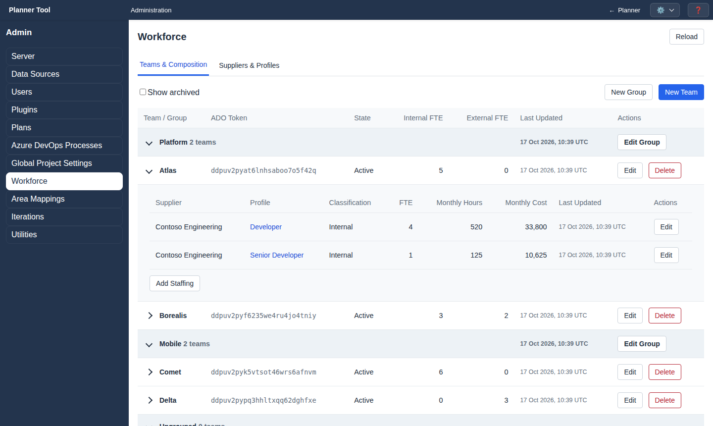
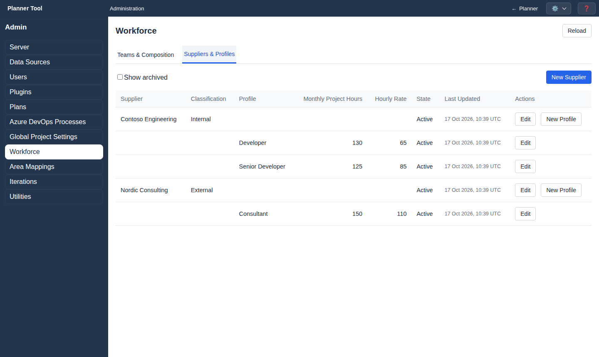

# Admin - Workforce

The **Workforce** section (`#workforce`) defines who can be allocated to work and what that capacity costs. It replaces the former Teams, People and Cost Configuration screens. Teams appear in the planner's Team Drill-down and allocation lists; staffing, profiles and suppliers feed the [Cost Analysis](plugin_cost.md) tool.

Permissions: `manage_workforce_teams` edits groups, teams and staffing; `manage_workforce_costs` edits suppliers and profiles. Controls you may not change are disabled.

The page has two tabs, **Teams & Composition** and **Suppliers & Profiles**, a **Show archived** checkbox and a **Reload** button.

## Teams & Composition

- **New Group** / **New Team** create definitions. Groups bundle teams (for example by department); teams without a group are listed under "Ungrouped".
- Each team row shows its **ADO Token** (the immutable allocation token stored in work item allocations), state, Internal and External FTE and last update, with **Edit** and **Delete**.
- Expand a team to see its staffing: supplier, profile, classification, FTE, monthly hours (FTE × the profile's monthly project hours) and monthly cost (monthly hours × hourly rate). **Add Staffing** adds a row; **Edit** changes or deletes one.
- Click a profile link to edit that profile.

Dialogs:

| Dialog | Fields |
| --- | --- |
| Group | Name, Short Name, Archived (edit only) |
| Team | Name, Short Name, Group, Archived (edit only) |
| Staffing | Supplier, Profile, FTE; **Edit Selected Profile**; **Delete Staffing** when editing |

## Suppliers & Profiles

- **New Supplier** creates a supplier (Name, **External supplier**, Archived). External suppliers count as External FTE and cost.
- **New Profile** on a supplier row creates a profile with **Monthly Project Hours** and **Hourly Rate**. The profile dialog lists the staffing rows it affects with their current hours and cost.

## Available project hours

Define each profile's monthly hours as **project hours**, not total working hours. Project hours are the time available for delivering project work and form the capacity against which work is allocated.

Exclude time unavailable for project delivery, such as holidays, absences and company administration, when determining available project hours. The remaining hours up to total working hours are not specified in PlannerTool; the tool does not track or deduct them separately.

Maintenance, internal projects and other activities that consume this project capacity must instead be planned as work with explicit start and end dates and team allocations. There is no implicit buffer for them. Agree on this capacity basis with Product Owners and Project Managers before reviewing allocation graphs. See [Planning principles](best_practices.md#planning-principles).

## Archiving and deleting

- Archive groups, teams, suppliers and profiles with the **Archived** checkbox in their dialog. Archived items are hidden unless **Show archived** is on, and stay available for existing references.
- **Delete** on a team opens "Permanently Delete Team", which lists the staffing, availability lists, allocations and selections affected. Deletion requires acknowledging that historical calculations may become unusable; **Archive Instead** is offered as the safer option.
- Changes affect calculations using current definitions, including historical ones.

Workforce definitions can be exported and imported as YAML in [Admin - Utilities](admin_utilities.md).
