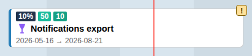

# Card Anatomy & Recommended Workflows

## Card anatomy

- **Left edge**: coloured in the plan's colour. Cards with children also show a fold chevron here.
- **Allocation badges** (Normal mode only): the dark badge is the task's organisation load (its share of the whole organisation's capacity). The coloured badges show each allocated team's percentage, in the team's colour. Badges of teams not selected in the Sidebar are dimmed. An ℹ️ marker means the task has children, and the children's allocations are used in calculations.
- **Type icon and title**: the work item type icon (for example 👑 Epic, a cup for Feature, a book for User Story) and the title.
- **Dates**: start → end (Normal mode only).
- **Ancestor** label: the task was pulled in only as context for a descendant; its other child branches are not loaded.
- **Warning marker (!)**: a [Reconciliation](plugin_reconciliation.md) finding. Toggle the markers with **Show on task cards** in the Reconciliation panel.

Visual states:

- Selected cards are highlighted.
- Modified cards (changed in the active scenario) are marked as dirty.
- Completed tasks are struck through.
- Unplanned tasks appear as dashed ghost labels instead of cards.
- Cards inside a group carry the group's colour.

## Interactions

- Click: opens the [Details Panel](details.md).
- Drag (editable scenario): move the task in time. See [Timeline & Board](timeline.md).
- Right-edge handle (editable scenario): change the end date.
- Double-click (editable scenario): revert the card's local changes.
- Right-click (editable scenario): add the task to a group or remove it. See [Groups](groups.md).

## Recommended workflows

1. Baseline review and dataset preparation
  - Select plans in the Plan menu, use the Scope menu to include the related work you need for context, and narrow the board with the Sidebar's Task Filters.
  - Check **N on board** (Board information) to understand how the displayed set was reached.

2. Load balancing across teams
  - Copy the baseline into a scenario first (Scenario → Copy Scenario).
  - Inspect the allocation badges and the [Graph Area](graph.md) for overloaded periods (shaded in the graph).
  - Click a task and adjust team allocations in the Details panel. Use the mouse wheel over an allocation field for quick steps.

3. Rescheduling work
  - Drag cards horizontally. Moving a parent also shifts its planned descendants.
  - Re-check the graph and the Reconciliation findings after rescheduling.

4. Preparing changes for Azure DevOps
  - Save the scenario (💾 in the Scenario menu), then click ☁️ (Publish scenario) to open the [Review Modal](review_modal.md).
  - Select the changes to write and confirm with **Publish selected changes**.

5. Exporting
  - Use [Export Timeline](plugin_export.md) for SVG/PNG images or JSON/CSV data.

## Troubleshooting

- Card cannot be moved: Baseline is read-only. Copy it into a scenario first.
- Allocations not visible: switch to Normal card mode and check that the task has team allocations in the Details panel.
- Dependency lines missing: enable **Dependencies** in the Scope menu.
