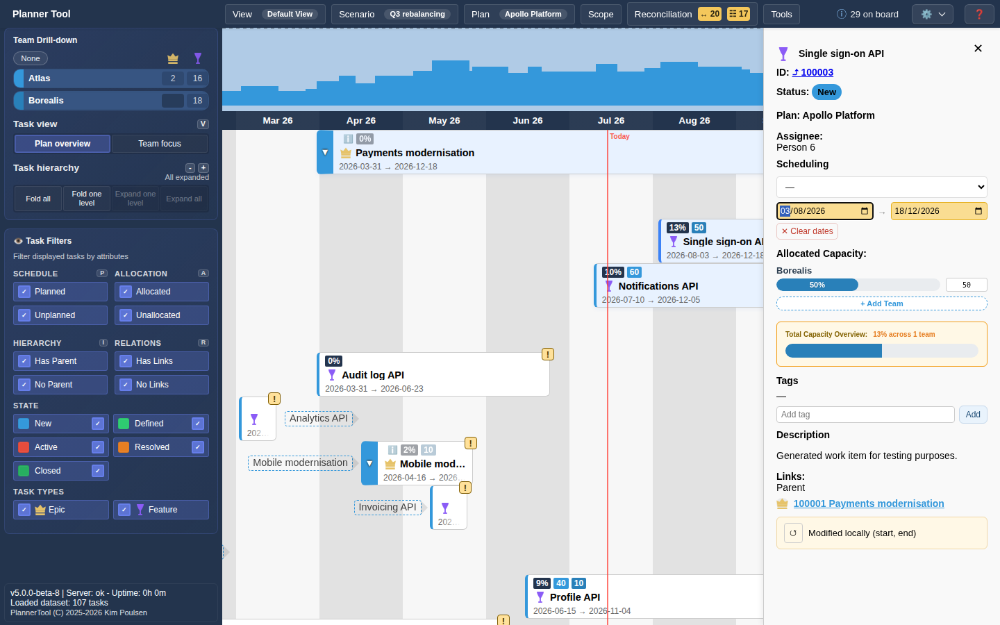
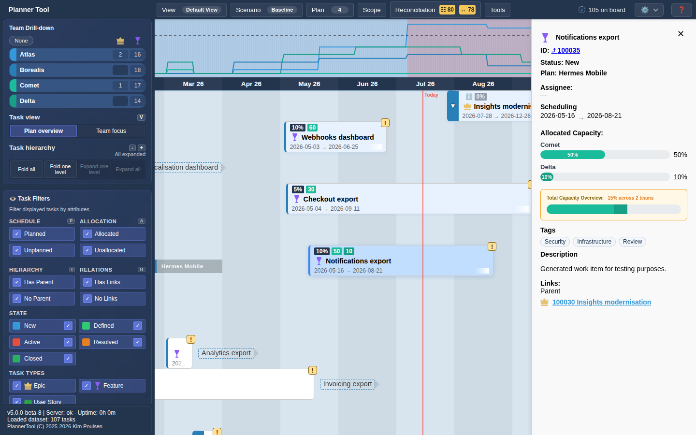
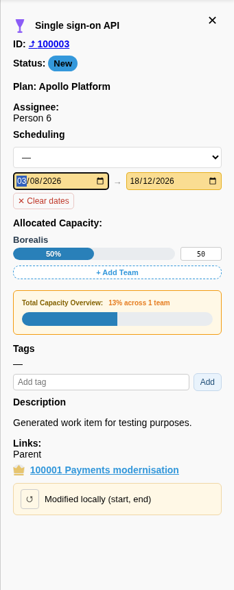

# Details Panel

Click a card to open the Details panel on the right. It shows all fields of the selected task. In Baseline the panel is read-only; in an editable scenario the state, dates, allocations and tags can be changed. Close it with ✕.

In Baseline, fields are shown as plain values:

## Header

- **Title** with the work item type icon.
- **ID**: opens the work item in Azure DevOps in a new tab.
- **Status**: the current state. In a scenario, click it to choose another state. A changed state shows the original value as "(was …)".
- **Plan**: the plan that owns the task.
- **Assignee**: the person assigned in Azure DevOps, if any.

## Scheduling

Every work item needs its own start and end dates to be planned. Dates are not inferred from hierarchy, state, dependencies or other factors; items without both dates stay unplanned. See [Planning principles](best_practices.md#planning-principles).

- **Schedule preset**: choose a named iteration (timebox) to set both dates at once. The list comes from the iteration sets configured for the plan (see [Iterations](iterations.md)); it shows "No date presets available" when none are configured.
- **Start → End**: date fields. Changes show immediately on the board.
- For tasks with children, extra buttons align the dates with the children: **Snap start to earliest child** (⇤), **Shrink to children** (fits the task to the span of its children) and **Snap end to latest child**. Hover a button for its name.
- **✕ Clear dates** removes both dates so the task becomes unplanned.

Choosing a preset or an alignment button is an explicit action that sets dates; it is not implicit date resolution.

Date fields, presets and alignment buttons retain allocation percentages in **Percent** mode and preserve effort in **Man-days** mode. To choose either behavior for an individual resize without changing entry units, use the card's [two-part resize handle](card_workflows.md#resizing-a-task): upper teal keeps allocation; lower ochre keeps effort. The whole handle takes the chosen color for the duration of the drag.

## Allocated Capacity

- One row per allocated team with a bar and a value field. Bars are always percentages.
- Choose **Percent** (default) or **Man-days** as entry unit in Configuration. The heading then reads "Allocated Capacity (man-days)". This browser-local setting changes the entry unit, not the estimate's accuracy.
- Enter whole numbers. The mouse wheel over a field changes percentages in 10% steps and man-days in single-day steps. Values display rounded up; leaving a rounded value unchanged keeps the stored precision.
- **+ Add Team** opens a small form: choose the team, enter a value and click **Add**.
- **Total Capacity Overview** shows the task's organisation load and the number of teams.
- Man-days are team-specific and not comparable between teams as measures of output, productivity or cost. Allocations support forward resource planning; they are not automatically delivery commitments. See [Capacity and allocations](best_practices.md#capacity-and-allocations).

## Tags

Existing tags are shown as chips. In a scenario remove a tag with its ✕, or type a new tag and click **Add**.

## Description

The work item description from Azure DevOps (read-only). PlannerTool's allocation block is hidden.

## Links

Parents, children, dependencies and related tasks, grouped by link type. Each entry shows the type icon, ID and title (the title only when the task is loaded). Click the link to open the item in Azure DevOps, or the icon to centre the task on the board.

## Modified locally

When a task has changes in the active scenario, a box lists the changed fields. Click ↺ to revert them, or double-click the card on the board.

## Step-by-step: change dates and allocations

1. Make sure an editable scenario is active (Scenario → Copy Scenario creates one).
2. Click the card. The panel opens with the task's details.
3. Change **Start** and **End**, or choose a **Schedule preset**.
4. Change an allocation value, or use **+ Add Team** to add a team.
5. Save the scenario with 💾 in the Scenario menu.
6. To write the changes to Azure DevOps, click ☁️ (Publish scenario) and confirm in the [Review Modal](review_modal.md).
7. To undo, click ↺ in the Modified box or double-click the card.

Allocations are stored in a PlannerTool block in the work item description, so they round-trip to Azure DevOps.
