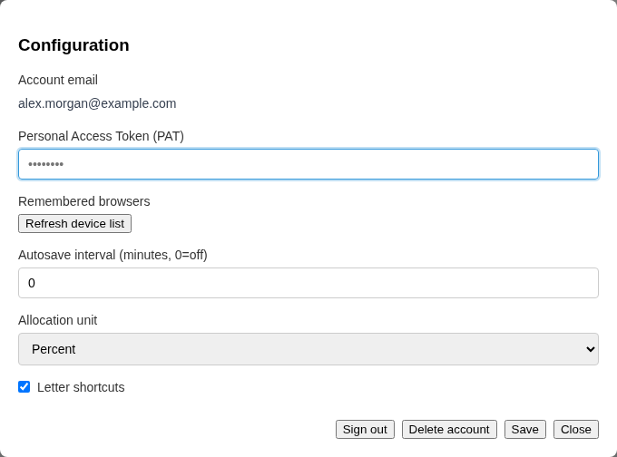

# Initial user setup

Your installation chooses how you sign in. If it uses Microsoft Entra, select
**Sign in** and follow your organization's sign-in prompts. Azure DevOps access
uses your delegated identity; contact your administrator if access or consent is
required. See [Account Access](account_access.md#entra-sign-in).

On an enrollment-based installation, enroll your account and save the account key before
continuing. On another browser or after sign-out, use the same Enrollment form
with your latest account key, then save its replacement. See
[Account Access](account_access.md) for enrollment, deletion, and administrator
reset instructions.

## Configuration

Open the gear (Settings) menu and choose **Configuration** to manage your account and personal preferences. Available authentication controls depend on the installation. Server, plan and team settings are managed by your administrator.

Fields
- Account email: the signed-in account identity, displayed as non-editable text.
- Personal Access Token (PAT): in PAT-based installations, enter your Azure DevOps PAT. Demo or static sources may not need one. Entra installations do not use this field.
- Remembered browsers: in enrollment-based installations, use **Refresh device list** to inspect or revoke browsers. See [Account Access](account_access.md).
- Autosave interval (minutes, 0=off): saves changed editable scenarios to your account at this interval. This is a browser preference; it does not publish changes to Azure DevOps. See [Scenarios & Saving](scenarios.md).
- Allocation unit: enter allocations in Percent (default), Man-days or Hours. Hours reflect each team's workforce project-hour budget. This is a browser-local preference.
- Letter shortcuts: enables or disables the plain-letter board shortcuts in this browser.

Buttons: **Sign out**, **Delete account** (see [Account Access](account_access.md)), **Save** and **Close**.

The following steps apply only if your installation uses a PAT.

1. Enter your Azure PAT if the installation requires it.
2. Save the configuration.
3. Reload the application.

Now you should see projects defined on the server and teams. If this works, you are set for using the application.

### Tips
- If projects or teams do not appear after saving configuration, refresh the browser.
- Verify PAT scopes and expiry if refresh or write operations fail.

### How do I generate a Personal Access Token (PAT) when using ADO as the backend?
When you are logged into Azure devops do as follows:

1. Click the "User Settings" button next to your profile image.
2. Select "Personal access tokens".
3. Generate a token by clicking "+ New token".
4. Give it a name "PlannerTool", and assign only the **Work Items** (Read, Write, Manage) and **Wiki** (Read, Write) permission scopes.
5. Set the expiry date to as far in the future it is allowed.
6. Save the token and copy the string to a safe place.

### I cannot refresh delivery plan markers
You need to have the right permission in Azure DevOps: "Manage Delivery Plans"
