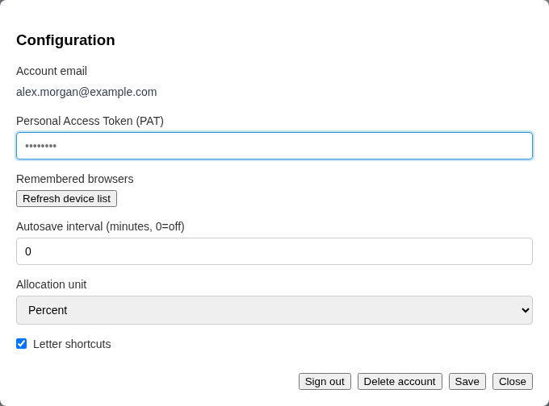

# Initial user setup

On your first visit, enroll your account and save the account key before
continuing. On another browser or after sign-out, use the same Enrollment form
with your latest account key, then save its replacement. See
[Account Access](account_access.md) for enrollment, deletion, and administrator
reset instructions.

## Configuration

Open the gear (Settings) menu and choose **Configuration** to set your Azure access token and personal preferences. Server, plan and team settings are managed by your administrator.

Fields
- Account email: the signed-in account identity, displayed as non-editable text.
- Personal Access Token (PAT): paste a PAT from Azure DevOps with Work Items (Read/Write/Manage) scope, and Wiki permission (read/write). Installations using a demo or static data source may not need one.
- Remembered browsers: lists the browsers that remember your account; use **Refresh device list** to update it. See [Account Access](account_access.md) to revoke a browser.
- Autosave interval (minutes, 0=off): stored as a browser preference. Scenario changes are currently saved explicitly with the Save action in the Scenario menu (see [Scenarios & Saving](scenarios.md)).
- Allocation unit: enter allocations in Percent (default) or Man-days. This is a browser-local preference.
- Letter shortcuts: enables or disables the plain-letter board shortcuts in this browser.

Buttons: **Sign out**, **Delete account** (see [Account Access](account_access.md)), **Save** and **Close**.

If you don't know how to get a PAT, see below.

1. Enter your Azure PAT if the installation requires it.
2. Save the configuration.
3. Reload the application.

Now you should see projects defined on the server and teams. If this works, you are set for using the application.

### Tips
- If projects or teams do not appear after saving configuration, refresh the browser.
- Verify PAT scopes and expiry if refresh or write operations fail.

### How do I generate a Personal Access Token (PAT) when using ADO as the backend?
When you are logged into Azure devops do as follows:

1. Click the "User Settings" button next to your profile image.
2. Select "Personal access tokens".
3. Generate a token by clicking "+ New token".
4. Give it a name "PlannerTool", and assign only the **Work Items** (Read, Write, Manage) and **Wiki** (Read, Write) permission scopes.
5. Set the expiry date to as far in the future it is allowed.
6. Save the token and copy the string to a safe place.

### I cannot refresh delivery plan markers
You need to have the right permission in Azure DevOps: "Manage Delivery Plans"
