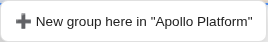
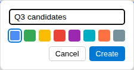
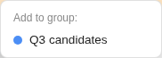
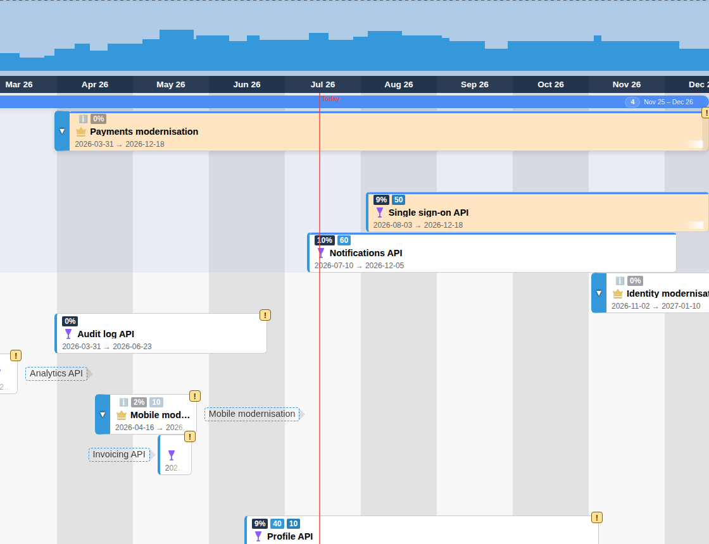

# Groups (Virtual Nested Groups)

Groups organise tasks into named, collapsible clusters directly on the board without creating work items in Azure DevOps. A group belongs to a single plan, has a name and a colour, and can be nested inside another group. Use groups for things like "next sprint candidates" or thematic clusters that you do not want to model as a bucket work item.

Groups can only be changed in an editable scenario. In Baseline the right-click menu says "Switch to an editable scenario to change groups".

## Creating a group

1. Select a single plan in the Plan menu. With several plans selected, the board menu says "Select a single plan to create groups".
2. Right-click empty board background where the group should go.
3. Choose **➕ New group here in "plan"**, or **➕ New sub-group in "group"** when you right-click inside an existing group. A caret line shows where the group will be inserted.
4. Enter a name, choose a colour and click **Create**.

## Adding tasks

Right-click a card and choose a group under **Add to group:**. Its descendants come with it. If the plan has no groups yet, the menu says "No groups — right-click board to create one". A card that is already in a group offers **Remove from group**.

## Group anatomy

- A group is drawn as a coloured header bar spanning its members' dates, showing its name, the number of items and the date range. Its members are shown in a tinted area below it.
- Member cards carry the group's colour.
- A group has no dates of its own; its extent follows its member tasks.
- Sub-groups are drawn inside their parent group.

## Working with groups

Right-click a group to:

- **➕ Add sub-group**
- **⬆️ Move up** / **⬇️ Move down** among its siblings
- **✏️ Update group**: change name, colour or parent group
- **🗑 Delete group**: removes the group (and its sub-groups); the tasks themselves are not deleted

Click a group's header to collapse or expand it.

## Scope and persistence

- Groups are scenario-aware: group changes made in a scenario stay in that scenario until published.
- Pending group changes are listed in the [Review Modal](review_modal.md) together with task changes. Groups are stored by PlannerTool (or the configured groups backend), not as Azure DevOps work items.
