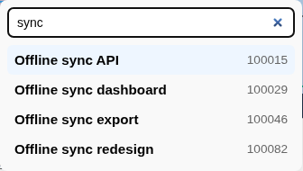

# Keyboard Shortcuts

PlannerTool uses plain-letter board shortcuts, plus local Enter/Escape conventions in dialogs and inline edit fields.

## Global shortcuts

Press these letters without Ctrl, Shift, Alt or Meta while working on the board:

| Shortcut | Action |
| --- | --- |
| `f` | Find a task: open Search |
| `t` | Cycle Timeline Scale (3 Months → Weeks → Months → Quarters → Years) |
| `c` | Cycle Cards (Normal → Compact → Packed) |
| `s` | Switch task Sort between Rank and Date; unavailable in Packed mode |
| `g` | Cycle Graph Type through the currently available plan/container levels |
| `v` | Switch task View between Plan overview and Team focus |
| `h` | Toggle relationship Highlighting |
| `p` | Cycle Schedule: Planned / Unplanned |
| `a` | Cycle Allocation: Allocated / Unallocated |
| `i` | Cycle Hierarchy: Has Parent / No Parent |
| `r` | Cycle Relations: Has Links / No Links |

The display shortcuts use the same controls as the [View menu](topmenu.md).
Task view is also available in the [Sidebar](sidebar.md).
The former Ctrl+Shift search and display bindings are no longer used.

### Filter cycles

Each filter key cycles **both on → first option only → second option only → both on**.
The first and second options follow the order shown in the table and Sidebar.
The cycle never turns both options off and updates the pair in one operation.

Shortcuts respect the same disabled state as the Sidebar buttons. A disabled option
keeps its current value; states requiring it to change are skipped. If no other
state is reachable, the key does nothing. In Packed mode, `p` cannot enable
Unplanned tasks or turn off the only enabled Planned option.

### Task hierarchy

| Shortcut | Action |
| --- | --- |
| `+` | Expand one hidden hierarchy level |
| `-` | Fold one visible hierarchy level |

These perform the same actions as the Sidebar's **Expand one level** and
**Fold one level** buttons. Shift-generated `+` and numpad `+` both work.
At the fully expanded/folded limit, or when hierarchy folding is unavailable
(including Packed mode), there is no change. Ctrl + plus/minus still zooms.

Sidebar hints use the same shortcut-pill style as the View menu, including `V`
for Task view and `-` / `+` for Task hierarchy. Letter hints are uppercase labels,
not a requirement to hold Shift.

### Typing and focus

Letter shortcuts do not run while typing in inputs, textareas or editable content,
or while focus is inside a menu, dialog, listbox or other text/value-entry control.
This includes the Search input and fields inside nested components.
Application modals suspend background shortcuts. Keys already handled by a control
and text composition are left alone; holding a letter does not repeatedly trigger it.

To return to board shortcuts, close the menu or dialog and move focus to the board.

### Turn letter shortcuts off

Open the Gear button's Configuration dialog, clear **Letter shortcuts**, then
choose **Save**. The choice takes effect immediately and is remembered in this
browser across reloads. Check and save it again to re-enable the letters.
This setting also controls the plain `+` and `-` hierarchy shortcuts.
Zoom controls and local Enter/Escape keys remain available when letters are off.

## Board zoom

Zoom shortcuts are unchanged:

| Shortcut | Action |
| --- | --- |
| `Ctrl` `+` / `Ctrl` `=` | Zoom the timeline board in |
| `Ctrl` `-` | Zoom the timeline board out |
| `Ctrl` `0` | Reset timeline board zoom |
| `Ctrl` + mouse wheel | Zoom the timeline board in/out, centered on the cursor |

Keyboard zoom leaves editable controls and menus/dialogs alone. Ctrl + mouse wheel
continues to zoom the board independently of the letter-shortcut setting.

## Search tool

Press `f` on the board to open Search. Type part of a task title or ID; matching tasks are listed below the field.

Once open, letters enter the query rather than trigger board shortcuts:

- `Arrow Down` / `Arrow Up`: move the highlighted result.
- `Enter`: open the highlighted result.
- `Escape`: close the search tool.

## Modals and inline edit fields

Across modals (rename/clone scenario or view, save view, color popover, help/info dialogs) and inline edit fields (feature state, tags, team capacity percentage):

- `Enter`: confirm/save the current field or dialog.
- `Escape`: cancel the edit or close the dialog without saving.
- In the tag input on the [Details Panel](details.md), `Enter` or `,` (comma) commits the current tag.

## Tool-specific shortcuts

- [Tool - Link Editor](plugin_link_editor.md): `Escape` cancels a pending link action (after clicking a colored zone, before clicking a target card).
- [Tool - Annotations](plugin_annotations.md): `Delete` or `Backspace` removes the selected annotation; `Escape` cancels an in-progress note edit or closes the icon picker.

Local tool keys remain available when letter shortcuts are disabled.
