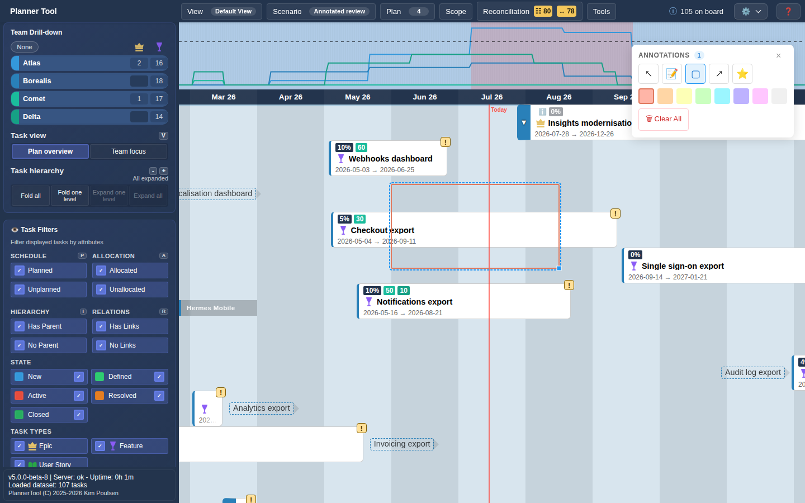

# Tool - Annotations

Annotations let you draw notes, shapes and lines directly on the timeline board to highlight areas, leave comments for yourself or your team, or visually group related cards.

## Opening the tool

Open the Top Menu → Tools → "Annotations". A floating "Annotations" toolbar appears with the drawing tools, a colour palette and the number of annotations. Drawing requires an editable scenario; in Baseline the toolbar shows no tools.

## Tools

- Select: pick and move existing annotations.
- Note: places a text box; click the board to add one, type your text, then click elsewhere to finish.
- Rectangle: click and drag to draw a rectangle around an area or a set of cards.
- Line: click a starting point and drag to an endpoint to draw a line or arrow between concepts.
- Icon: click the board to place a small marker at that point.

Pick a colour (Coral, Peach, Lemon, Mint, Sky, Lavender, Pink or Cloud) before drawing; it is used as fill and stroke. Hover a tool button to see its name.

## Managing annotations

- The toolbar title shows a count of annotations in the current scenario.
- Use "🗑 Clear All" to remove every annotation in the current scenario; you will be asked to confirm since this cannot be undone.
- Select an annotation with the Select tool to move or delete it.

## Scope and persistence

- Annotations are saved per scenario — switching scenarios shows that scenario's own annotations.
- Annotations are local to PlannerTool and are never written back to Azure DevOps or synced with work item comments.
- Annotations are included when you use [Export Timeline](plugin_export.md).
