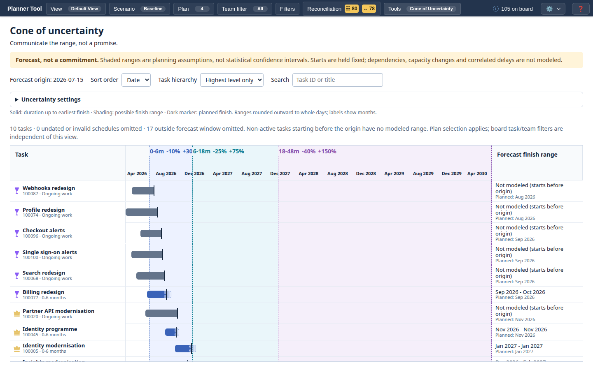

# Cone of Uncertainty

Open **Tools > Cone of Uncertainty** to discuss illustrative task finish ranges
for the selected plans. This is a read-only forecast: it does not change task
dates or make a delivery commitment.

The solid bar reaches the earliest modeled finish, the shading shows the range,
and the dark marker shows the planned finish. Global and selected-plan events
appear as labeled lines or bands. Click a task to inspect its details.

Choose **Highest level only** or **All levels**, search by ID or title, and sort
by rank or latest forecast finish. Task type and state filters are independent
of the board's selections and are restored when the tool closes.

Under **Uncertainty settings**, set three increasing end months and lower and
upper duration percentages. Save preferences in this browser or reset to the
defaults. The scope is chosen by task start relative to today; already active
work uses its remaining duration. Undated tasks, invalid schedules and tasks
outside the forecast window are counted and omitted. Non-active tasks starting
before today have no modeled range.

These are assumptions, not statistical confidence intervals. Starts are held
fixed; dependencies, capacity changes and correlated delays are not modeled.
Review the assumptions and underlying schedules before using the visualization.
