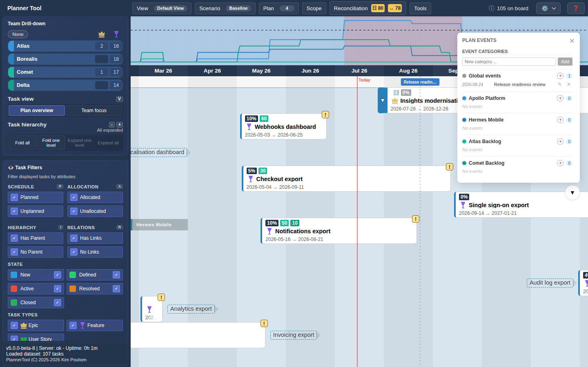

# Tool - Plan Events

Plan Events places your own milestones and events on the timeline, such as "Sprint review", "Launch window" or "Steering committee". Events belong to a plan and are independent of Azure DevOps Delivery Plans (see [Plan Markers](plugin_markers.md) for those).

## Opening the tool

Open **Tools → Plan Events**. A floating "Plan Events" panel opens with an **Event Categories** section, a **Global events** section for events that are not tied to a plan, and one section per selected plan. Each section lists its events (newest first) with a count.

## Adding and editing events

1. Click **+** (Add event) next to a plan, or next to Global events.
2. Enter a start date, an optional end date for multi-day events, a title and a category.
3. Click **Add** (or press Enter in the title field).

Use ✎ to edit an event (including moving it to another plan) and ✕ to delete it.

## Categories

- Add a category with the **New category…** field and **Add**; rename it with ✎ and delete it with ✕.
- Click a category name to hide or show its events on the timeline and in the panel.
- Click ★ to mark a category as special; its events are drawn with a black border.

## On the timeline

Events appear as labelled markers in a strip above the board, with a dashed line down the timeline at their date. Multi-day events span their date range.

## Storage

Events are shared: everyone sees the same events for a plan, independent of the active scenario. Depending on the server configuration they are stored in PlannerTool's database or on an Azure DevOps wiki page (see [Admin - Data Sources](admin_data_sources.md)). Events are not work items.
