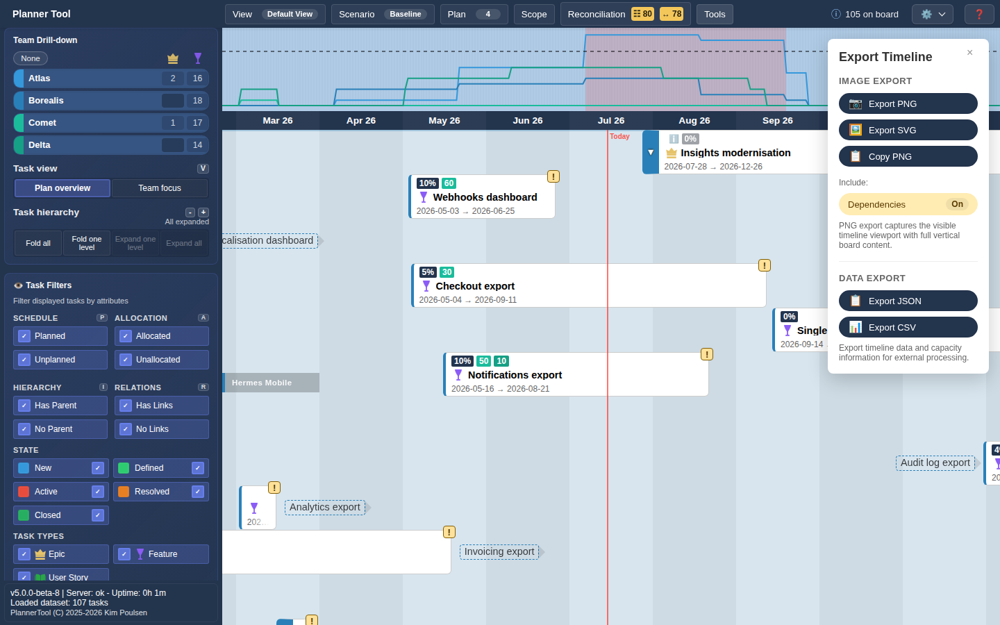

# Exporting Timelines and Images

PlannerTool includes an export tool to produce a portable representation of the current timeline for sharing or offline review.

## What you can export

Image Export:
- **Export SVG**: downloads a vector image of the timeline. Best for high-quality, scalable output.
- **Copy PNG**: copies a raster image to the clipboard for pasting into slides, chat or email.
- **Include**: toggle **Annotations** and **Dependencies** to include them in the image.

Data Export:
- **Export JSON**: downloads `timeline-export.json` with plans, teams, the daily plan and team capacity series, the tasks and view settings.
- **Export CSV**: downloads `timeline-export.csv` with one row per date and one column per plan, holding that plan's daily allocated capacity (%).

## Where to find the export tool
- Open the Top Menu → Tools → Export Timeline. Close the panel with ×.

## Usage notes
- The export captures the visible timeline viewport and applied filters. Pan/zoom to the desired view before exporting.
- Annotations added via the annotations plugin are included in the export when enabled.
- Exports may include layered SVG elements; some styling may vary by browser when converting to PNG.

## Troubleshooting
- If exported text looks different from the on-screen font, check browser font availability and try exporting as SVG for fidelity.
- Large timelines may produce very large PNG files — consider exporting a cropped view or a smaller viewport.

## Limitations
Browsers cannot export their own page content directly, so the tool renders the board independently as SVG.
This SVG is either exported directly or rasterised to PNG.
SVGs can render all loaded tasks. PNG rasterisation is limited to a height of 32768 pixels, so copying a very large board as PNG may fail.
Because of the separate rendering, exported cards may look slightly different from the screen.
