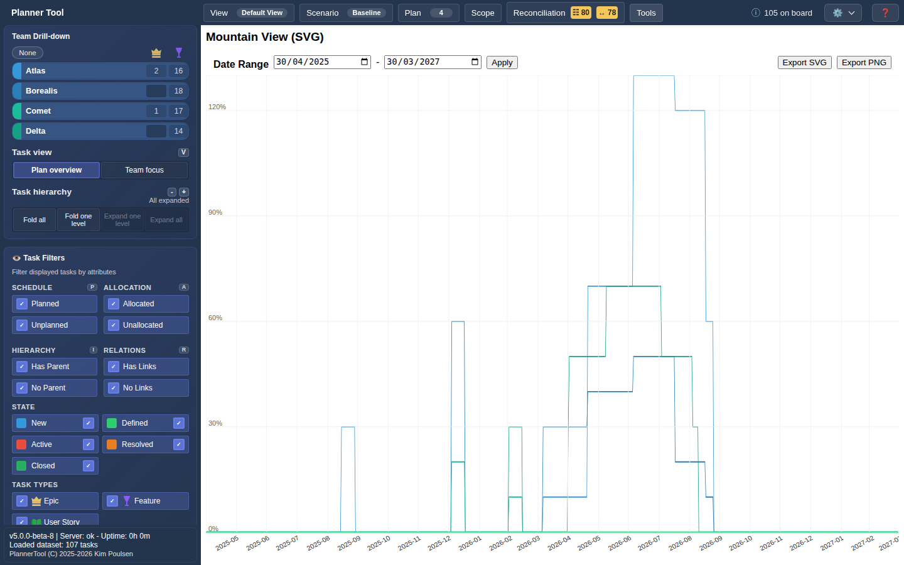

# Tool - Graph Viewer

Graph Viewer opens the capacity allocation graph as a large "Mountain View" chart. It shows the same data as the [Graph Area](graph.md), at full size for a closer look, presentations or export.

## Opening the tool

Open **Tools → Graph Viewer**. The board area is replaced by the chart. Select the tool again in the Tools menu to return to the timeline.

## Controls

- **Date Range**: choose a start and end date and click **Apply** to change the displayed period.
- **Export SVG** / **Export PNG**: download the chart as an image.
- Hover the chart to see the date, the allocation per plan or team and the total for that day.

## Usage

Everything described in [Graph Area](graph.md) — plan levels, team lines at the lowest level, organisational weighting at higher levels — applies here as well. The graph type follows **View → Graph Type**.
