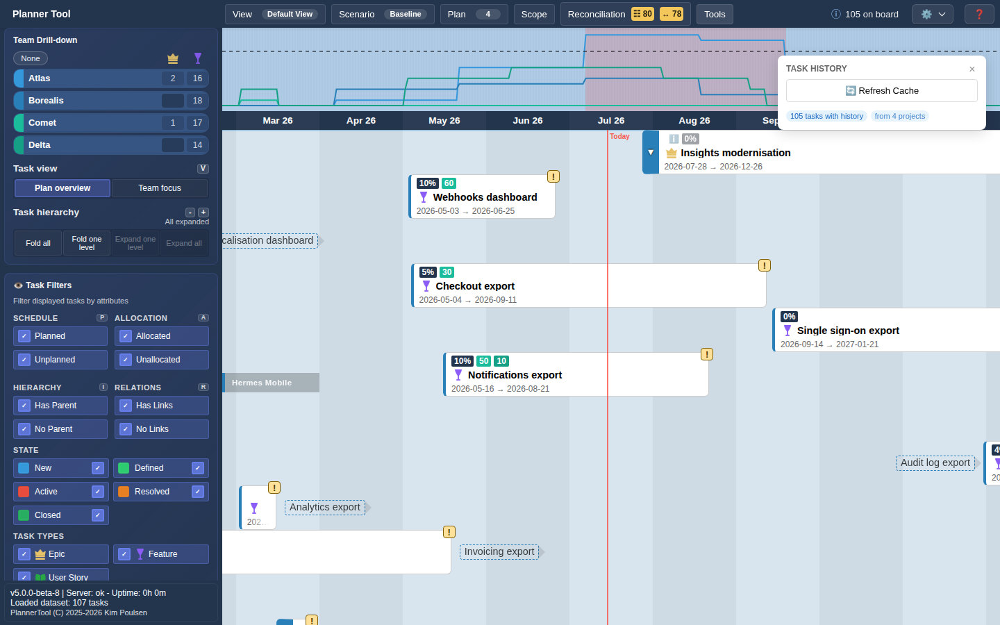

# Tool - Task History

Task History shows how the dates of tasks have changed over time, based on the Azure DevOps revision history.

## What it shows

On the board, cards whose dates changed get two history lines: one tracing earlier start dates and one tracing earlier end dates. Circles on the lines mark each change; hover a circle to see when the dates moved and who moved them.

This helps when tracing the lifecycle of work. Items that move around a lot may be less important than assumed, or hard to break down into understandable work.

## How to use it

1. Select the plans you want to inspect in the Plan menu.
2. Open **Tools → Task History**. A floating "Task History" panel opens and shows progress while history is retrieved ("Investigating", plans left, tasks checked).
3. When loading is done the panel shows how many tasks have history and from how many plans. "No history data available" means no revisions were found.
4. **🔄 Refresh Cache** fetches the history again from Azure DevOps. Normally this is not needed; history is cached for 24 hours by default.
5. Close the panel with × or deselect the tool in the Tools menu.
