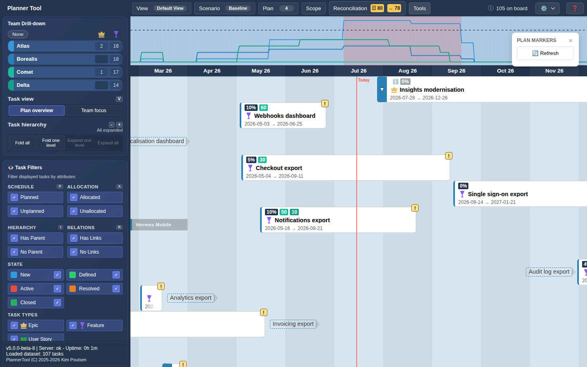

# Tool - Plan Markers

Plan Markers shows milestone markers from Azure DevOps Delivery Plans on the timeline, so milestones tracked there (for example "M1: Planning" or "M3: Release") appear alongside PlannerTool's schedule.

## Requirements

- Your Azure DevOps organisation has Delivery Plans with markers.
- Your administrator has mapped and enabled those delivery plans for your plans' area paths in [Admin - Area Mappings](admin_area_mappings.md).
- Your Personal Access Token can read the delivery plans (see [Getting Started](getting_started.md)).

## Using the panel

1. Open **Tools → Plan Markers**. A floating "Plan Markers" panel opens and fetches markers for the selected plans.
2. The panel shows how many markers are displayed; "Filtered by selected teams/projects" appears when the current selection hides some of them.
3. A legend lists every delivery plan contributing markers, with a colour swatch and a count. Click a row to hide or show that plan's markers; hidden plans are greyed out.
4. **🔄 Refresh** fetches the markers again.
5. Hover a marker on the timeline to see its plan and label.

The demo data in these screenshots has no delivery plan markers, so only the empty panel is shown.

## Notes

- Plan Markers is read-only; PlannerTool does not write marker changes back to Azure DevOps.
- For your own milestones, use [Plan Events](plugin_events.md).
- If markers do not refresh, check that your Personal Access Token is valid and allowed to read delivery plans.
