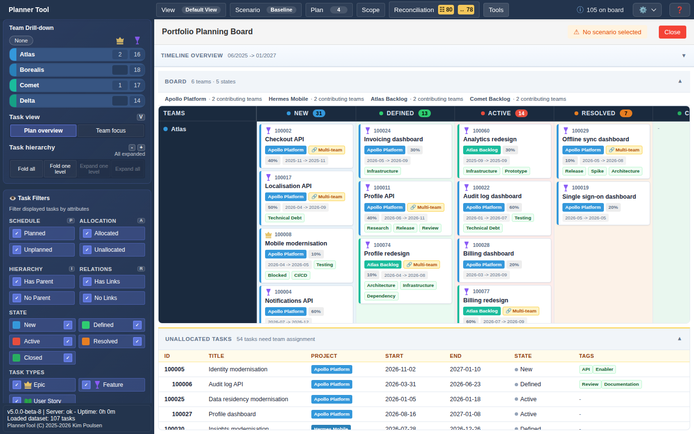

# Tool - Portfolio Board

Portfolio Board is a Kanban-style view of the selected work: teams as rows, states as columns and tasks as cards in each cell. It gives a quick read of "what is where" across teams, independent of the timeline layout.

## Opening the tool

Open **Tools → Portfolio Board**. The board area is replaced by the "Portfolio Planning Board"; the top menu and Sidebar stay available. Close it with **Close** or by selecting it again in the Tools menu.

## Layout

- **Toolbar**: shows "No scenario selected" while Baseline is active (the board is then read-only) and the number of pending changes in a scenario.
- **Timeline overview** (collapsible): bars for the same tasks on a compact timeline.
- **Board** (collapsible): the header shows the number of teams and states, and each plan's number of contributing teams. Rows are the teams selected in the Sidebar's Team Drill-down; columns are the workflow states with task counts. Cards show ID, title, owning plan, the team's allocation, dates and tags. "Multi-team" marks tasks allocated to several teams.
- **Unallocated tasks** (collapsible): a table of tasks without any team allocation (ID, title, plan, start, end, state, tags), so they can be assigned.

## Working with cards

- Click a card or an unallocated row to select the task and open the [Details Panel](details.md).
- In an editable scenario, drag a card to another state column in the same team row to change its state. The change goes into the active scenario.

## Scope

The board follows the selected plans, Scope, the Sidebar's task filters and team selection.
