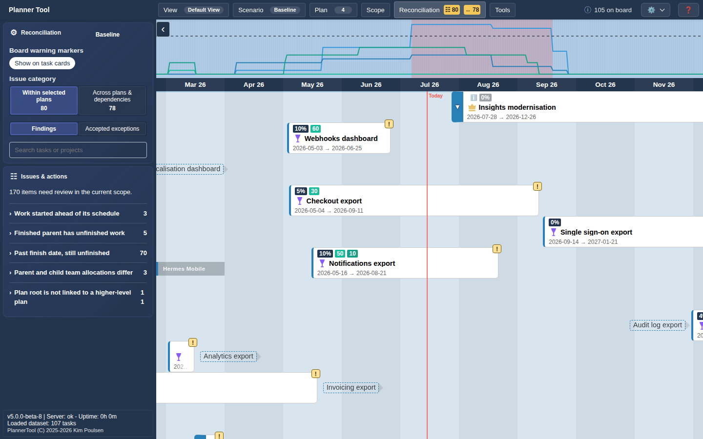
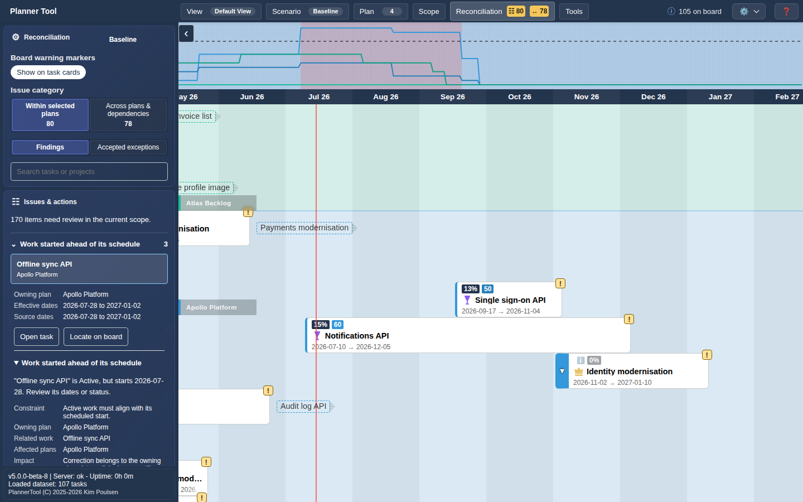

# Reconciliation

Reconciliation continuously reviews the tasks in scope for schedule conflicts and plan quality issues. It is a menu in the top bar, next to Scope. The badges on the menu count affected tasks per category, so you can see at a glance whether anything needs attention.

Click **Reconciliation** to open the review. It replaces the Sidebar while open; click the menu again (or press Escape inside the panel) to close it. The ‹ button on the panel edge hides the toolbox to give the board more room.

## Controls

- **Save scenario** / **Publish scenario**: shortcuts to save the active scenario and open the [Review Modal](review_modal.md) (editable scenarios only).
- **Board warning markers → Show on task cards**: shows a ! marker on every affected card.
- **Issue category**:
  - **Within selected plans** (☷): plan quality findings inside the selected plans, for example work that started ahead of its schedule or is past its finish date but unfinished.
  - **Across plans & dependencies** (↔): schedule conflicts across hierarchy and dependency links, for example tasks dated outside their ancestor's dates or starting before a predecessor.
- **Findings** / **Accepted exceptions**: switch between open findings and exceptions you have accepted.
- **Board context** (across-plans category): **Relevant context** limits the board to the tasks involved; **All tasks** keeps the full board.
- **Search tasks or projects**: filters the list.

## Issues & actions

Findings are grouped by issue class, each with a task count. Expand a class and select a task to see its details: owning plan, effective and source dates, the constraint that is violated, related work, affected plans and impact.

Depending on the finding you can:

- **Open task** (opens the Details panel) or **Locate on board**; for relationships also **Open related task** / **Locate related task**. These never change data.
- **Edit dates**, choose a **Task state**, or **Edit dependency** to correct the data in the active scenario. Some corrections show an **Impact review** with the related work first.
- **Accept exception** with a reason when a discrepancy is deliberate. Acceptance does not change task data. It becomes invalid when any involved task changes, and can be withdrawn with **Undo acceptance**.

Corrections and exceptions require an editable scenario. In Baseline the panel says so and only navigation is available. Accepted exceptions are published together with the scenario (see [Review Modal](review_modal.md)).
