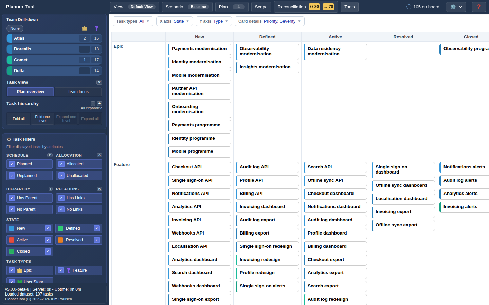

# Tool - XY Board

XY Board places tasks in a matrix built from any two fields, for example State against Priority, or Area Path against Type. Each cell holds the tasks matching that combination, which makes distribution and clusters easy to see.

## Opening the tool

Open **Tools → XY Board**. The board area is replaced by the matrix; the top menu and Sidebar stay available. Select the tool again in the Tools menu to return to the timeline.

## Controls

- **Task types**: which work item types are included.
- **X axis** / **Y axis**: the fields defining columns and rows. Options are State, Type, Iteration, Priority, Severity, Product Type, Tags and Area Path, plus custom fields present on the tasks.
- **Card details**: extra fields shown as badges on each card (for example Priority or Tags).

Column and row headers stay visible while you scroll.

## Working with cards

- Click a card to select it and open the [Details Panel](details.md).
- A task with a multi-valued field (such as Tags) appears once per value, so it can show up in several cells.
- Cards cannot be dragged on this board; use the timeline or the Details Panel to change fields.
- "No features match the current filter." means no task passes the current selection.

## Persistence

Axis choices, task type filter and card details are remembered, so reopening XY Board restores your last configuration.
