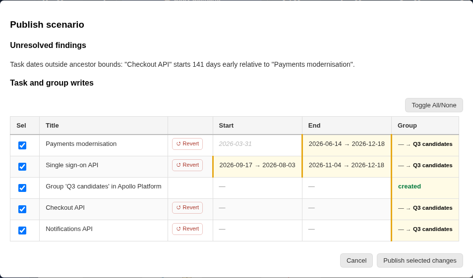

# Review Modal — Publish scenario

Publishing writes selected scenario changes back to Azure DevOps. Open it with ☁️ **Publish scenario** in the Scenario menu (on the active scenario when it has changes), or with **Publish scenario** in the [Reconciliation](plugin_reconciliation.md) panel.

## What the modal shows

- **Unresolved findings**: [Reconciliation](plugin_reconciliation.md) findings that would remain after publishing the selected changes and involve the written tasks.
- **Cross-plan impact**: selected writes to tasks owned by plans other than the ones you are working on, or findings spanning several plans.
- **Local-only changes**: scenario changes to fields that cannot be published; they stay in PlannerTool.
- **Scenario exception decisions**: Reconciliation exceptions accepted in this scenario.
- **Task and group writes**: one row per changed task or group. Columns show the changed fields as old → new. Publishable task fields are start, end, allocations (capacity), state, iteration path and tags. Group creations and membership changes are listed too.

## How to use it

1. Check the **Sel** checkbox of each row you want to publish. **Toggle All/None** selects or clears every row. Click a column header to toggle that field for all rows.
2. Use **↺ Revert** on a row to discard that item's local changes from the scenario.
3. Click **Publish selected changes**. Progress and results are shown in the modal; failed updates are reported inline.
4. **Cancel** closes the modal without writing anything.

## Safety notes

- Nothing is written until you click **Publish selected changes**.
- Only selected rows and fields are written; the rest stays in your scenario.
