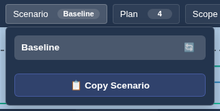
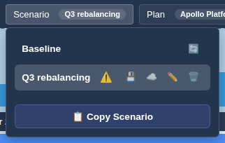
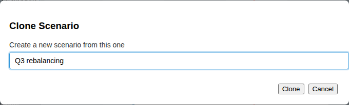

# Scenarios & Saving

## Baseline and scenarios

- **Baseline** is the live data loaded from Azure DevOps. It is always read-only: cards cannot be dragged and the Details panel cannot edit.
- A **scenario** is your own copy where you can change dates, allocations, states, tags and groups without touching the source data. Scenarios are stored on the server for your account.

## Scenario menu

- Click a scenario to make it active. The active scenario is shown as a badge on the Scenario menu.
- **🔄** (Baseline): refresh the baseline data from the server.
- **📋 Copy Scenario**: copy the active scenario (Baseline or another scenario) into a new scenario. The suggested name is the date plus a number, for example "07-15 Scenario 1".

Your own scenarios have these buttons:

- **⚠️**: the scenario has unsaved changes.
- **💾 Save scenario changes**
- **☁️ Publish scenario**: shown on the active scenario when it has changes. Opens the [Review Modal](review_modal.md).
- **✏️ Rename scenario**
- **🗑️ Delete scenario**

## Workflow

1. Open **Scenario → 📋 Copy Scenario**, enter a name and click **Clone**. The new scenario becomes active.
2. Make changes: drag cards, edit dates, states and allocations in the [Details Panel](details.md), or organise [groups](groups.md).
3. Save with 💾. Unsaved scenarios show ⚠️.
4. Use ☁️ **Publish scenario** to choose which changes to write to Azure DevOps.

The [Reconciliation](plugin_reconciliation.md) panel also has **Save scenario** and **Publish scenario** buttons.

## Safety notes

- Only the changes you select in the Review Modal are written. Nothing is pushed automatically.
- Scenarios shared with you as read-only cannot be edited; copy them to make your own version.
