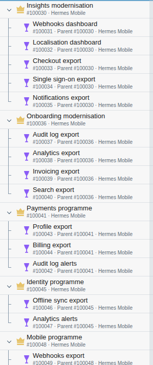

# Task List, Teams, Hierarchy & Task Filters

The frozen task column aligns task names with the timeline. Above it, the **View context** overview provides Plan/Team focus, teams, task types, states and advanced filter controls. The [Top Menu](topmenu.md) also has **Team filter** and **Filters** menus.

## Task List

- Task and group labels follow the board's rows, folding, filtering and zoom. Horizontal scrolling keeps labels visible; vertical scrolling moves labels and cards together.
- Click a task title to open the shared Details Panel. Click the selected row again to bring its card's start alongside the list. Indentation and branch lines show visible parent-child relationships; chevrons reveal parents or children.
- Drag the column divider to resize it between 200 and 600 pixels. When the divider is focused, Left/Right changes width by 20 pixels; Home/End selects the limits. Escape cancels a pointer resize.
- Collapse or restore the column using its edge. Width and collapse state are captured by saved views.
- Search beside the Tasks heading matches task IDs and titles, ignoring case, with ID matches first. Enter or the arrow buttons navigates through matches. Search does not filter tasks or unfold branches; only currently eligible, unfolded tasks are searched, including rows outside the virtualized viewport.

## Team Drill-down

- Open **Team filter** in the top menu, or use the team picker above the task list.
- **Work shown → Plan** shows work in the selected plans; selecting teams switches to team focus within those plans.
- **Work shown → Team** shows selected teams' work across plans, independently of the plan selection. The **Plan** menu is disabled in this mode; switch back to Plan context to use or change your existing selection.
- In single-team cross-plan focus, read-only **Other plan** rows show additional effective commitments. Select a row to inspect the source task.
- Each team row shows a color dot (click to open the color popover), the team name, and counts for the two highest-ranking nonempty task types in the configured hierarchy. When more types have counts, expand **Counts** to see the full table. Types with no counts across the listed teams are omitted; individual zero cells are blank.
- Counts show the number of tasks explicitly allocated to that team anywhere in the loaded data, including active scenario changes. Each task is counted once per allocated team, not by allocation percentage or by which plan the team belongs to. Tasks without a team allocation do not contribute to team counts.
- These counts are not limited to selected plans, team focus, or task filters. They are an allocation overview, not the number of that team's tasks you should expect to find in the current display.
- Click a team row to select or deselect it for display. On the [Graph Area](graph.md), team selection changes visible team lines, not organisational weighting or allocation calculations.
- Use the "All" / "None" toggle above the list to quickly select or deselect every team at once.
- When the view is focused on teams, an empty team selection shows no tasks.
- If the selected plan(s) have no teams assigned, the section shows a short message instead of an empty list.

## Task Hierarchy

Open **Filters** and use **Collapse one level** (`-`) and **Expand one level** (`+`) to change visible
task hierarchy depth one level at a time. **Collapse all** and **Expand all** act on
every branch. Controls stop at the available limits and folding is unavailable
in Packed mode. The header shows `-` and `+` shortcut pills; Task view shows `V`.

## Task Filters

Open **Filters** or use View context to narrow down which tasks are displayed, independent of which plans and teams are selected. Tab moves between enabled options; Space or Enter toggles the focused option.

- Schedule (`p`): Planned / Unplanned.
- Allocation (`a`): Allocated / Unallocated.
- Hierarchy (`i`): Has Parent / No Parent.
- Relations (`r`): Has Links / No Links.
- State: dynamic list populated from the loaded features — click a state to toggle it, the colored dot matches its configured state color.
- Task Types: dynamic list (Epic, Feature, etc.), ordered per the task type hierarchy configured by your administrator.

A filter option is greyed out and disabled when it is "not relevant in current tool context" (for example while a full-screen tool such as Portfolio Board or XY Board is active).

Each of the four filter keys cycles both options on, first only, second only,
then both on again. Disabled options keep their values and unreachable states
are skipped; the cycle never turns both options off. Schedule also respects
Packed mode's disabled Unplanned option. See [Keyboard Shortcuts](keyboard_shortcuts.md)
for typing protection and the browser-local opt-out.

## Related controls

- Plan/project selection: [Top Menu & View Options](topmenu.md) — Plan menu.
- Related tasks and board counts: [Top Menu & View Options](topmenu.md#related-work).
- Timeline scale, card display mode, task sort and graph type: [Top Menu & View Options](topmenu.md) — View menu.
- Scenarios and Tools (plugins): [Scenarios & Saving](scenarios.md) and [Tools Overview](tools_overview.md).
