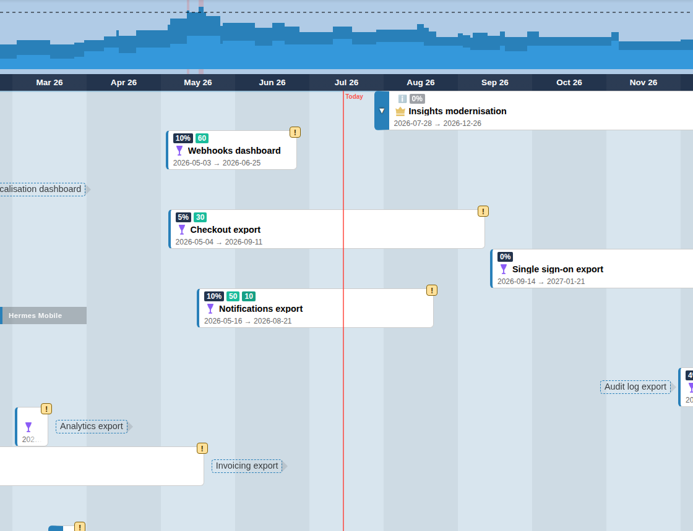
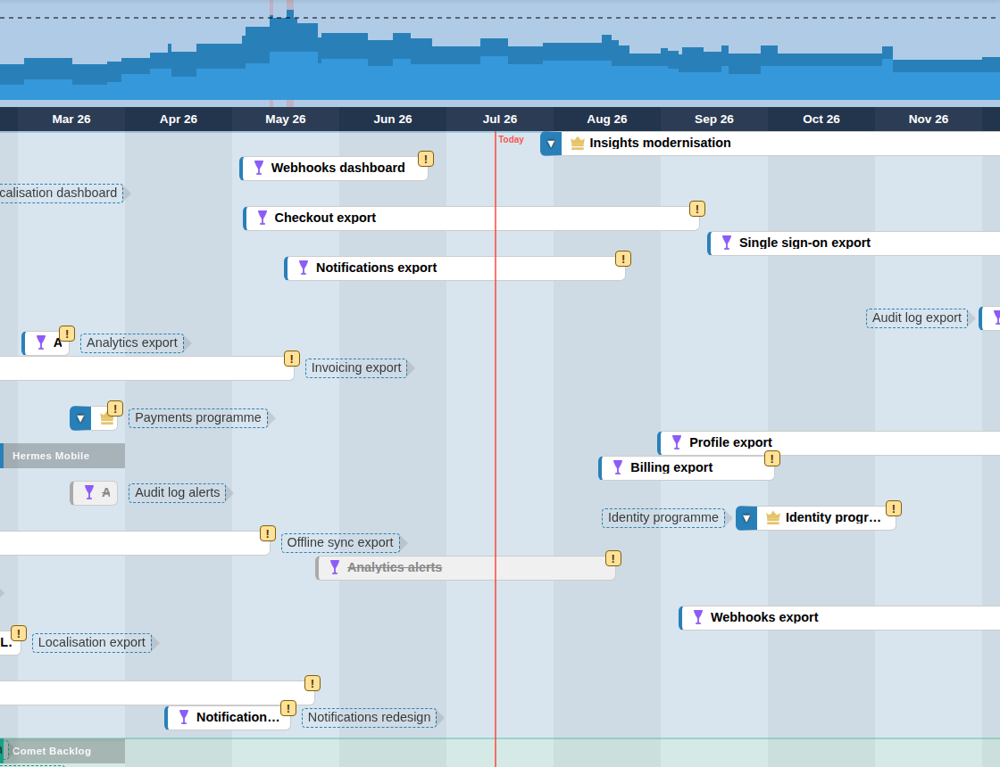
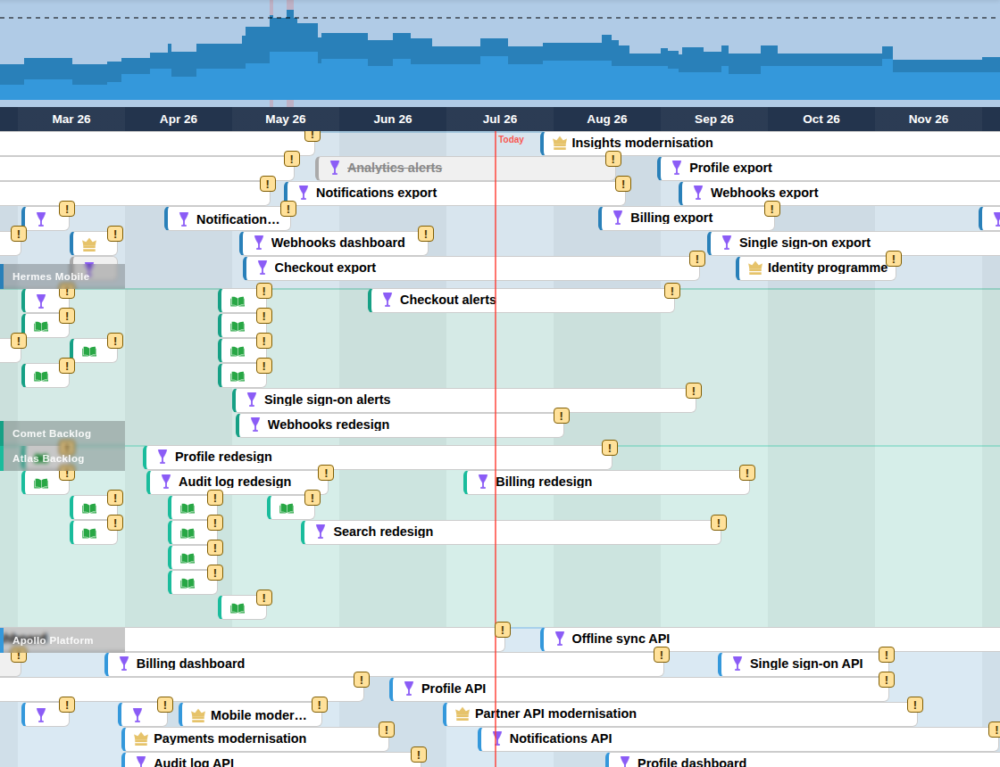

# Timeline & Board

The board is the main workspace. Each selected plan gets a horizontal band, labelled on the left, and its tasks are drawn as cards on a shared time axis. The month header at the top stays visible while you scroll, and a red line marks today.

## Card modes

Choose the card mode in **View → Cards** or press `c`.

- **Normal**: allocation badges, title and dates on each card.
- **Compact**: one line per card with icon and title only, so more tasks fit on screen.
- **Packed**: cards are packed tightly into as few rows as possible. Task sort and hierarchy folding are unavailable, and unplanned tasks are hidden.

## Planned and unplanned tasks

A task is planned when it has both a start and an end date; its card spans those dates. A task without both dates is unplanned. It is drawn as a dashed "ghost" label next to its parent (or at the left of its plan band) and can be hidden with the Sidebar's **Schedule** filter. Dates are never inferred from parents, states or dependencies; see [Planning principles](best_practices.md#planning-principles).

## Interactions

- **Click** a card to open the [Details Panel](details.md).
- **Right-click** a card or the board background for the [group](groups.md) menu (editable scenarios only).
- **Drag** the board background to pan; use the mouse wheel to scroll vertically.
- **Ctrl + mouse wheel**, or `Ctrl` `+` / `Ctrl` `-` / `Ctrl` `0`, zooms the board — see [Keyboard Shortcuts](keyboard_shortcuts.md).
- **Fold / expand**: cards with children show a chevron at their left edge. Click it to hide or show the children; a folded card shows how many tasks are hidden. The Sidebar's Task hierarchy buttons fold or expand one level for the whole board.

In an editable scenario (not Baseline) you can also change dates directly:

- **Drag** a card horizontally to move it; its duration is kept and the dates update live on the card. Moving a parent shifts its planned descendants by the same amount; unplanned descendants stay unplanned.
- **Drag an unplanned task** onto the timeline to plan it. It gets a one-month duration, and an unplanned parent is planned with the same dates.
- **Resize** a card with the handle at its right edge to change the end date. A parent cannot end before its latest child.
- **Double-click** a modified card to revert its local changes.

Changes go into the active scenario. See [Scenarios & Saving](scenarios.md).

## Dependencies and highlighting

Enable **Dependencies** in the Scope menu to bring linked work onto the board. Dependency links between cards are drawn as lines. Press `h` to toggle relationship highlighting.

## Timeline scale

Use **View → Timeline Scale** (`t`) to switch between 3 months, weeks, months, quarters and years.

## Tips

- Use Compact or Packed mode for overviews and Normal mode when you need allocations and dates.
- Combine the timeline scale with Task Filters in the Sidebar to focus on a time window and team.
- The [Reconciliation](plugin_reconciliation.md) warning markers (!) on cards point to schedule conflicts or plan quality findings.
