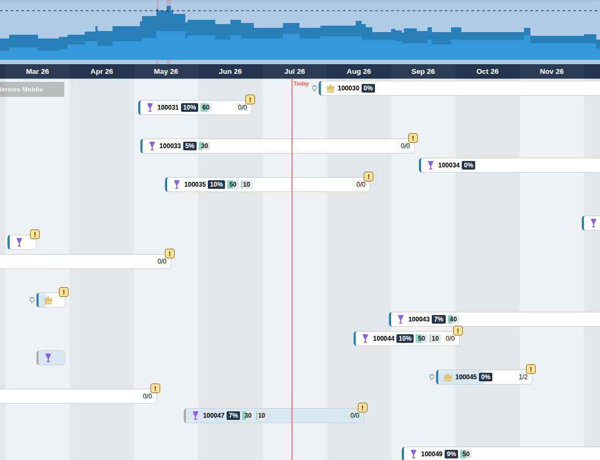
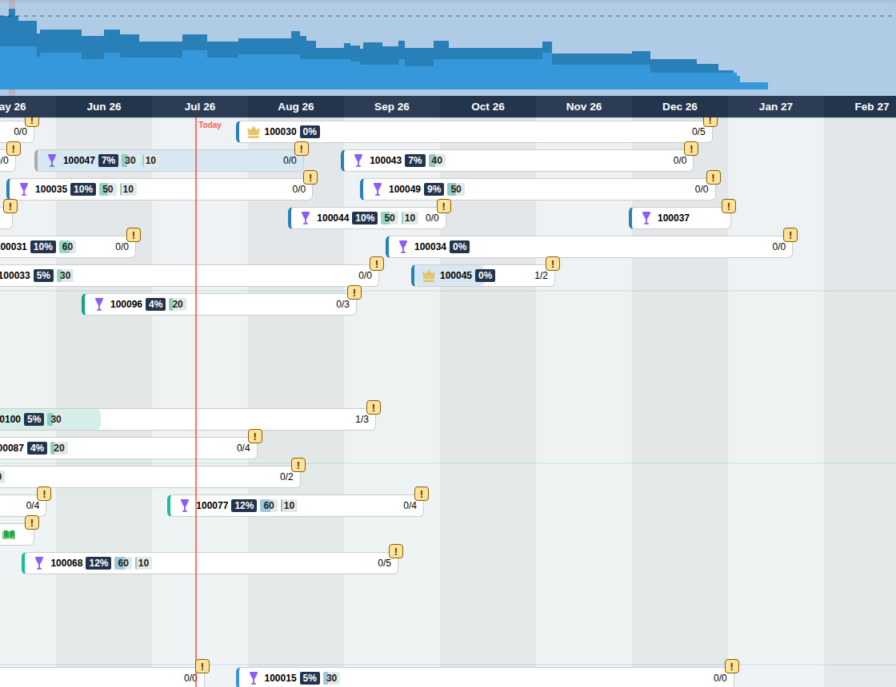

# Timeline & Board

The board is the main workspace. Each selected plan gets a horizontal band, and its tasks are drawn as cards on a shared time axis. The frozen [task column](sidebar.md#task-list) keeps titles aligned beside their cards. The month header stays visible while you scroll, and a red line marks today.

## Card modes

Choose the card mode in **View → Cards** or press `c`.

- **Normal**: compact-height cards align with rows in the task column.
- **Packed**: cards are packed into as few rows as possible; task sort and hierarchy folding are unavailable, and unplanned tasks are hidden.

## Planned and unplanned tasks

A task is planned when it has both a start and an end date; its card spans those dates. A task without both dates is unplanned. Its dashed placeholder appears next to its parent (or at the left of its plan band) and can be hidden with **Task Filters > Schedule**. Dates are never inferred from parents, states or dependencies; see [Planning principles](best_practices.md#planning-principles).

## Interactions

- **Click** a card to open the [Details Panel](details.md).
- **Right-click** a card or the board background for the [group](groups.md) menu (editable scenarios only).
- **Drag** the board background to pan; use the mouse wheel to scroll vertically.
- **Ctrl + mouse wheel**, or `Ctrl` `+` / `Ctrl` `-` / `Ctrl` `0`, zooms the board — see [Keyboard Shortcuts](keyboard_shortcuts.md).
- **Fold / expand**: task rows show chevrons for related parents and children. Use **Filters** to collapse or expand hierarchy levels for the whole board.

In an editable scenario (not Baseline) you can also change dates directly:

- **Drag** a card horizontally to move it; its duration is kept and the dates update live on the card. Moving a parent shifts its planned descendants by the same amount; unplanned descendants stay unplanned.
- **Drag an unplanned task** onto the timeline to plan it. It gets a one-month duration, and an unplanned parent is planned with the same dates.
- **Resize** a card with the handle at its right edge to change the end date. A parent cannot end before its latest child.
- **Double-click** a modified card to revert its local changes.

Changes go into the active scenario. See [Scenarios & Saving](scenarios.md).

## Dependencies and highlighting

Use **Tools > Dependencies** to draw links between tasks already on the board. Press `h` to toggle relationship highlighting.

## Timeline scale

Use **View → Timeline Scale** (`t`) to switch between 3 months, weeks, months, quarters and years.

## Tips

- Use Packed mode for a dense overview and Normal mode to follow task hierarchy.
- Combine the timeline scale with the Task Filters menu to focus on a time window and team.
- The [Reconciliation](plugin_reconciliation.md) warning markers (!) on cards point to schedule conflicts or plan quality findings.
