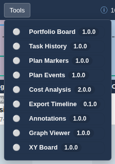

# Tools Overview

The Top Menu's **Tools** menu lists optional tools. Each entry shows a status dot (active or inactive) and its version; click a tool to activate it and click it again to deactivate it. Most tools close with their own Close (✕) button too. Activating one exclusive tool closes another. Which tools exist and which are enabled is configured by your administrator (see [Admin - Plugins](admin_plugins.md)).

## Overlay tools

These add a floating panel or extra information on top of the board:

- [Task History](plugin_history.md) — how task dates changed over time.
- [Plan Markers](plugin_markers.md) — Azure DevOps Delivery Plan milestones.
- [Plan Events](plugin_events.md) — your own milestones and events per plan.
- [Annotations](plugin_annotations.md) — notes, shapes and lines on the board.
- [Export Timeline](plugin_export.md) — SVG/PNG images and JSON/CSV data.
- [Link Editor](plugin_link_editor.md) — create dependency links by clicking cards (disabled by default).

## Full views

These replace the board area with another view of the same tasks (the top menu and Sidebar stay available):

- [Portfolio Board](plugin_portfolio.md) — teams as rows and states as columns.
- [XY Board](plugin_xyboard.md) — a matrix of any two fields.
- [Graph Viewer](plugin_graph_viewer.md) — a large capacity graph with export.
- [Cost Analysis](plugin_cost.md) — cost and hours per plan, task, team and workforce.

## Always-on and menu plugins

- [Dependencies](plugin_dependencies.md) draws dependency lines between cards. It has no Tools entry; dependency context is controlled in the Scope menu.
- Menu plugins appear directly in the top bar, before or after Tools. [Reconciliation](plugin_reconciliation.md) is the standard one. Their position is configured in [Admin - Plugins](admin_plugins.md). Opening a plugin menu does not replace the board or deactivate a tool.
