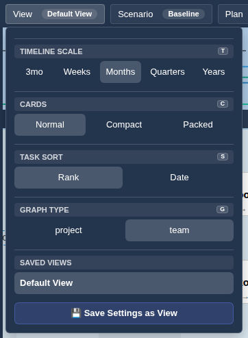
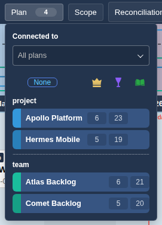
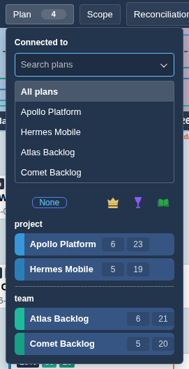
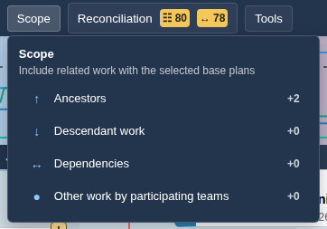
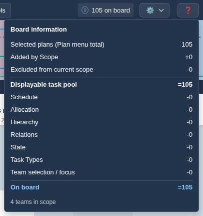

# Top Menu & View Options

The top menu holds the menus that decide what is shown on the board, plus the board counter, settings and help.

From left to right:

- **View**: timeline scale, card mode, task sort, graph type and saved views. The badge shows the active view.
- **Scenario**: switch, copy, save, publish, rename or delete scenarios. The badge shows the active scenario. See [Scenarios & Saving](scenarios.md).
- **Plan**: choose which plans are on the board. The badge shows the plan name, or the number of selected plans.
- **Scope**: pull related work into the board around the selected plans. Arrows after the label show which scope options are on.
- **Reconciliation**: schedule conflicts and plan quality findings, with counts per category. See [Reconciliation](plugin_reconciliation.md).
- **Tools**: optional tools such as Portfolio Board or Cost Analysis. See [Tools Overview](tools_overview.md).
- **N on board**: board information, explaining how the number of cards on the board is reached.
- **🔔 Notification log**: appears when the application has reported notifications (for example warnings from the server). It lists each message with severity, source and time; **Clear log** empties it.
- **⚙ Settings**: Configuration and, for administrators, links to the administration sections.
- **?**: this Help.

Menus close with Escape or by clicking outside them. Left and right arrow keys move between the top menu entries.

## View menu

- **Timeline Scale** (`t`): 3mo, Weeks, Months, Quarters or Years.
- **Cards** (`c`): Normal, Compact or Packed. See [Timeline & Board](timeline.md) for examples.
- **Task Sort** (`s`): Rank (backlog order) or Date. Unavailable in Packed mode.
- **Graph Type** (`g`): one button per plan level represented in the current scope (for example `project` and `team`). It controls which level the [Graph Area](graph.md) shows.
- **Saved Views**: click a view to apply it. Your own views have buttons to update it with the current settings (💾), rename it (✏️) and delete it (🗑️).
- **💾 Save Settings as View**: saves the current plans, scope, filters, team selection and display options under a new name.

## Plan menu

- Plans are grouped by plan level (configured by your administrator, see [Admin - Plans](admin_plans.md)). Click a plan to include or exclude it.
- The columns to the right count the plan's tasks per work item type.
- Click a plan's colour dot to change its colour.
- **All** / **None** selects or clears the plans currently listed.
- **Connected to** narrows the list to plans linked to one chosen plan through task ancestry. It does not change which plans are checked. Choose **All plans** to clear it. While a focus is active, **Clear hidden** appears when checked plans are hidden by the focus, and unchecks only those. Saved views remember the focus.

Which teams appear in the Sidebar depends on the plans selected here (see [Sidebar](sidebar.md)).

## Scope menu

Scope adds related work to the board around the selected (base) plans:

- **Ancestors** (↑): parents and further ancestors of base tasks, even if they belong to plans that are not selected.
- **Descendant work** (↓): children and further descendants.
- **Dependencies** (↔): tasks linked by dependency relations.
- **Other work by participating teams** (●): other tasks allocated to the teams that work on the selected plans.

The number next to each option shows how many displayable tasks enabling it would add (or disabling it would remove). Tasks shared by several options are counted once.

## Board information

Click **N on board** to see how the number of cards is reached: tasks counted in the selected plans, shared tasks counted once, tasks added by Scope, tasks excluded from the current scope, then the tasks removed by each Sidebar filter and by team focus. The last line is the number of cards on the board. Hover a row for an explanation. The footer shows how many teams are in scope.

## Tools menu

Each entry shows a status dot and version. Click a tool to activate it, and again to deactivate it. Which tools are available is configured by your administrator in [Admin - Plugins](admin_plugins.md).

## Using views

- A view captures the selected plans, Plan menu focus, scope, filters, team selection and View menu options.
- Loading a view applies its selections immediately.
- Most View menu options, board zoom and search also have a [keyboard shortcut](keyboard_shortcuts.md). Plain letters work outside text fields, menus and dialogs. Disable them with **Configuration > Letter shortcuts**, then **Save**.
