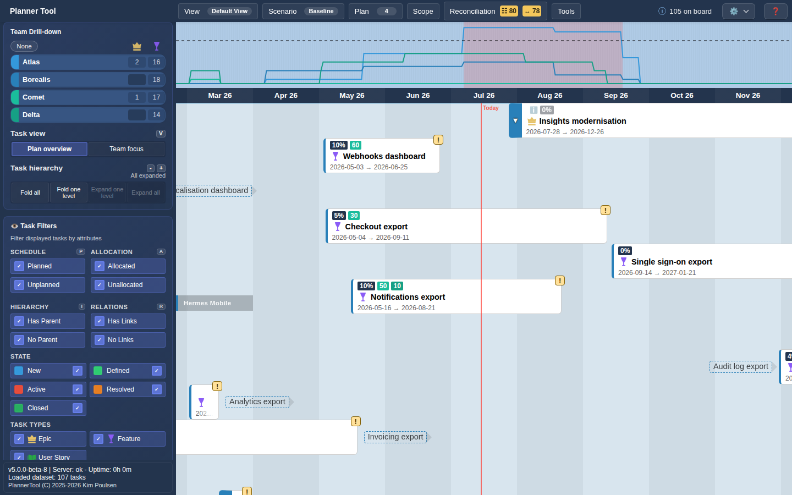
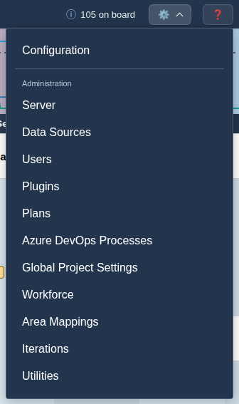
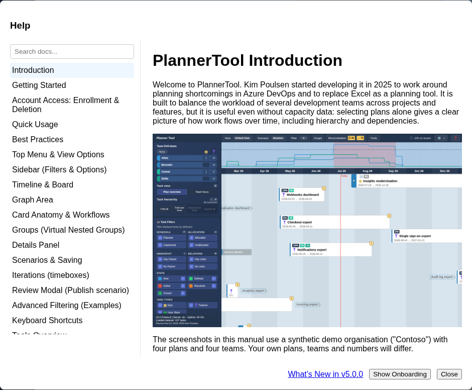

# Quick Usage

This page gives a short tour of the screen and the most common tasks.

## Screen layout

- **Top menu** (top): the View, Scenario, Plan and Scope menus, the Reconciliation menu, Tools, the board information counter, Settings (gear) and Help (?). See [Top Menu & View Options](topmenu.md).
- **Sidebar** (left): Team Drill-down, Task view, Task hierarchy and Task Filters. See [Sidebar](sidebar.md).
- **Graph area** (below the top menu): allocated capacity over time for the selected plans. See [Graph Area](graph.md).
- **Board** (centre): one band per selected plan with task cards on a timeline. The red line marks today. See [Timeline & Board](timeline.md).
- **Details panel** (right, when a card is selected): all fields of the selected task, editable in a scenario. See [Details Panel](details.md).
- **Footer** (bottom of the sidebar): application version, server status, uptime and the number of loaded tasks.

## Settings and help

The gear button opens the Settings menu. **Configuration** opens your personal settings (see [Getting Started](getting_started.md)); administrators also see links to each section of the administration area.

The ? button opens this Help. Use the search box to filter pages by title or tag. The Help window also links to the release notes of the current version.

## Common tasks

- Find a task: press `f` on the board and type part of the title or ID.
- Choose which plans to show: open the **Plan** menu.
- Pull in related work such as parents, children and dependencies: open the **Scope** menu.
- Focus on teams: select teams in the Sidebar's Team Drill-down and switch Task view to **Team focus** (`v`).
- Change dates or allocations: create a scenario with **Scenario → Copy Scenario**, then drag cards or edit them in the Details panel.
- Save a favourite setup: **View → Save Settings as View**.
- See [Keyboard Shortcuts](keyboard_shortcuts.md) for display keys, zoom and typing behaviour.
